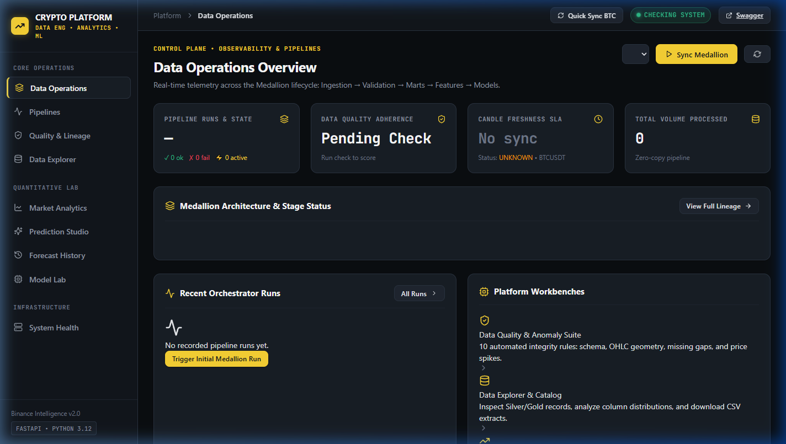
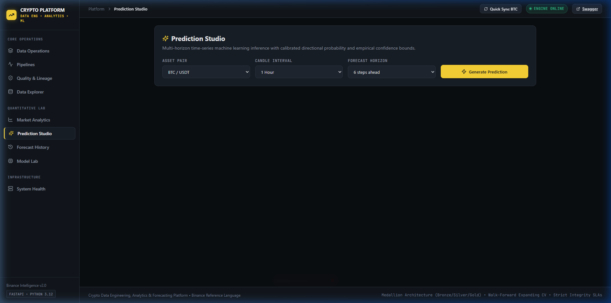
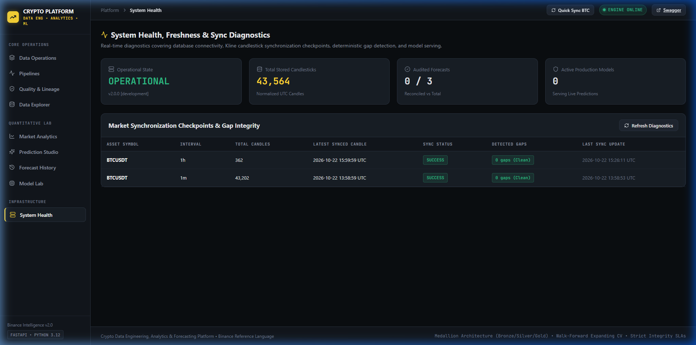
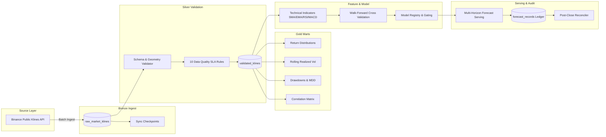

# Binance Crypto Data Engineering, Analytics & Forecasting Platform

[](https://github.com/DungTran1201/Binance-Predict-Value-And-Trend/actions/workflows/ci.yml)
[](https://www.python.org/downloads/)
[](https://fastapi.tiangolo.com)
[](https://react.dev)
[](https://www.typescriptlang.org/)
[](https://opensource.org/licenses/MIT)

An institutional-grade, evidence-based **Data Engineering, Analytics Engineering, and ML Forecasting Workbench** for cryptocurrency market data.

The platform executes and monitors the complete data lifecycle:
$$\text{Ingest (Bronze)} \longrightarrow \text{Validate (Silver)} \longrightarrow \text{Marts (Gold)} \longrightarrow \text{Features} \longrightarrow \text{Walk-Forward Gating} \longrightarrow \text{Serve Predictions} \longrightarrow \text{Audit Quality \& Lineage}$$

Built with a Binance-inspired dark technical visual language (`#0B0E11` graphite surfaces with restrained `#FCD535` yellow active state), high information density, persistent categorized sidebar navigation adapted from `AgentHarnessBuilderTools`, strict zero-leakage ML validation, and honest telemetry—never showing fake zeroes or fabricated production metrics.

---

## Visual Tour of the Running Platform

The following screenshots are captured directly from the live running application:

### 1. Data Operations Overview (`/overview`)
*Control-plane overview displaying live pipeline telemetry, the 6-stage Medallion Data Lifecycle DAG, KPI SLA adherence, and recent orchestration runs.*


### 2. Market Analytics & Quantitative Research (`/analytics`)
*High-density technical analytics featuring responsive HTML5 Canvas candlestick charting, SMA overlays, return distributions with higher moments ($\mu$, $\sigma$, Skewness, Kurtosis), rolling volatility, and drawdowns.*


### 3. Automated Data Quality & Lineage DAG (`/quality`)
*Data quality engine scoring 10 automated schema, geometry, and continuity rules across Bronze, Silver, and Gold partitions, with interactive lineage DAG tracing upstream Binance sources to model serving.*


### 4. Pipeline Observatory & Task Breakdown (`/pipelines`)
*Task-level execution runner showing sequential execution stages (`ingest_bronze` → `validate_silver` → `build_gold_marts` → `extract_features`) with duration, record counts, and execution logs.*


### 5. Multi-Horizon Prediction Studio (`/studio`)
*Point-in-time multi-step forecast generation with frozen cutoff timestamps, calibrated directional probabilities, and empirical 95% confidence bands.*


### 6. Data Explorer & Catalog (`/explorer`)
*Safe, read-only dataset exploration with schema dictionaries, dataset profiling watermarks, server-side pagination, and bounded CSV data exports.*


### 7. System Health & Diagnostic Center (`/system`)
*Real-time diagnostics covering database connectivity, kline sync checkpoints, deterministic gap detection, and model serving status.*


### 8. Responsive Mobile & Tablet Drawer
*Compact collapsible navigation drawer verified on mobile and tablet viewports (768px).*


---

## Feature Summary & Implementation Status

| Capability / Module | Status | Description |
| :--- | :--- | :--- |
| **Medallion Data Pipeline** | `Implemented` | Bronze buffer ingestion, Silver validation, and Gold analytical marts. |
| **10 Data Quality SLA Rules** | `Implemented` | Programmatic checks for schema, geometry, nulls, monotonicity, gaps, spikes, freshness. |
| **Market Analytics Canvas** | `Implemented` | Pure Canvas candlestick rendering with SMA(7, 25, 99) overlays and indicators. |
| **Quantitative Moments & Risk** | `Implemented` | Empirical calculation of return distributions, Skewness, Excess Kurtosis, and $VaR_{95\%} / VaR_{99\%}$. |
| **Rolling Realized Volatility** | `Implemented` | Multi-window annualized rolling standard deviation ($7, 14, 30$ periods). |
| **Maximum Drawdown (MDD)** | `Implemented` | Cumulative running peak trajectory, active drawdown %, and MDD callout. |
| **Cross-Asset Correlation Matrix** | `Implemented` | Pairwise Pearson correlation matrix across BTC, ETH, SOL, and BNB return series. |
| **Data Explorer & CSV Export** | `Implemented` | Server-side paginated table, dataset profiling stats, and bounded CSV downloads. |
| **Multi-Horizon Forecasting** | `Experimental` | Point-in-time recursive multi-step forecasting with directional confidence intervals. |
| **Walk-Forward CV Gating** | `Implemented` | Expanding-window cross-validation enforcing $\ge 1\%$ improvement over naive baselines. |
| **Immutable Forecast Ledger** | `Implemented` | Persistent record of all generated forecasts with post-close realization reconciliation. |
| **Remote MLflow Tracking** | `Optional` | Seamless fallback to local file registry when remote MLflow server is unconfigured. |
| **System Health Diagnostics** | `Implemented` | Database connection probe, sync checkpoints, gap tracking, and worker readiness. |

---

## Technology Stack & Architectural Roles

```
┌─────────────────────────────────────────────────────────────────────────────┐
│                          PRESENTATION LAYER (Vite + React)                  │
│   • AppShell & Persistent Sidebar (AgentHarnessBuilderTools layout)         │
│   • Centralized Design Tokens: #0B0E11 dark surface, #FCD535 Binance yellow │
│   • Lucide React Icons • Pure HTML5 Canvas Candlestick & Indicator Engine   │
└──────────────────────────────────────┬──────────────────────────────────────┘
                                       │ Async REST (JSON)
┌──────────────────────────────────────▼──────────────────────────────────────┐
│                        API GATEWAY & ROUTING (FastAPI)                      │
│   • 28 Strongly Typed REST Endpoints with OpenAPI Documentation             │
│   • Pydantic v2 Contract Validation & Error Shielding                       │
└──────────────┬───────────────────────┬───────────────────────┬──────────────┘
               │                       │                       │
┌──────────────▼──────────┐ ┌──────────▼──────────┐ ┌──────────▼──────────────┐
│  DATA QUALITY & LINEAGE │ │   ANALYTICS MARTS   │ │   FORECASTING ENGINE    │
│  • 10 Automated Rules   │ │  • Log/Simple Rets  │ │  • Zero-Leakage Feats   │
│  • SLA Engine & Metrics │ │  • Volatility & MDD │ │  • Walk-Forward Folds   │
│  • Upstream/Downstream  │ │  • Pearson Corrs    │ │  • Naive Baseline Gate  │
└──────────────┬──────────┘ └──────────┬──────────┘ └──────────┬──────────────┘
               │                       │                       │
┌──────────────▼───────────────────────▼───────────────────────▼──────────────┐
│                        PERSISTENCE & STORAGE (SQLAlchemy)                   │
│   • Asynchronous Engine (aiosqlite / asyncpg) • WAL Journaling Mode         │
│   • Tables: raw_klines, validated_klines, pipeline_runs, forecasts, models  │
└─────────────────────────────────────────────────────────────────────────────┘
```

- **Backend**:
  - `Python 3.12+`: Modern asynchronous runtime.
  - `FastAPI 0.115+`: High-performance async ASGI web framework.
  - `Pydantic v2`: Strict request/response schema validation and contract serialization.
  - `SQLAlchemy 2.0 (Async)`: Asynchronous ORM and SQL abstraction with SQLite (`aiosqlite`) and PostgreSQL (`asyncpg`) support.
  - `NumPy & SciPy`: Vectorized return calculations, higher moments, and empirical quantile estimation.
  - `Pandas`: Dataframe transformations and analytical mart aggregation.
- **Frontend**:
  - `React 18 & TypeScript 5.6`: Component-based typed user interface.
  - `Vite 6`: Instant HMR developer environment and optimized production bundler.
  - `Vanilla CSS (Design Tokens)`: High-performance, zero-overhead theming system without bloated CSS frameworks.
  - `HTML5 Canvas API`: High-frequency, lag-free interactive candlestick and indicator rendering.
  - `Lucide React`: Clean, uniform open-source iconography.
- **Data Source**:
  - `Binance Public Vision & REST API`: Free public cryptocurrency market klines (`https://data-api.binance.vision/api/v3/klines`) requiring zero API keys.

---

## End-to-End Data Lifecycle



1. **Source Ingestion**: Fetches raw 1,000-candle batches from Binance Public API with exponential retry backoff.
2. **Bronze Storage**: Persists raw unmutated payloads into `raw_market_klines` and records continuous watermarks in `sync_checkpoints`.
3. **Silver Validation**: Deduplicates primary keys `(symbol, timeframe, open_time)`, verifies temporal monotonicity, and enforces OHLC physical geometry ($Low \le Open, Close \le High$).
4. **Data Quality SLA Scoring**: Evaluates the 10 data quality rules and logs pass/fail metrics into `data_quality_runs` and `data_quality_results`.
5. **Gold Mart Aggregation**: Computes simple/log return distributions, rolling realized volatilities ($7, 14, 30$ periods), drawdown curves, and cross-asset correlations.
6. **Feature Engineering**: Calculates rolling indicators (SMA, EMA, RSI, MACD, Bollinger Bands) using strictly chronological zero-lookahead formulas.
7. **Model Gating**: Requires forecast candidates to achieve $\ge 1\%$ lower MAE than naive persistence ($P_{t+h} = P_t$) before promotion.
8. **Forecast Serving & Reconciliation**: Stores generated predictions immutably into `forecast_records` and reconciles directional accuracy once future candles close.

---

## Data Quality Rules & SLAs

Every market partition is continuously audited against 10 rigorous programmatic rules:

| Rule ID | Rule Name | Category | Severity | Failure Condition |
| :--- | :--- | :--- | :--- | :--- |
| **DQ-SCH-01** | Schema & Type Adherence | SCHEMA | CRITICAL | Column types differ from float/int/datetime |
| **DQ-NUL-01** | Non-Null Prices & Timestamps | COMPLETENESS | CRITICAL | Null or NaN values detected in OHLCV columns |
| **DQ-UNI-01** | Primary Key Uniqueness | INTEGRITY | CRITICAL | Duplicate `(symbol, timeframe, open_time)` |
| **DQ-ORD-01** | Monotonic Ordering | CONSISTENCY | ERROR | Out-of-order timestamp sequence ($t_i \le t_{i-1}$) |
| **DQ-GAP-01** | Interval Continuity | CONSISTENCY | WARNING | Gap exceeding $1.5\times$ expected timeframe delta |
| **DQ-REL-01** | OHLC Price Geometry | INTEGRITY | CRITICAL | $High < Low$ or extremes fail to bound $Open / Close$ |
| **DQ-VOL-01** | Non-Negative Volume | INTEGRITY | ERROR | Base or quote asset volume $< 0$ |
| **DQ-FUT-01** | Timestamp Temporal Validity | CONSISTENCY | CRITICAL | Candle open timestamp exceeds current UTC time |
| **DQ-OUT-01** | Extreme Price Spike Flag | ANOMALY | WARNING | Single-bar price change $> 35\%$ (flagged for review) |
| **DQ-FRE-01** | Freshness SLA Adherence | COMPLETENESS | WARNING | Latest closed candle exceeds allowable delay window |

---

## Prerequisites

| Tool / Runtime | Minimum Version | Tested Version | Purpose |
| :--- | :--- | :--- | :--- |
| **Python** | `3.12.0` | `3.12.3` | Backend API, data pipeline, and ML engine |
| **Node.js** | `18.0.0` | `24.18.0` | Frontend TypeScript development and building |
| **npm** | `9.0.0` | `10.8.2` | Frontend package manager |
| **SQLite** | `3.35.0+` | Built-in | Default asynchronous local database |
| **PowerShell** | `5.1` / `7+` | `5.1` (Win10/11) | Primary validated development shell |

---

## Windows PowerShell Setup & Run Guide

### 1. Clone & Enter Repository
```powershell
git clone https://github.com/DungTran1201/CryptocurrencyPriceAnalysis_Forecasting.git
cd Binance-Predict-Value-And-Trend
```

### 2. Configure Environment
Copy `.env.example` to create your local `.env`:
```powershell
Copy-Item .env.example .env
```
*Note: Default settings run completely offline or against public Binance endpoints with zero API keys required.*

### 3. Setup Python Backend Environment
```powershell
# Create virtual environment (if not already present)
python -m venv .venv

# Activate virtual environment
.venv\Scripts\Activate.ps1

# Upgrade pip and install backend dependencies
python -m pip install --upgrade pip
pip install -r requirements.txt
```

### 4. Initialize Database Tables
```powershell
# Initialize SQLite database schema
$env:PYTHONPATH = "."
python -c "import asyncio; from backend.app.core.database import init_db; asyncio.run(init_db())"
```

### 5. Install Frontend Dependencies & Compile Bundle
```powershell
cd frontend
npm install
npm run build
cd ..
```
*Note: `npm run build` compiles the production assets into `frontend/dist`. FastAPI automatically mounts and serves these static assets at the root URL `http://127.0.0.1:8000/`.*

### 6. Start the Application

You can run the application in either of two modes:

#### Option A: Unified Production Mode (Single Terminal)
FastAPI serves both the API endpoints and the compiled React frontend:
```powershell
$env:PYTHONPATH = "."
uvicorn backend.app.main:app --host 127.0.0.1 --port 8000 --reload
```
Open your browser to: **`http://127.0.0.1:8000/`**

#### Option B: Dual-Terminal Development Mode (Hot-Reloading Frontend)
- **Terminal 1 (Backend API)**:
  ```powershell
  $env:PYTHONPATH = "."
  uvicorn backend.app.main:app --host 127.0.0.1 --port 8000 --reload
  ```
- **Terminal 2 (Vite Frontend with HMR)**:
  ```powershell
  cd frontend
  npm run dev
  ```
  Open your browser to: **`http://127.0.0.1:5173/`**

---

## Running Data Synchronization & Backfills

Synchronize historical klines directly from the public Binance Vision API:

```powershell
# Using PowerShell Invoke-RestMethod against running backend:
Invoke-RestMethod -Uri "http://127.0.0.1:8000/api/v1/market/sync?symbol=BTCUSDT&timeframe=1h&limit=500" -Method POST

# Or trigger the complete Medallion sync pipeline:
Invoke-RestMethod -Uri "http://127.0.0.1:8000/api/v1/pipelines/trigger?pipeline_name=medallion_full_sync&symbol=BTCUSDT&timeframe=1h" -Method POST
```

---

## API Documentation & Route Specifications

The backend exposes **28 strongly typed REST endpoints**. Interactive API documentation is available at:
- **Swagger UI**: `http://127.0.0.1:8000/docs`
- **ReDoc**: `http://127.0.0.1:8000/redoc`

### Complete Endpoint Reference

| Category | Method | Endpoint | Description |
| :--- | :--- | :--- | :--- |
| **System** | `GET` | `/api/v1/health` | Service liveness, version, and health probe |
| | `GET` | `/api/v1/system/status` | Operational metrics, database state, sync checkpoints |
| **Pipelines** | `GET` | `/api/v1/pipelines/overview` | Pipeline runs summary, success rate, duration |
| | `GET` | `/api/v1/pipelines/runs` | Filterable list of historical pipeline runs |
| | `GET` | `/api/v1/pipelines/runs/{id}` | Task stage breakdown, ingested rows, and execution logs |
| | `POST` | `/api/v1/pipelines/trigger` | Trigger synchronous or asynchronous Medallion pipeline run |
| **Data Quality** | `GET` | `/api/v1/data-quality/overview` | Overall quality pass rates, active rules summary |
| | `GET` | `/api/v1/data-quality/lineage` | Medallion lineage DAG (upstream sources to forecast serving) |
| | `GET` | `/api/v1/data-quality/runs` | Historical quality audit runs ledger |
| | `GET` | `/api/v1/data-quality/runs/{id}` | Detailed rule results and violation samples |
| | `POST` | `/api/v1/data-quality/evaluate` | Trigger on-demand quality evaluation on active symbol/timeframe |
| **Data Explorer**| `GET` | `/api/v1/data-explorer/datasets` | Dataset catalog with column schemas and nullability contracts |
| | `GET` | `/api/v1/data-explorer/preview` | Paginated partition inspection with profile stats |
| | `GET` | `/api/v1/data-explorer/export` | Download filtered dataset partitions as CSV |
| **Analytics** | `GET` | `/api/v1/analytics/returns` | Return distributions, moments ($\mu$, $\sigma$, Skewness, Kurtosis), VaR |
| | `GET` | `/api/v1/analytics/volatility` | Rolling annualized realized volatility ($7, 14, 30$ periods) |
| | `GET` | `/api/v1/analytics/drawdowns` | Cumulative peak series, drawdown %, and Maximum Drawdown |
| | `GET` | `/api/v1/analytics/correlations`| Pairwise Pearson correlation matrix across assets |
| **Market** | `GET` | `/api/v1/market/symbols` | Supported cryptocurrency trading pairs and sync status |
| | `GET` | `/api/v1/market/klines` | Validated OHLCV candlestick bars and technical indicators |
| | `POST` | `/api/v1/market/sync` | Incremental candle synchronization from Binance |
| **Forecasts** | `GET` | `/api/v1/forecasts` | Paginated immutable forecast history ledger |
| | `POST` | `/api/v1/forecasts/generate` | Generate multi-horizon price & direction prediction |
| | `POST` | `/api/v1/forecasts/reconcile` | Reconcile pending forecasts with realized market outcomes |
| **Models** | `GET` | `/api/v1/models` | Registered models and walk-forward CV metrics |
| | `GET` | `/api/v1/models/experiments` | MLflow experiment runs and hyperparameters |
| | `GET` | `/api/v1/models/tracking-status`| Probe remote MLflow server vs local registry fallback |
| | `POST` | `/api/v1/models/train` | Execute walk-forward cross validation with naive baseline gating |

---

## Verification & Testing Suite

All tests execute cleanly without external network dependencies:

```powershell
# 1. Backend Pytest Suite (28 tests covering contracts, DQ engine, analytics, and pipelines)
$env:PYTHONPATH = "."
pytest -v

# 2. Frontend Unit Tests (5 tests covering components and data formatting)
cd frontend
npm test

# 3. Frontend TypeScript Typecheck & Production Build
npm run build
cd ..
```

---

## Troubleshooting Guide

| Issue / Symptom | Root Cause | Solution |
| :--- | :--- | :--- |
| `ModuleNotFoundError: No module named 'backend'` | Python cannot locate package root | Set `$env:PYTHONPATH = "."` in PowerShell before running `uvicorn` or `pytest`. |
| `Port 8000 already in use` | Another process is holding port 8000 | Find and terminate: `Get-Process -Id (Get-NetTCPConnection -LocalPort 8000).OwningProcess \| Stop-Process` or use `--port 8080`. |
| Missing or stale market data | Fresh installation without synced candles | Run `POST /api/v1/market/sync?symbol=BTCUSDT&timeframe=1h` or trigger a pipeline from the UI. UI honestly displays empty state rather than fake zeroes. |
| Binance rate limit error (HTTP 429) | Exceeded public request limits | Backoff is automatic. The application retries with exponential backoff up to 5 times. Alternatively, wait 60 seconds. |
| Database table missing error | Tables not initialized | Run: `python -c "import asyncio; from backend.app.core.database import init_db; asyncio.run(init_db())"`. |
| CORS origin blocked in frontend dev | Port 5173 not permitted | Ensure `http://localhost:5173` is present in `CORS_ORIGINS` in `.env` (it is enabled by default). |

---

## Limitations & Disclaimer

> [!IMPORTANT]
> **Experimental Research Platform**: The predictive models and forecasting outputs provided by this software are for computational and exploratory research purposes only. Cryptocurrency markets are highly volatile and influenced by macroeconomic, regulatory, and systemic factors.
> 
> **No Financial Advice**: Nothing in this repository constitutes financial, investment, or trading advice. Past performance or backtested walk-forward metrics do not guarantee future returns. The authors and maintainers assume no liability for financial losses incurred through the use of this software.

---

## Reference & Attribution

- **Binance Public Market Data**: Provided via public REST API endpoints (`data-api.binance.vision`).
- **Design References**:
  - `DungTran1201/AgentHarnessBuilderTools`: Persistent category sidebar layout, telemetry topbar, and status badges.
  - `Binance Official Visual Language`: Deep graphite surfaces (`#0B0E11`, `#181A20`), restrained yellow primary action token (`#FCD535`), semantic market colors (`#2EBD85` Buy, `#F6465D` Sell).
  - `IBM Carbon Design System`: Enterprise data visualization hierarchy and quantitative dashboard blocks.
  - `Ant Design & shadcn/ui`: High-density tables, status badge typography, and shimmer loading skeletons.

---

## License

This project is licensed under the **MIT License**. See the [LICENSE](LICENSE) file for complete details.