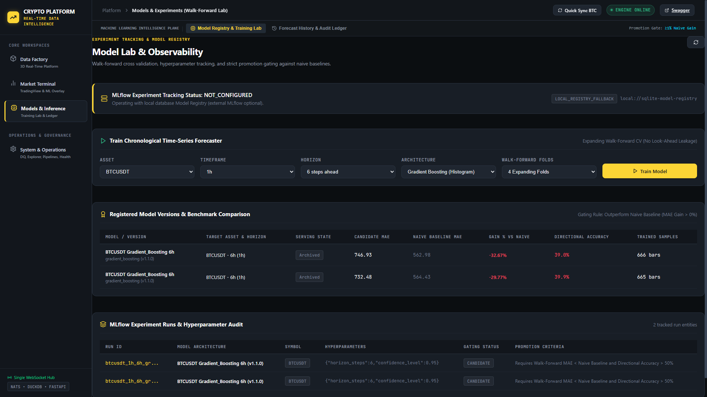
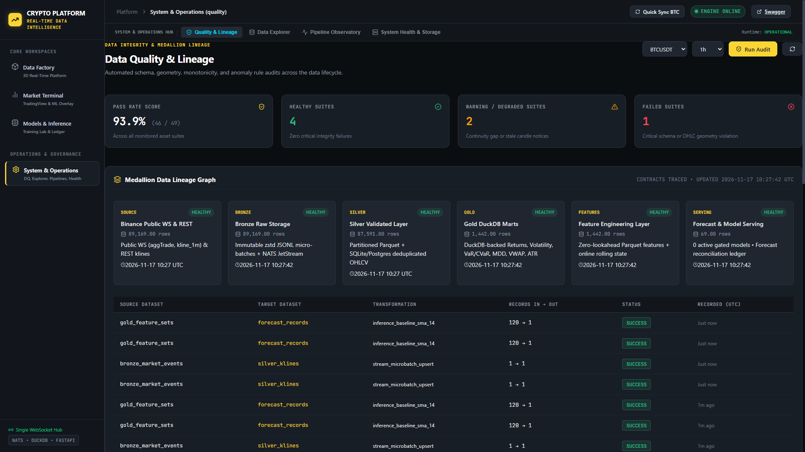
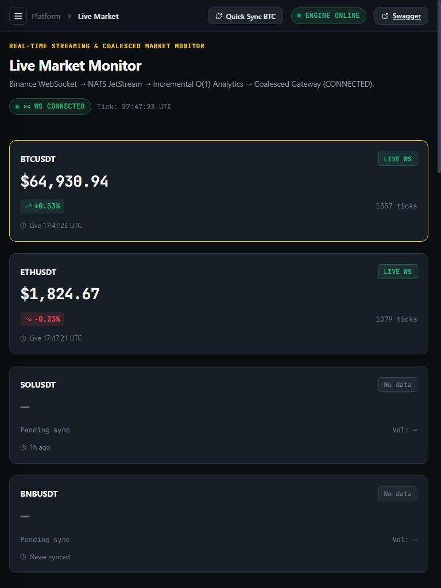
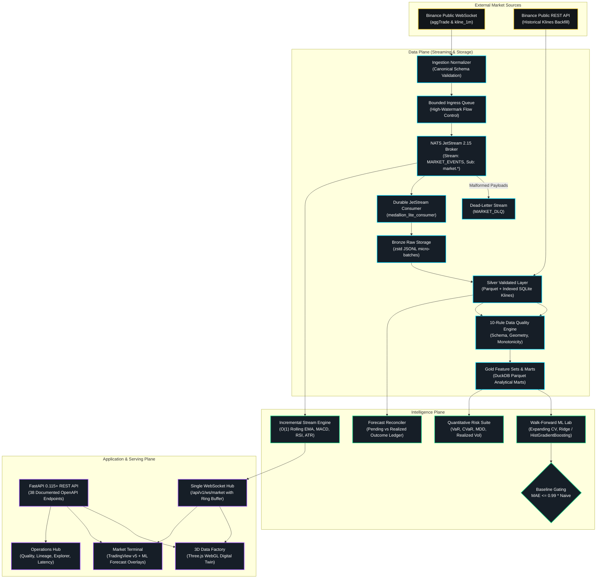

# MarketStream — Real-Time Financial Data Intelligence Platform

<p align="center">
  
</p>

<p align="center">
  <strong>From live market data to actionable intelligence.</strong><br />
  <em>A resource-aware, single-node Real-Time Financial Data Intelligence Platform integrating streaming data engineering, lakehouse storage, quantitative analytics, and machine learning forecasting into a unified system.</em>
</p>

<p align="center">
  <a href="https://github.com/DungTran1201/CryptocurrencyPriceAnalysis_Forecasting/actions/workflows/ci.yml"></a>
  <a href="https://www.python.org/downloads/"></a>
  <a href="https://fastapi.tiangolo.com"></a>
  <a href="https://nats.io/"></a>
  <a href="https://duckdb.org/"></a>
  <a href="https://react.dev"></a>
  <a href="https://www.typescriptlang.org/"></a>
  <a href="https://threejs.org/"></a>
  <a href="https://tradingview.github.io/lightweight-charts/"></a>
  <a href="LICENSE"></a>
</p>

---

## Table of Contents

- [1. Overview](#1-overview)
- [2. Core Capabilities](#2-core-capabilities)
  - [A. Real-Time Data Engineering](#a-real-time-data-engineering)
  - [B. Lakehouse & Data Management](#b-lakehouse--data-management)
  - [C. Financial Intelligence & Machine Learning](#c-financial-intelligence--machine-learning)
  - [D. Application & Observability](#d-application--observability)
- [3. Product Showcase](#3-product-showcase)
- [4. Architecture Overview](#4-architecture-overview)
  - [Data Plane](#data-plane)
  - [Intelligence Plane](#intelligence-plane)
  - [Application Plane](#application-plane)
  - [Architecture Topology Diagram](#architecture-topology-diagram)
- [5. End-to-End Data Lifecycle](#5-end-to-end-data-lifecycle)
- [6. Technology Stack](#6-technology-stack)
- [7. Repository Structure](#7-repository-structure)
- [8. Installation & Quick Start](#8-installation--quick-start)
  - [Prerequisites](#prerequisites)
  - [Automated Windows Setup (`setup.bat` & `run.bat`)](#automated-windows-setup-setupbat--runbat)
  - [Manual Step-by-Step Setup (PowerShell / Bash)](#manual-step-by-step-setup-powershell--bash)
  - [Containerized Deployment (Docker Compose)](#containerized-deployment-docker-compose)
  - [Verified Local Endpoints](#verified-local-endpoints)
- [9. Runtime Profiles & Resource Management](#9-runtime-profiles--resource-management)
- [10. API & Realtime Interfaces](#10-api--realtime-interfaces)
- [11. Testing & Verification](#11-testing--verification)
- [12. Documentation Navigation](#12-documentation-navigation)
- [13. Roadmap & Known Boundaries](#13-roadmap--known-boundaries)
- [14. License & Disclaimer](#14-license--disclaimer)

---

## 1. Overview

### What is MarketStream?

**MarketStream** is a resource-aware, single-node **Real-Time Financial Data Intelligence Platform**. It ingests high-frequency cryptocurrency market data from public Binance feeds, streams events through an embedded durable message broker, stores historical records in a columnar Medallion Lakehouse, computes incremental financial analytics and risk metrics in real-time, trains leakage-free machine learning models, and serves interactive visualizations through an institutional-grade web terminal.

### Why Does MarketStream Exist?

Most cryptocurrency data repositories fall into one of two extremes:
1. **Fragile Notebooks**: Jupyter notebooks that download static CSVs, compute moving averages with look-ahead bias, train models without chronological walk-forward splits, claim artificial 90%+ directional accuracy, and fail when exposed to real-time streams.
2. **Heavy Distributed Clusters**: Over-engineered platforms requiring Apache Kafka, Apache Spark, Apache Flink, Elasticsearch, and GPU clusters that cannot be executed, tested, or demonstrated on a developer's personal workstation.

### The MarketStream Philosophy: Complete Architecture on Commodity Hardware

MarketStream is engineered with an **Absolute Resource Optimization Policy**:
- **Single-Node Execution**: Runs on a single laptop or PC without Kubernetes, distributed message clusters, or GPU requirements.
- **Strict Resource Budgets**: Enforces bounded memory limits across adaptive execution profiles (`LITE`: 450 MB RAM cap, `STANDARD`: 950 MB RAM cap, `EXTENDED`: 2048 MB RAM cap).
- **Data-Engineering-First Rigor**: End-to-end data lifecycle guarantees—canonical event normalization, high-watermark backpressure, durable consumer offsets, immutable raw storage, automated data quality SLAs, and zero look-ahead ML validation.
- **Honest Telemetry**: Empty, unavailable, stale, and failed data states are represented distinctly; the platform **never shows fabricated numeric zeroes or mock metrics**.

```
┌───────────────────────────────────────────────────────────────────────────────────────────────────────┐
│                                       MARKETSTREAM DATA LIFECYCLE                                     │
│                                                                                                       │
│  [Market Data] ──► [Ingestion] ──► [Streaming] ──► [Processing] ──► [Lakehouse] ──► [Analytics & ML]  │
│    Binance WS        Typed           NATS            Durable          Medallion       O(1) Indicators │
│    & REST API     Normalization    JetStream        Consumers       Bronze/Silver/Gold Walk-Forward ML│
│                                                                                             │         │
│  [Serving Gateway] ◄── [Single WebSocket Hub] ◄── [Realtime Ring Buffer Coalescing] ◄───────┴─────────┘
│    FastAPI REST          3D Data Factory & TradingView Institutional Terminal                         │
└───────────────────────────────────────────────────────────────────────────────────────────────────────┘
```

---

## 2. Core Capabilities

MarketStream organizes its platform capabilities into four cohesive engineering domains:

### A. Real-Time Data Engineering
- **Binance WebSocket Ingestion**: Resilient WebSocket client connecting to Binance Vision/Com streaming feeds (`aggTrade` execution ticks and `kline_1m` continuous bars) with automatic reconnection, heartbeat keep-alive, and exponential backoff.
- **REST Synchronization & Gap Healing**: High-performance REST backfill client fetching historical klines in bounded batches (1,000 candles/batch) with rate-limit backoff and automatic interval gap detection.
- **Canonical Event Normalization**: Ingestion normalizer transforming heterogeneous vendor payloads into immutable, typed canonical schemas (`MarketDataIngestEvent`, `CanonicalTradeEvent`, `CanonicalKlineEvent`) with strict UTC timestamp parsing.
- **Bounded Queues & Flow Control**: In-memory ring buffer (1,000 to 10,000 events) coupled with high-watermark producer flow control and disk-spooling overflow when downstream systems experience backpressure.
- **Durable Event Streaming (NATS JetStream 2.15)**: In-process message broker managing stream `MARKET_EVENTS` under subject `market.{type}.{symbol}` with consumer ACK/NAK delivery semantics and bounded memory/file storage caps.
- **Dead-Letter Handling (DLQ)**: Poison pills, corrupt payloads, and parsing failures are automatically isolated into the durable `MARKET_DLQ` stream without halting consumer progress.

### B. Lakehouse & Data Management
- **Bronze Layer (Raw Storage)**: Date-partitioned raw JSON Lines files compressed with `zstandard` (`.jsonl.zst`) in `data/bronze/{symbol}/{date}/events.jsonl.zst`, achieving a **22.5x to 25.8x compression ratio** with append-only immutability.
- **Silver Layer (Validated Columnar Lakehouse)**: Cleaned, deduplicated, and schema-enforced OHLCV records stored as partitioned Apache Parquet files (`data/silver/{symbol}/candles_1m/`) alongside indexed SQLite/PostgreSQL operational tables.
- **Gold Layer (Analytical Marts & Features)**: Materialized Parquet datasets containing engineered time-series features (`data/gold/{symbol}/features_1h.parquet`) and summary marts.
- **DuckDB Vectorized OLAP**: Embedded columnar analytical query engine executing zero-copy queries against Parquet files with configurable thread (`2-4`) and memory caps (`128MB-512MB`).
- **Data Quality & Governance**: Automated 10-rule programmatic data quality engine auditing every partition for schema adherence, non-null completeness, OHLC geometry, timestamp monotonicity, and outlier spikes with interactive lineage tracking.

### C. Financial Intelligence & Machine Learning
- **Incremental $O(1)$ Stream Engine**: In-memory rolling analytical engine maintaining bounded per-symbol state (`IncrementalSymbolState`) with exact mathematical parity against batch reference implementations:
  - Moving Averages: Exponential Moving Averages (`EMA 12`, `EMA 26`), Simple Moving Average (`SMA 20`).
  - Momentum & Trend: Wilder's Relative Strength Index (`RSI 14`), Moving Average Convergence Divergence (`MACD 12/26/9` line, signal, and histogram).
  - Volatility & Range: Wilder's Average True Range (`ATR 14`), Bollinger Bands (`20, 2.0` standard deviations).
  - Quantitative Risk: Rolling realized volatility, Value-at-Risk (`VaR 95%` and `VaR 99%`), Conditional Value-at-Risk (`CVaR` / Expected Shortfall), and Maximum Drawdown (`MDD`).
- **Leakage-Free Walk-Forward ML**: Supervised machine learning models (`HistGradientBoostingRegressor`, `HistGradientBoostingClassifier`, `Ridge`, `LogisticRegression`) trained strictly using chronological expanding walk-forward cross-validation without future look-ahead bias.
- **Naive Baseline Gating Policy**: A candidate ML model is promoted to active serving status **only if** its out-of-sample MAE outperforms the naive persistence baseline by at least **1.0%** ($\text{MAE}_{\text{candidate}} \le 0.99 \times \text{MAE}_{\text{naive}}$). If gating fails, the system automatically defaults to baseline fallbacks.
- **Point-in-Time Multi-Horizon Inference**: On-demand and triggered prediction serving for $1, 3, 6, 12,$ and $24$ steps ahead with calibrated directional probabilities and 95% parametric/empirical confidence interval bounds.
- **Forecast Audit Ledger & Reconciliation**: Immutable persistence of every forecast generated; background reconciler scores matured predictions against closed market candles, recording realized error metrics (MAE, RMSE, directional hit rate).

### D. Application & Observability
- **3D Real-Time Data Factory**: WebGL Three.js interactive digital-twin visualizing physical financial data processing across 8 industrial stations with dynamic conveyor particle telemetry and 2D topology fallback.
- **Institutional Market Terminal**: High-performance TradingView `lightweight-charts` v5.3.0 candlestick charting with real-time incremental open-candle tick updates, overlay indicators (SMA, EMA, Bollinger Bands, VWAP), synchronized Oscillator Pane (RSI, MACD, ATR), and direct in-chart ML forecast projections.
- **Unified Operations Cockpit**: Integrated workspaces for Model Lab & Walk-Forward Experiments, 10-rule Data Quality Scorecard, interactive Medallion Lineage DAG, Data Explorer with bounded CSV export, and 8-node Pipeline Latency Flowchart.
- **Resource Governance**: Real-time process RSS memory tracking against configured profile budgets, CPU utilization %, NATS broker message counts, and storage partition watermarks.

---

## 3. Product Showcase

The platform user interface is built with **React 18**, **TypeScript 5.6**, **Three.js** (WebGL 3D Data Factory), **TradingView lightweight-charts v5** (Institutional Terminal), and **Tailwind CSS**. All screenshots below are captured directly from the live running application:

### 1. Real-Time Data Factory — 3D Architecture Observatory (`#/factory`)
The flagship interactive 3D digital-twin data plant simulating physical financial data processing across 8 industrial stations (`ST-01` Sources → `ST-02` Ingest/Normalize → `ST-03` Broker Hub → `ST-04` Stream Engine → `ST-05` Medallion Lakehouse → `ST-06` Feature Store → `ST-07` DuckDB OLAP → `ST-08` FastAPI Gateway).

*Displays: WebGL 3D isometric view with raycast station selection, conveyor tubes with dynamic pulsing particles linked to live telemetry, real-time KPI strip (Pipeline Health: OPERATIONAL, Ingress Events, Buffer Occupancy, JetStream Lag, Inline Latency < 2.5ms), Station Inspector drawer for ST-03 Message Broker Hub (66,443 durable messages, queue occupancy 0/1000, 0 DLQ msgs), and instant 2D topology schematic fallback.*

---

### 2. Real-Time Market Terminal — TradingView & ML Overlay (`#/terminal`)
Institutional quantitative financial terminal integrating high-frequency market streaming, technical indicators, and direct in-chart machine learning inference projections.

*Displays: High-performance TradingView candlestick charting with volume histogram, live price ticking ($64,194.69, +0.53%), real-time incremental open-candle tick updates, technical overlay indicators (SMA, EMA, Bollinger Bands, VWAP), secondary synchronized Oscillator Pane (RSI, MACD, ATR), direct ML forecast overlay (target price line $64,674.97, 95% confidence interval bounds [$63,390.89 - $65,959.05]), and right-hand AI Model Intelligence Panel with on-demand point-in-time inference and reconciliation audit.*

---

### 3. Machine Learning Intelligence Plane (`#/models`)
Walk-forward cross-validation experiment lab and immutable forecast reconciliation ledger.

*Displays: Model Registry & Training Lab with walk-forward CV, naive persistence benchmarking (gating rule $\ge 1\%$ Naive Gain), candidate model comparisons, MLflow hyperparameter audit, and immutable forecast audit ledger with realized outcomes.*

---

### 4. System Operations & Data Quality Observatory (`#/operations`)
Unified engineering cockpit housing Medallion data quality audits, schema catalog exploration, pipeline latency flowcharts, and system resource governance.

*Displays: Automated 10-rule Data Quality audit (93.9% pass rate), end-to-end Medallion Lineage DAG (Binance Public WS & REST → Bronze → Silver → Gold Marts → Features → Serving), real-time transformation ledger, server-side data exploration, 8-node pipeline latency breakdown, and memory budget tracking.*

---

### 5. Automated Data Quality & Medallion Lineage (`#/operations` -> Quality)
The platform data integrity center auditing market partitions against 10 automated rules and rendering interactive dataset lineage.

*Displays: 92.7% pass rate score across active asset suites, interactive Medallion Lineage DAG tracing Binance Public API → Bronze → Silver → Gold Marts → Features → Serving, and the lineage transformation edges ledger with record counts and UTC timestamps.*

---

### 6. Pipeline Observatory & Real-Time Processing Time (`#/operations` -> Pipelines)
Task-level execution audit tracking stage transitions, execution durations, records processed, and the **Real-Time Data Pipeline Telemetry Flowchart**.

*Displays: The 8-node Real-Time Data Flow Pipeline (`ws_ingest` → `normalize` → `bounded_queue` → `nats_broker` → `consumer_handle` → `incremental_analytics` → `ws_gateway` → `medallion_flush`), rolling p95 latency, inline processing sum (4.204 ms), background micro-batch flush time (170.55 ms), primary bottleneck analysis, and filterable historical pipeline runs.*

---

### 7. Data Explorer & Schema Catalog (`#/operations` -> Explorer)
Safe, read-only dataset exploration interface with schema contract dictionaries, partition watermarks, server-side pagination, and bounded CSV exports.

*Displays: Indexed records for Silver Validated Klines (722 records indexed), column types, timestamps, formatted prices ($64,927.21, $65,150.00), volume, trade counts, server-side page navigation (page 1 of 29), and CSV export snapshot controls.*

---

### 8. System Health & Resource Observatory (`#/operations` -> Health)
Real-time infrastructure diagnostic center monitoring process memory against configured budgets, CPU utilization, NATS JetStream lag, storage usage, and sync checkpoints.

*Displays: Operational state (`OPERATIONAL` under `LITE`), Process RSS memory (328.01 MB / 72.9% of 450 MB cap, CPU 8%), Host RAM free (878.7 MB), 19,158 stored candles, NATS JetStream broker messages (59,399), Medallion storage usage (Bronze 2.61MB, Silver 3.04MB, Gold 0.51MB, NATS 27.7MB, DB 6.98MB), and Checkpoints table.*

---

### 9. Responsive Mobile & Tablet Navigation
Collapsible navigation drawer and responsive layout verified on 768px tablet and mobile viewports.

*Displays: Compact collapsible drawer maintaining full navigation access, status indicators, and operational controls on constrained viewports.*

---

## 4. Architecture Overview

MarketStream is partitioned into three architectural planes designed for high cohesion and decoupled execution:

```
┌────────────────────────────────────────────────────────────────────────────────────────────────────────┐
│                                     MARKETSTREAM THREE-PLANE ARCHITECTURE                               │
├────────────────────────────────────────────────────────────────────────────────────────────────────────┤
│                                                                                                        │
│   ┌────────────────────────────────────────────────────────────────────────────────────────────────┐   │
│   │ 1. DATA PLANE (Ingestion, Streaming & Storage)                                                 │   │
│   │                                                                                                │   │
│   │  [Binance WS] ──► [Normalizer] ──► [Bounded Queue] ──► [NATS JetStream] ──► [Durable Consumer] │   │
│   │         │                                                                         │            │   │
│   │  [Binance REST] ──────────────────────────────────────────────────────────► [Bronze zstd]     │   │
│   │                                                                                   │            │   │
│   │                                                                           [Silver Parquet]     │   │
│   │                                                                                   │            │   │
│   │                                                                           [Gold Marts / DuckDB]│   │
│   └───────────────────────────────────────────────┬───────────────────────────────────┬────────────┘   │
│                                                   │                                   │                │
│                                                   ▼                                   ▼                │
│   ┌────────────────────────────────────────────────────────────────────────────────────────────────┐   │
│   │ 2. INTELLIGENCE PLANE (Incremental Stream Engine, Risk & Machine Learning)                     │   │
│   │                                                                                                │   │
│   │  [O(1) Incremental Analytics] ──► [Rolling Indicators & Moments (EMA/MACD/RSI/ATR)]            │   │
│   │  [Quantitative Risk Suite]   ──► [Rolling Realized Volatility, VaR 95/99%, CVaR, MDD]         │   │
│   │  [Walk-Forward ML Lab]       ──► [HistGradientBoosting / Ridge with 1% Naive Gain Gate]        │   │
│   │  [Forecast Reconciliation]   ──► [Realized vs Target Price Audit Ledger]                       │   │
│   └───────────────────────────────────────────────┬───────────────────────────────────┬────────────┘   │
│                                                   │                                   │                │
│                                                   ▼                                   ▼                │
│   ┌────────────────────────────────────────────────────────────────────────────────────────────────┐   │
│   │ 3. APPLICATION & SERVING PLANE (FastAPI REST, WebSocket Hub & React UI)                        │   │
│   │                                                                                                │   │
│   │  [FastAPI 0.115+ REST] ──────► [38 Endpoints: /market, /analytics, /forecast, /models, etc.]   │   │
│   │  [Single WebSocket Hub] ─────► [/api/v1/ws/market (Coalesced Ring Buffer Broadcast)]           │   │
│   │  [React 18 + TS Frontend] ───► [3D Data Factory, TradingView Terminal, Operations Hub]        │   │
│   └────────────────────────────────────────────────────────────────────────────────────────────────┘   │
│                                                                                                        │
└────────────────────────────────────────────────────────────────────────────────────────────────────────┘
```

### Data Plane
- **External Connectors**: Binance public WebSocket streams (`aggTrade` and `kline_1m`) and REST client.
- **Normalizer**: Validates input contracts and enforces uniform `CanonicalTradeEvent` and `CanonicalKlineEvent` schemas.
- **Bounded Ingress Producer**: High-watermark memory queue buffer with disk-spooling fallback to protect process memory.
- **NATS JetStream 2.15**: Single-binary durable messaging backbone tracking stream offsets and consumer ACK/NAK sequences.
- **Medallion Lakehouse**: Layered data persistence:
  - *Bronze*: Raw immutable zstd-compressed JSONL files.
  - *Silver*: Validated OHLCV Parquet partitions with indexed relational tables (`klines`).
  - *Gold*: Aggregated analytical marts and ML feature sets.
- **Operational Database**: SQLite (WAL mode enabled via `aiosqlite`) for `LITE`, or PostgreSQL (`asyncpg` / `psycopg3`) for `STANDARD`/`EXTENDED`.

### Intelligence Plane
- **Incremental Stream Analytics**: $O(1)$ constant-time calculation per trade/bar, eliminating batch recalculation overhead on live ticks.
- **Quantitative Risk**: Online rolling returns, realized annualized volatility, historical VaR (95% and 99%), Conditional VaR (Expected Shortfall), and peak-to-trough Maximum Drawdown.
- **Machine Learning Engine**: Multi-horizon time-series regression and classification trained with chronological expanding walk-forward splits.
- **Baseline Gating Rule**: Mandatory gate requiring $\text{MAE} \le 0.99 \times \text{MAE}_{\text{naive}}$ before promoting a model.
- **Forecast Audit Ledger**: Reconciles expired forecasts against actual closed market prices.

### Application Plane
- **FastAPI REST API**: 38 documented endpoints providing market data, streaming status, data quality audits, model training triggers, and system diagnostics.
- **Single-Connection WebSocket Hub**: Broadcasts live ticks and pipeline metrics to connected clients over a coalesced ring buffer.
- **Modern React 18 Frontend**: Three.js WebGL 3D Data Factory, TradingView `lightweight-charts` terminal, Models Hub, and System Operations.

### Architecture Topology Diagram



---

## 5. End-to-End Data Lifecycle

MarketStream traces data across 12 deterministic stages from market origination to forecast reconciliation:

1. **Market Data Acquisition**: The streaming ingestor connects to Binance public WebSockets (`aggTrade` and `kline_1m`) with automatic reconnection and exponential backoff. REST clients concurrently backfill historical candles in 1,000-candle batches.
2. **Event Normalization**: Ingestion normalizers convert raw JSON vendor payloads into strongly typed canonical schemas (`CanonicalTradeEvent`, `CanonicalKlineEvent`), standardizing timestamp formats and attribute names.
3. **Bounded Buffering & Flow Control**: Events are enqueued in an in-memory bounded queue (`1,000-10,000` items). If downstream processing stalls, high-watermark flow control applies backpressure to prevent unbounded RAM growth.
4. **Durable Message Publishing**: Events are published to NATS JetStream stream `MARKET_EVENTS` on subject `market.{type}.{symbol}`. Malformed payloads are quarantined into `MARKET_DLQ`.
5. **Durable Consumer Processing**: Single-node consumer pull batches (`50-500` messages) from NATS with ACK/NAK semantics. Unacknowledged messages are retried after timeout.
6. **Bronze Raw Persistence**: Ingested events are flushed in micro-batches to date-partitioned `data/bronze/{symbol}/{date}/events.jsonl.zst` using zstandard compression (~25x compression ratio).
7. **Silver Validation & Transformation**: Micro-batches are deduplicated by `(symbol, timeframe, open_time)` using a two-phase in-memory/SQL deduplication filter, validated against schema rules, and written to partitioned Parquet files (`data/silver/`) and SQLite tables.
8. **Gold Analytical Materialization**: DuckDB aggregates historical Silver Parquet files into analytical marts (`data/gold/analytics_marts/`) and feature sets (`data/gold/feature_sets/`) with thread and memory caps.
9. **Incremental Analytics & Feature Generation**: For every trade tick and bar, `IncrementalSymbolState` calculates real-time technical indicators ($O(1)$ per bar) and risk metrics (VaR, CVaR, MDD), matching batch pandas calculation parity.
10. **ML Training & Model Registration**: Models are trained using chronological expanding walk-forward cross-validation without look-ahead bias. The model registry evaluates performance against naive persistence baseline; models beating the baseline by $\ge 1\%$ are registered.
11. **Triggered Inference**: Point-in-time inference is triggered on-demand or upon candle completion, generating multi-horizon predictions with calibrated directional probabilities and 95% confidence intervals.
12. **Serving & Forecast Reconciliation**: Predictions and live market ticks are broadcast to the frontend via `/api/v1/ws/market`. When future candles close, a background worker reconciles forecasts against actual prices and updates the audit ledger.

### Data Engineering Concepts Reference

| Concept | Architectural Implementation in MarketStream |
| :--- | :--- |
| **Event Time** | Original trade execution or candle open timestamp assigned by Binance exchange at market origination. |
| **Ingestion Time** | UTC timestamp recorded by MarketStream normalizer upon receiving the payload on the socket. |
| **Processing Time** | Timestamp when the durable consumer or analytics engine completes transformation of the message. |
| **ACK vs NAK** | Consumer sends `ACK` after successful micro-batch write; `NAK` or unacknowledged messages trigger redelivery. |
| **Backpressure** | Bounded queue blocks producer ingress when consumer lags, preventing Out-Of-Memory (OOM) failures. |
| **Micro-Batching** | Events are batched by count (e.g. 50-250) or age timeout (e.g. 5s) before flushing to Bronze/Silver. |
| **Deduplication** | Two-phase deduplication: in-memory bloom/set filter combined with SQL unique constraint on `(symbol, timeframe, open_time)`. |
| **Dead-Letter Queue (DLQ)** | Dedicated stream `MARKET_DLQ` isolating corrupted payloads with error metadata for post-mortem analysis. |
| **Watermark & Gap Healing** | Timestamp tracking ensuring strictly monotonic progress; missing intervals trigger automated REST backfills. |

---

## 6. Technology Stack

MarketStream's technology stack is strictly verified against the project manifests (`requirements.txt` and `frontend/package.json`):

| Layer | Technology | Manifest Version | Role & Responsibility | Core / Optional |
| :--- | :--- | :--- | :--- | :--- |
| **Backend API** | [FastAPI](https://fastapi.tiangolo.com/) | `0.115.8` | Asynchronous REST API framework, dependency injection, and routing | **Core** |
| **ASGI Server** | [Uvicorn](https://www.uvicorn.org/) | `0.34.0` | Production ASGI web server running FastAPI application | **Core** |
| **Data Contracts** | [Pydantic v2](https://docs.pydantic.dev/) | `2.10.6` | Strict typed schemas, validation, and settings management | **Core** |
| **Relational ORM** | [SQLAlchemy](https://www.sqlalchemy.org/) | `2.0.38` | Async SQL ORM for operational tables and metadata | **Core** |
| **Async SQLite** | [aiosqlite](https://github.com/omnilib/aiosqlite) | `0.21.0` | Async SQLite driver with Write-Ahead Logging (WAL) for `LITE` profile | **Core** |
| **Database Migrations**| [Alembic](https://alembic.sqlalchemy.org/) | `1.14.1` | Version-controlled deterministic database schema migrations | **Core** |
| **Streaming Broker** | [NATS JetStream](https://nats.io/) | `2.15.3` | Single-binary durable message broker (~22 MB idle) | **Core** |
| **NATS Python Client** | [nats-py](https://github.com/nats-io/nats.py) | `2.9.0` | Async client connecting backend to NATS JetStream | **Core** |
| **Lakehouse Storage** | [PyArrow](https://arrow.apache.org/docs/python/) | `19.0.0` | Columnar Apache Parquet read/write for Silver & Gold layers | **Core** |
| **Columnar OLAP** | [DuckDB](https://duckdb.org/) | `1.2.0` | Embedded in-process vectorized SQL engine for Parquet analytics | **Core** |
| **Raw Compression** | [zstandard](https://github.com/indygreg/python-zstandard) | `0.23.0` | High-ratio zstd compression for Bronze JSONL micro-batches | **Core** |
| **Quantitative ML** | [scikit-learn](https://scikit-learn.org/) | `1.6.1` | Supervised regression & classification (`HistGradientBoosting`, `Ridge`) | **Core** |
| **Array & DataFrames** | [NumPy](https://numpy.org/) / [Pandas](https://pandas.pydata.org/) | `2.2.3` / `2.2.3` | Vectorized indicator math, rolling window calculations, and stats | **Core** |
| **System Diagnostics** | [psutil](https://github.com/giampaolo/psutil) | `7.0.0` | Process RSS memory, CPU % tracking, and disk headroom checks | **Core** |
| **Metrics Exposition**| [prometheus-client](https://github.com/prometheus/client_python) | `0.21.1` | Standard Prometheus text `/metrics` endpoint | **Core** |
| **Frontend UI** | [React 18](https://react.dev/) | `18.3.1` | Reactive component framework for web user interface | **Core** |
| **Frontend Language** | [TypeScript](https://www.typescriptlang.org/) | `5.6.3` | Strongly typed JavaScript client interfaces | **Core** |
| **Frontend Bundler** | [Vite](https://vitejs.dev/) | `6.2.0` | Fast sub-second module bundler and dev server | **Core** |
| **3D Visualization** | [Three.js](https://threejs.org/) | `0.187.0` | WebGL 3D isometric Data Factory simulation | **Core** |
| **Financial Charting** | [TradingView lightweight-charts](https://tradingview.github.io/lightweight-charts/) | `5.3.0` | Institutional candlestick charting engine with live tick updates | **Core** |
| **UI Iconography** | [Lucide React](https://lucide.dev/) | `0.460.0` | Clean technical SVG icons | **Core** |
| **PostgreSQL Drivers** | [asyncpg](https://github.com/MagicStack/asyncpg) / [psycopg3](https://www.psycopg.org/) | `0.29.0` / `3.2.0` | Async and sync drivers for PostgreSQL in `STANDARD`/`EXTENDED` | *Optional* |
| **Experiment Tracking**| [MLflow](https://mlflow.org/) | Dynamic | Remote MLflow tracking (defaults to local SQLite registry fallback) | *Optional* |
| **Object Store Client**| [boto3](https://boto3.amazonaws.com/v1/documentation/api/latest/index.html) | Configurable | S3 / MinIO remote storage backend (defaults to local disk storage) | *Optional* |

---

## 7. Repository Structure

```
CryptocurrencyPriceAnalysis_Forecasting/
├── backend/                              # Core Python backend package
│   └── app/
│       ├── api/v1/                       # API v1 routes (38 REST endpoints + 1 WS hub)
│       │   ├── analytics.py              # Quantitative returns, volatility, drawdowns, correlations
│       │   ├── data_explorer.py          # Paginated dataset browser & CSV export
│       │   ├── data_quality.py           # DQ scorecards, 10-rule evaluator, and lineage DAG
│       │   ├── forecast.py               # Point-in-time predictions and reconciliation
│       │   ├── governance.py             # Data catalog, checkpoints, and retention pruning
│       │   ├── market.py                 # Symbols, candlestick history, and REST sync
│       │   ├── models.py                 # Walk-forward CV training and model registry
│       │   ├── pipelines.py              # Medallion orchestrator and execution logs
│       │   ├── streaming.py              # Streaming status, DLQ, flush, and /ws/market
│       │   ├── system.py                 # Health probes, sync state, and resource telemetry
│       │   └── router.py                 # Master API v1 router assembly
│       ├── core/                         # Config, async database, logging, and metrics
│       │   ├── config.py                 # Typed settings, adaptive profiles (LITE, STANDARD, EXTENDED)
│       │   ├── database.py               # Async SQLAlchemy engine & session factory
│       │   ├── logging.py                # Structured console logging
│       │   └── metrics.py                # Prometheus metric collectors & memory tracking
│       ├── models/                       # SQLAlchemy ORM models
│       │   ├── market.py                 # Symbol, KlineCandle, MarketSummary
│       │   ├── forecast.py               # ForecastRecord (predictions, outcomes, errors)
│       │   ├── ml_model.py               # MLModelMetadata, ModelBenchmark
│       │   ├── pipeline.py               # PipelineRun, PipelineStageLog
│       │   ├── data_quality.py           # DataQualityAudit, QualityRuleResult
│       │   ├── governance.py             # DatasetCatalog, LineageEdge, AuditLog
│       │   ├── lake.py                   # BronzePartition, SilverPartition, GoldMart
│       │   └── workflow.py               # Durable SQL workflow runs, tasks, and leases
│       ├── schemas/                      # Pydantic v2 schemas and event contracts
│       ├── services/                     # Domain services (market, sync, analytics, forecast, DQ)
│       ├── storage/                      # Hybrid Medallion Lakehouse & DuckDB warehouse
│       │   ├── medallion.py              # Bronze zstd, Silver Parquet, Gold marts
│       │   ├── duckdb_engine.py          # Vectorized DuckDB session & query engine
│       │   ├── warehouse.py              # Materialized snapshot tables & retention
│       │   ├── local.py                  # Local filesystem storage backend
│       │   └── s3.py                     # Optional MinIO / S3 storage backend
│       └── streaming/                    # Real-time streaming data pipeline
│           ├── binance_ws.py             # Binance WebSocket client (aggTrade, kline_1m)
│           ├── broker.py                 # NATS JetStream 2.15 client & stream manager
│           ├── consumers.py              # Durable stream consumers with ACK/NAK
│           ├── producer.py               # Bounded memory queue & flow control
│           ├── normalizer.py             # Canonical typed event transformation
│           ├── telemetry.py              # 8-node pipeline latency tracking
│           ├── ws_hub.py                 # WebSocket broadcast hub with ring buffer
│           └── runtime.py                # StreamPlatformRuntime coordinator
├── frontend/                             # React 18 + TypeScript + Vite frontend
│   ├── src/
│   │   ├── components/                   # Modular UI components
│   │   │   ├── data-factory/             # 3D Three.js canvas, Inspector, KPI strip, Fallback
│   │   │   ├── market/                   # TradingView Candlestick chart, Oscillator, AI panel
│   │   │   └── StatusBadge.tsx           # Institutional status pills
│   │   ├── context/                      # Single WebSocket Hub provider (MarketStreamContext)
│   │   ├── hooks/                        # useMarketStream and helper hooks
│   │   ├── services/                     # Typed Axios API client
│   │   ├── types/                        # TypeScript interfaces matching backend contracts
│   │   └── views/                        # Core workspaces & operations hub
│   │       ├── DataFactoryView.tsx       # Flagship 3D Data Factory workspace (#/factory)
│   │       ├── MarketTerminalView.tsx    # Flagship TradingView Market Terminal (#/terminal)
│   │       ├── ModelsHubView.tsx         # Model Lab & Forecast History workspace (#/models)
│   │       └── SystemOperationsView.tsx  # Secondary Operations hub (#/operations)
│   ├── package.json                      # Frontend dependencies (marketstream-ui)
│   └── dist/                             # Compiled production bundle served by FastAPI
├── ml/                                   # Machine Learning & Quantitative Analytics
│   ├── baselines.py                      # Naive persistence and Rolling SMA baseline heuristics
│   ├── evaluation.py                     # Chronological walk-forward cross-validation & metrics
│   ├── features.py                       # Vectorized technical indicator computations
│   ├── incremental_analytics.py          # O(1)-per-bar streaming indicator state tracker
│   ├── models.py                         # Supervised CPU models (HistGradientBoosting, Ridge)
│   └── registry.py                       # Local SQLite model registry with MLflow fallback
├── docs/                                 # Architectural specifications and audit reports
│   ├── 10-audit/                         # Hardware capability audit & resource budgets
│   ├── 20-requirements/                  # Software Requirements Specification (SRS)
│   ├── 30-architecture/                  # Comprehensive 3-plane system architecture
│   ├── 40-adr/                           # Architectural Decision Records (ADR-001 through 005)
│   ├── data-plane/                       # Detailed Data Plane specifications
│   ├── screenshots/                      # Verified application screenshots
│   └── audit/                            # Codebase audit & README verification reports
├── scripts/                              # Setup and operational scripts
│   ├── install_nats.ps1                  # Downloads & extracts NATS server into .bin/
│   ├── start_nats.ps1                    # Starts local single-node NATS JetStream
│   ├── stop_nats.ps1                     # Stops NATS JetStream server
│   ├── start_lite.ps1                    # One-click PowerShell platform launcher
│   └── benchmark_platform.py             # Resource and throughput benchmark runner
├── docker/                               # Containerized deployment definitions
│   ├── docker-compose.yml                # Multi-profile container setup
│   ├── Dockerfile.backend                # Multi-stage Python 3.12 container
│   └── Dockerfile.frontend               # Nginx frontend distribution container
├── tests/                                # Comprehensive automated test suite (78 tests)
├── setup.bat                             # One-click Windows setup script
├── run.bat                               # One-click Windows launch and control script
├── requirements.txt                      # Pinned Python backend dependencies
└── README.md                             # Project presentation and documentation
```

---

## 8. Installation & Quick Start

### Prerequisites
- **Operating System**: Windows 10/11 (64-bit), Ubuntu 22.04+, or macOS 13+.
- **Python**: Version `3.12.0` or higher (tested on Python 3.12.9).
- **Node.js & npm**: Node `18.0.0`+ / npm `9.0.0`+ (tested on Node 20 & 24).
- **Git**: Installed and available on system PATH.

---

### Automated Windows Setup (`setup.bat` & `run.bat`)

The fastest way to install, configure, and run MarketStream on Windows:

#### Step 1: Environment Setup
Open Command Prompt or PowerShell in the repository root and run:
```cmd
setup.bat
```
`setup.bat` automatically executes a 7-step preflight routine:
1. Detects Python 3.12+ and verifies system requirements.
2. Creates the Python virtual environment in `.venv\`.
3. Upgrades `pip` and installs pinned dependencies from `requirements.txt`.
4. Copies `.env.example` to `.env` (configured for profile `lite`).
5. Downloads and extracts the `nats-server.exe` binary into `.bin\`.
6. Executes database migrations (`alembic upgrade head`).
7. Installs frontend dependencies and builds the production UI into `frontend\dist`.

#### Step 2: One-Click Startup
To start the entire platform:
```cmd
run.bat
```
`run.bat` automatically:
- Starts NATS JetStream in the background (port 4222).
- Verifies database migrations.
- Launches FastAPI on **`http://127.0.0.1:8000/`** with the embedded streaming runtime and frontend UI.

**Useful Launcher Flags:**
```cmd
run.bat --open         :: Launches platform and opens default web browser
run.bat standard       :: Launches with STANDARD profile (950 MB memory budget)
run.bat --port 8080    :: Starts backend on custom port 8080
run.bat --check        :: Runs preflight environment & port checks without starting
run.bat --stop         :: Gracefully terminates running NATS and Uvicorn processes
```

---

### Manual Step-by-Step Setup (PowerShell / Bash)

#### 1. Clone & Enter Repository
```powershell
git clone https://github.com/DungTran1201/CryptocurrencyPriceAnalysis_Forecasting.git
cd CryptocurrencyPriceAnalysis_Forecasting
```

#### 2. Configure Environment Variables
```powershell
Copy-Item .env.example .env
```

#### 3. Create Python Virtual Environment & Install Dependencies
```powershell
py -3.12 -m venv .venv
.\.venv\Scripts\python.exe -m pip install --upgrade pip
.\.venv\Scripts\python.exe -m pip install -r requirements.txt
```

#### 4. Install Local NATS Server Binary
```powershell
.\scripts\install_nats.ps1
```

#### 5. Apply Database Migrations
```powershell
$env:PYTHONPATH = "."
.\.venv\Scripts\alembic.exe upgrade head
```

#### 6. Build Frontend Production Assets
```powershell
cd frontend
npm install
npm run build
cd ..
```

#### 7. Launch Platform
```powershell
# Start NATS JetStream broker
.\scripts\start_nats.ps1

# Launch FastAPI with embedded streaming runtime
$env:PYTHONPATH = "."
$env:PLATFORM_PROFILE = "lite"
.\.venv\Scripts\uvicorn.exe backend.app.main:app --host 127.0.0.1 --port 8000
```

---

### Containerized Deployment (Docker Compose)

For Linux servers or containerized environments:
```bash
docker compose -f docker/docker-compose.yml up --build -d
```
The Docker Compose topology deploys:
- `nats`: NATS JetStream server (ports 4222, 8222).
- `backend`: Multi-stage Python 3.12 container (port 8000).
- `frontend`: High-performance Nginx static distribution container.

---

### Verified Local Endpoints

| Service | Local URL | Description |
| :--- | :--- | :--- |
| **MarketStream Web UI** | [`http://127.0.0.1:8000/`](http://127.0.0.1:8000/) | 3D Data Factory, Market Terminal, Models Hub, Operations |
| **Interactive OpenAPI Docs** | [`http://127.0.0.1:8000/docs`](http://127.0.0.1:8000/docs) | Swagger UI for exploring and testing all 38 REST endpoints |
| **ReDoc Specification** | [`http://127.0.0.1:8000/redoc`](http://127.0.0.1:8000/redoc) | Clean formatted API reference documentation |
| **Prometheus Metrics** | [`http://127.0.0.1:8000/metrics`](http://127.0.0.1:8000/metrics) | Standard text metrics exposition for scraper integration |
| **NATS JetStream Monitor** | [`http://127.0.0.1:8222/`](http://127.0.0.1:8222/) | NATS server statistics, stream health, and consumer offsets |

---

## 9. Runtime Profiles & Resource Management

MarketStream implements three adaptive runtime profiles defined in [ADR-001](docs/40-adr/ADR-001-runtime-profiles-and-single-node-budget.md). Set `PLATFORM_PROFILE` in `.env` to adapt resource consumption:

| Parameter | Profile A (`lite`) | Profile B (`standard`) | Profile C (`extended`) |
| :--- | :--- | :--- | :--- |
| **Target Workstation** | 4–8 GB RAM Laptop | 8–16 GB RAM PC (Default) | 16+ GB RAM Workstation |
| **Configured Memory Budget**| **450 MB** | **950 MB** | **2048 MB** |
| **Max Python Processes** | 1 process (Embedded) | 3 processes (Decoupled) | 4 processes (Decoupled) |
| **Worker Concurrency** | 2 workers | 4 workers | 6 workers |
| **Stream Ingest Queue Cap** | 1,000 events | 5,000 events | 10,000 events |
| **Micro-Batch Size** | 50 records / 5.0s | 200 records / 5.0s | 500 records / 10.0s |
| **Bronze Buffer Max** | 16 MB | 32 MB | 64 MB |
| **DuckDB Memory Cap** | 128 MB (2 threads) | 256 MB (4 threads) | 512 MB (4 threads) |
| **NATS Memory / File Cap** | 64 MB / 128 MB | 128 MB / 512 MB | 256 MB / 1024 MB |
| **Monitored Symbols** | `BTCUSDT`, `ETHUSDT` | Up to 4 symbols | Up to 10 symbols |
| **Database Engine** | SQLite WAL (`aiosqlite`) | PostgreSQL (`asyncpg`) | PostgreSQL (`asyncpg`) |
| **Storage Backend** | Local File System | Local File System | Local File System or S3/MinIO |

*Note: The configured memory budget defines the internal throttling threshold. Measured process RSS on Windows under the `lite` profile is typically **225 MB to 330 MB**, well within the 450 MB cap.*

---

## 10. API & Realtime Interfaces

The backend exposes **38 HTTP REST routes**, **1 WebSocket streaming gateway**, and **1 Prometheus metrics endpoint**. Complete schemas are available at `/docs`.

### Primary API Route Groups

| Category | Method | Endpoint | Description |
| :--- | :--- | :--- | :--- |
| **System & Ops** | `GET` | `/api/v1/health` | Liveness and readiness health probe (DB, disk headroom, broker). |
| | `GET` | `/api/v1/system/status` | Database connectivity, sync state, and checkpoint watermarks. |
| | `GET` | `/api/v1/system/resources` | Live process RSS memory, CPU %, host free RAM, and budget limits. |
| | `POST` | `/api/v1/system/flush-bronze` | Manually trigger a micro-batch buffer flush. |
| | `GET` | `/metrics` | Prometheus text exposition format metrics. |
| **Streaming & WS** | `GET` | `/api/v1/streaming/status` | NATS JetStream lag, queue depth, backpressure state, and node latencies. |
| | `GET` | `/api/v1/streaming/telemetry` | Rolling p50/p95 latency breakdown across the 8 pipeline stages. |
| | `GET` | `/api/v1/streaming/dlq` | Inspect quarantined Dead-Letter Queue events. |
| | `WS` | `/api/v1/ws/market` | Coalesced WebSocket stream for real-time prices, indicators & pipeline flow. |
| **Governance** | `GET` | `/api/v1/governance/catalog` | Persistent Medallion Data Catalog entries and dataset metadata. |
| | `GET` | `/api/v1/governance/lineage` | End-to-end dataset transformation lineage edges. |
| | `POST` | `/api/v1/governance/retention/run` | Execute Bronze/Silver/Gold retention pruning policy. |
| **Pipelines** | `GET` | `/api/v1/pipelines/runs` | Filterable list of historical pipeline executions. |
| | `GET` | `/api/v1/pipelines/flowchart` | 8-node pipeline flowchart node definitions and edge transitions. |
| | `POST` | `/api/v1/pipelines/trigger` | Trigger synchronous or asynchronous Medallion pipeline run. |
| **Data Quality** | `GET` | `/api/v1/data-quality/summary` | Data quality scorecard, pass rates (10 rules), and active rules overview. |
| | `POST` | `/api/v1/data-quality/audit` | Trigger on-demand quality evaluation on active symbol/timeframe. |
| **Data Explorer** | `GET` | `/api/v1/explorer/datasets` | Registered datasets and schema contract dictionaries. |
| | `GET` | `/api/v1/explorer/records` | Paginated dataset records inspection with column types. |
| | `GET` | `/api/v1/explorer/export-csv` | Bounded dataset extract download as CSV. |
| **Analytics** | `GET` | `/api/v1/analytics/indicators` | Real-time technical indicators (SMA, EMA, RSI, MACD, Bollinger Bands). |
| | `GET` | `/api/v1/analytics/summary` | Return distributions, moments ($\mu, \sigma, s, k$), and rolling risk. |
| | `GET` | `/api/v1/analytics/rolling-risk`| Rolling annualized realized volatility, VaR 95/99%, CVaR, and MDD. |
| **Market Data** | `GET` | `/api/v1/market/symbols` | Supported cryptocurrency trading pairs and sync status. |
| | `GET` | `/api/v1/market/klines` | Validated OHLCV candlestick bars and indicators. |
| | `POST` | `/api/v1/market/sync` | Incremental candle synchronization from Binance REST API. |
| **Forecasts** | `GET` | `/api/v1/forecast/history` | Paginated immutable forecast history ledger with reconciliation audit. |
| | `POST` | `/api/v1/forecast/predict` | Multi-horizon price & direction prediction (honors baseline gating). |
| | `POST` | `/api/v1/forecast/reconcile` | Reconcile matured pending forecasts against closed candle outcomes. |
| **Models** | `GET` | `/api/v1/models/active` | Active promoted model card and gating evaluation. |
| | `GET` | `/api/v1/models/registry` | Registered model versions and walk-forward CV benchmark metrics. |
| | `POST` | `/api/v1/models/train` | Execute CPU walk-forward CV with naive baseline gating rule. |

### Real-Time WebSocket Interface (`/api/v1/ws/market`)
The WebSocket endpoint streams real-time market updates through a coalescing ring buffer:
- **Client Protocol**: Single bidirectional WebSocket connection per frontend instance.
- **Coalescing Buffer**: Tick events are coalesced at `250ms - 500ms` intervals to prevent browser DOM thrashing.
- **Payload Schema**:
  ```json
  {
    "type": "market_tick",
    "timestamp": "2026-11-17T10:24:42.128Z",
    "symbol": "BTCUSDT",
    "price": 64194.69,
    "volume_24h": 19420.5,
    "change_24h_pct": 0.53,
    "kline_1m": {
      "open_time": "2026-11-17T10:24:00Z",
      "open": 64180.00,
      "high": 64210.50,
      "low": 64175.20,
      "close": 64194.69,
      "volume": 12.45,
      "is_closed": false
    },
    "indicators": {
      "rsi_14": 58.42,
      "ema_12": 64150.20,
      "ema_26": 64080.15,
      "macd": 70.05,
      "macd_signal": 65.20,
      "macd_hist": 4.85,
      "atr_14": 112.50
    },
    "telemetry": {
      "inline_latency_ms": 2.14,
      "queue_occupancy": 0,
      "broker_lag_msgs": 0
    }
  }
  ```

---

## 11. Testing & Verification

Every subsystem is validated by automated regression test suites, type checking, and benchmarks:

### 1. Backend Pytest Suite
The backend test suite covers API response contracts, empty-candle edge cases, NATS JetStream integration, 10 DQ rules, incremental analytics parity, two-phase deduplication, DuckDB Star Schema warehouse, SQL durable workflows, and decoupled serving bridges:
```powershell
$env:PYTHONPATH = "."
$env:APP_ENV = "testing"
.\.venv\Scripts\python.exe -m pytest tests/ -v -m "not system and not performance and not live"
```
**Verified Execution Result:**
```
============================== 77 passed, 1 skipped in 12.87s ==============================
```

### 2. Frontend Unit Tests & Production Build
```powershell
cd frontend
npm test
npm run build
cd ..
```
**Verified Execution Result:**
- `npm test`: `5 passed, 0 failed in 108ms` (formatter formatting, currency, relative time).
- `tsc && vite build`: `✓ 1606 modules transformed. Built in 3.40s` with zero TypeScript errors.

### 3. Continuous Integration Matrix (`.github/workflows/ci.yml`)
The GitHub Actions workflow validates every commit across:
- **Python Matrix**: Python `3.12` and `3.13` on Ubuntu Latest.
- **Node Matrix**: Node.js `20` with strict TypeScript `tsc --noEmit`, `npm test`, and production bundling.

---

## 12. Documentation Navigation

MarketStream maintains a comprehensive engineering documentation repository:

| Document | Path | Scope & Subject Matter | Status |
| :--- | :--- | :--- | :--- |
| **System Architecture** | [`docs/30-architecture/system-architecture.md`](docs/30-architecture/system-architecture.md) | Comprehensive 3-plane architecture specification and data contracts | **Canonical** |
| **Data Plane Specification** | [`docs/data-plane/README.md`](docs/data-plane/README.md) | In-depth stage-by-stage data transformation mechanics | **Canonical** |
| **Software Requirements (SRS)**| [`docs/20-requirements/srs.md`](docs/20-requirements/srs.md) | Functional and non-functional requirements and acceptance criteria | **Canonical** |
| **Hardware Capability Audit** | [`docs/10-audit/hardware-capability-report.md`](docs/10-audit/hardware-capability-report.md) | Host machine inspection, CPU/RAM limits, and hardware-aware constraints | **Verified** |
| **Resource Budget Spec** | [`docs/10-audit/resource-budget.md`](docs/10-audit/resource-budget.md) | Quantified memory and CPU budgets for `lite`, `standard`, and `extended` | **Canonical** |
| **Performance Benchmark** | [`docs/10-audit/final-performance-report.md`](docs/10-audit/final-performance-report.md) | Measured throughput, compression ratios, and stage latency benchmarks | **Verified** |
| **Known Limitations** | [`docs/10-audit/known-limitations.md`](docs/10-audit/known-limitations.md) | Transparent engineering audit of current platform boundaries | **Canonical** |
| **Architectural Decisions** | [`docs/40-adr/`](docs/40-adr/) | ADR-001 (Profiles), ADR-002 (NATS), ADR-003 (Storage), ADR-004 (Streaming), ADR-005 (ML) | **Canonical** |
| **Design System Guide** | [`docs/design/design-system.md`](docs/design/design-system.md) | Color tokens, typography, component hierarchies, and dark mode rules | **Reference** |
| **Codebase Audit** | [`docs/audit/codebase-audit.md`](docs/audit/codebase-audit.md) | Static analysis, security audit, and response contract compliance | **Verified** |
| **README Verification Audit** | [`docs/audit/readme-audit.md`](docs/audit/readme-audit.md) | Verification matrix against acceptance criteria RD-01 through RD-18 | **Verified** |

---

## 13. Roadmap & Known Boundaries

### Verified Capabilities
- [x] High-frequency Binance public WebSocket streaming (`aggTrade` & `kline_1m`).
- [x] In-process single-binary NATS JetStream 2.15 durable messaging with ACK/NAK semantics.
- [x] Hybrid Medallion Lakehouse (Bronze zstd JSONL, Silver Parquet, Gold DuckDB marts).
- [x] Automated 10-rule Data Quality SLA engine and dataset lineage DAG.
- [x] Incremental $O(1)$ real-time streaming indicator and quantitative risk state calculation.
- [x] Leakage-free expanding walk-forward cross-validation with naive baseline gating.
- [x] WebGL Three.js interactive 3D Data Factory with real-time particle conveyor telemetry.
- [x] Institutional TradingView candlestick terminal with live tick updates and direct ML forecast overlays.
- [x] Single-connection WebSocket hub with coalesced ring buffering.
- [x] Automated Windows `setup.bat` and `run.bat` deployment scripts.

### Current Architectural Boundaries
- **Single-Node Execution Scope**: MarketStream is deliberately engineered for single-node workstations. Distributed multi-node clustering (Apache Spark, Kafka clusters, Kubernetes) is out of scope by design.
- **Public Data Streams**: Ingestion utilizes public Binance market feeds. Authenticated account execution, order placement, and private wallet actions are excluded from the current scope.
- **MLflow Tracking**: Operates using the built-in SQLite model registry fallback by default; connecting to an external MLflow server requires setting `MLFLOW_TRACKING_URI`.
- **Object Storage**: Defaults to local disk storage (`STORAGE_BACKEND=local`); MinIO / S3 integration requires setting credentials in `.env`.

### Planned Enhancements
- [ ] **v3.1.0**: Automated historical archive backfilling daemon leveraging Binance monthly data dumps.
- [ ] **v3.2.0**: Canonical connectors for additional public cryptocurrency spot exchanges (Coinbase, OKX, Kraken).
- [ ] **v3.3.0**: Extended backtesting simulator for statistical arbitrage and volatility trading strategies.

---

## 14. License & Disclaimer

### License
MarketStream is open-source software licensed under the **[MIT License](LICENSE)**.

```
Copyright (c) 2026 Dũng Trần
```

### Regulatory & Financial Disclaimer
> [!IMPORTANT]
> **MarketStream is an experimental data engineering, financial analytics, and machine learning research platform.**
> 
> It is **NOT** financial, investment, legal, tax, or trading advice. Cryptocurrency markets are highly volatile and speculative. Machine learning forecasts and statistical indicators provided by this software are computational research outputs and carry zero guarantees of future accuracy, profitability, or market performance. The authors, contributors, and maintainers assume no liability for financial losses, capital impairment, or trading decisions made using this software.