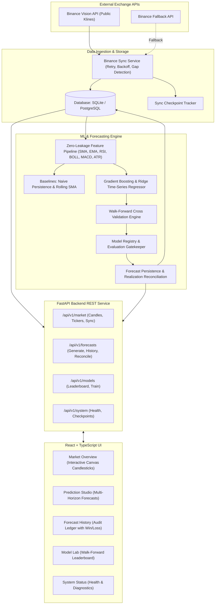

# Binance Crypto Intelligence & Market Forecasting Platform

[](https://github.com/DungTran1201/Binance-Predict-Value-And-Trend/actions/workflows/ci.yml)
[](https://www.python.org/downloads/)
[](https://fastapi.tiangolo.com)
[](https://react.dev)
[](https://www.typescriptlang.org/)
[](https://opensource.org/licenses/MIT)

A reliable, maintainable, production-ready cryptocurrency market intelligence and forecasting platform. Built with a **FastAPI** asynchronous REST backend, **React + TypeScript + Vite** frontend with rich dark crypto aesthetics, and an **ML time-series pipeline** featuring naive baselines, zero-leakage technical indicators, walk-forward cross validation, model evaluation gates, and an immutable forecast audit ledger with actual realization reconciliation.

---

## Table of Contents
1. [Architecture Overview](#architecture-overview)
2. [Component Responsibilities](#component-responsibilities)
3. [Quick Start & Setup](#quick-start--setup)
4. [Data Ingestion & Synchronization](#data-ingestion--synchronization)
5. [Machine Learning Pipeline & Reliability](#machine-learning-pipeline--reliability)
6. [API Specifications](#api-specifications)
7. [Environment Variables](#environment-variables)
8. [Testing & Verification](#testing--verification)
9. [Deployment with Docker Compose](#deployment-with-docker-compose)
10. [Troubleshooting Guide](#troubleshooting-guide)

---

## Architecture Overview



---

## Component Responsibilities

| Component | Technology | Responsibilities |
| :--- | :--- | :--- |
| **Backend REST API** | FastAPI, Pydantic v2, SQLAlchemy, uvicorn | Request validation, rate limiting, security headers, serving market data, inference, and audit history. |
| **Data Synchronization** | httpx, asyncio | Idempotent pagination from Binance Vision API, exponential backoff with jitter, timestamp normalization, closed-candle enforcement, and gap healing. |
| **Feature Engineering** | pandas, numpy | Zero look-ahead bias computation of multi-period returns, volatility, RSI, MACD, Bollinger Bands, ATR, volume dynamics, and supervised targets. |
| **Forecasting Engine** | scikit-learn, joblib | Naive persistence benchmark, rolling moving average, multi-horizon Histogram Gradient Boosting and Ridge models, empirical residual confidence intervals. |
| **Evaluation Gatekeeper** | Custom walk-forward validator | Expanding-window cross validation; enforces gate requiring candidate models to strictly beat naive baselines by margin $\ge 1\%$ and hit rate $\ge 50\%$ before promotion. |
| **Forecast Audit Ledger** | SQLAlchemy ORM | Immutable persistence of every forecast with data cutoff time, target time, probability, and automated reconciliation against realized candles. |
| **Frontend UI** | React 18, TypeScript, Vite, Vanilla CSS | High-performance HTML5 Canvas candlestick chart with crosshairs, prediction studio, leaderboard, and real-time system diagnostics. |
| **Background Worker** | Python asyncio daemon | Scheduled Kline sync, gap detection, and mature forecast realization audits. |

---

## Quick Start & Setup

### Prerequisites
- Python 3.11 or 3.12
- Node.js 18+ and npm 9+
- Git

### 1. Clone & Set Up Python Environment
```bash
git clone https://github.com/DungTran1201/Binance-Predict-Value-And-Trend.git
cd Binance-Predict-Value-And-Trend

# Create and activate virtual environment
python -m venv .venv

# On Windows (PowerShell):
.\.venv\Scripts\Activate.ps1
# On Linux/macOS:
source .venv/bin/activate

# Install backend dependencies
pip install -r requirements.txt
```

### 2. Build Frontend UI
```bash
cd frontend
npm install
npm run build
cd ..
```

### 3. Run FastAPI Backend & Unified Web App
```bash
# Serves both the REST API and the React SPA on port 8000
uvicorn backend.app.main:app --host 127.0.0.1 --port 8000 --reload
```
Open your browser to:
- **Web Application**: [http://127.0.0.1:8000](http://127.0.0.1:8000)
- **Interactive Swagger API Docs**: [http://127.0.0.1:8000/docs](http://127.0.0.1:8000/docs)
- **ReDoc API Documentation**: [http://127.0.0.1:8000/redoc](http://127.0.0.1:8000/redoc)

---

## Data Ingestion & Synchronization

### Binance Data Source
Candlestick (Kline) data is collected from the high-throughput, public Binance Vision API:
- Primary: `https://data-api.binance.vision/api/v3/klines`
- Fallback: `https://api.binance.com/api/v3/klines`
- No API keys are required for market data collection, eliminating credentials risk.

### Data Dictionary

| Field | Type | Description |
| :--- | :--- | :--- |
| `symbol` | `VARCHAR(32)` | Trading pair identifier (e.g. `BTCUSDT`, `ETHUSDT`) |
| `timeframe` | `VARCHAR(16)` | Interval interval (`1m`, `5m`, `15m`, `1h`, `4h`, `1d`) |
| `open_time` | `DATETIME (UTC)` | Candle opening timestamp normalized to UTC |
| `close_time` | `DATETIME (UTC)` | Candle closing timestamp normalized to UTC |
| `open` | `FLOAT` | Opening price in quote currency (USDT) |
| `high` | `FLOAT` | Highest trade price during candle |
| `low` | `FLOAT` | Lowest trade price during candle |
| `close` | `FLOAT` | Closing trade price during candle |
| `volume` | `FLOAT` | Base asset transaction volume |
| `quote_asset_volume` | `FLOAT` | Total quote asset volume |
| `number_of_trades` | `INTEGER` | Number of executed trades |
| `is_closed` | `BOOLEAN` | `True` if `close_time <= now_utc`, preventing training on forming candles |

### Synchronization Safeguards
1. **Idempotency & Duplicate Prevention**: Enforced via composite unique constraint on `(symbol, timeframe, open_time)`.
2. **Closed-Candle Handling**: Only finalized closed candles are used for feature computation and training sets.
3. **Gap Detection & Auto-Healing**: The sync service computes $(t_i - t_{i-1}) > \Delta t$ across consecutive timestamps and backfills missing ranges automatically.
4. **Resilient Retry**: Exponential backoff with random jitter handles HTTP 429 rate limits gracefully.

---

## Machine Learning Pipeline & Reliability

### Anti-Leakage & Time-Series Rigor
- **Chronological Ordering**: Data is strictly sorted ascending by timestamp. Random splitting is forbidden.
- **Fitting Preprocessors on Train Windows Only**: Scalers (e.g. `RobustScaler`) and models are fit exclusively on historical train data.
- **Strictly Forward Targets**: Features at time $t$ predict target price at $t + h$, where $h$ is the prediction horizon.

### Evaluation Metrics
- **MAE** (Mean Absolute Error): Primary regression metric.
- **RMSE** (Root Mean Squared Error): Penalizes large deviation outliers.
- **MAPE** (Mean Absolute Percentage Error): Normalized scale-invariant error.
- **Directional Accuracy** (Hit Rate %): Proportion of predictions that correctly identified upward vs downward direction:
  $$\text{Hit Rate} = \frac{1}{N} \sum_{i=1}^N \mathbb{I}\left(\text{sign}(\hat{y}_i - P_{t,i}) == \text{sign}(y_i - P_{t,i})\right)$$
- **Brier Score**: Evaluates probability calibration for binary direction probabilities.

### Model Gating Protocol
Before any trained model is promoted to `is_active = True`, it must pass three gates during Walk-Forward Cross Validation:
1. Candidate MAE must strictly beat the Naive Persistence baseline ($\text{MAE}_{\text{model}} < \text{MAE}_{\text{naive}}$).
2. The improvement margin must meet or exceed the activation threshold:
   $$\frac{\text{MAE}_{\text{naive}} - \text{MAE}_{\text{model}}}{\text{MAE}_{\text{naive}}} \ge 1\%$$
3. Directional accuracy must meet or exceed 50.0%.

---

## API Specifications

### 1. Market Data
- `GET /api/v1/market/symbols`
  - Returns active crypto pairs with 24h ticker prices, percent change, high, low, volume, `candle_count_24h`, `has_full_24h`, and explicit `data_status` (`"SYNCHRONIZED"`, `"PARTIAL"`, `"UNAVAILABLE"`, `"STALE"`). When no historical candles exist, metric fields are `null` (never false zeroes).
- `GET /api/v1/market/klines?symbol=BTCUSDT&timeframe=1h&limit=200`
  - Returns historical candles and technical indicators (SMA, EMA, Bollinger, RSI, MACD).
  - Empty results return HTTP 200 with `count: 0`, `candles: []`, and `indicators: {}` conforming to `MarketDataResponseSchema`.
- `POST /api/v1/market/sync`
  - Request: `{"symbol": "BTCUSDT", "timeframe": "1h", "lookback_days": 30}`
  - Initiates incremental synchronization from Binance with strict parameter validation and sanitized error handling.

### 2. Predictions & Forecasting
- `POST /api/v1/forecasts/generate`
  - Request: `{"symbol": "BTCUSDT", "timeframe": "1h", "horizon_steps": 6}`
  - Response:
    ```json
    {
      "id": "e4f87a32-15f2-4e9b-b461-7d526a0a911e",
      "model_id": "btcusdt_1h_6h_gradient_boosting_20261022",
      "model_version": "1.0.0",
      "symbol": "BTCUSDT",
      "timeframe": "1h",
      "horizon_steps": 6,
      "data_cutoff_time": "2026-10-22T12:00:00",
      "target_time": "2026-10-22T18:00:00",
      "current_price": 67450.00,
      "predicted_price": 68210.50,
      "predicted_return_pct": 1.13,
      "predicted_direction": "UP",
      "direction_probability": 0.642,
      "lower_bound_price": 66820.00,
      "upper_bound_price": 69600.00,
      "confidence_level": 0.95,
      "status": "PENDING"
    }
    ```
- `GET /api/v1/forecasts?symbol=BTCUSDT&status=RECONCILED`
  - Returns paginated forecast audit history and overall directional hit rate %.
- `POST /api/v1/forecasts/reconcile`
  - Audits all mature pending forecasts against actual closed candles.

### 3. Model Lab
- `GET /api/v1/models`
  - Lists registered models, active serving status, and evaluation metrics vs baselines.
- `POST /api/v1/models/train`
  - Request: `{"symbol": "BTCUSDT", "timeframe": "1h", "horizon_steps": 6, "model_type": "gradient_boosting", "n_splits": 4}`
  - Executes walk-forward cross validation and gates model activation.

### 4. System Status
- `GET /api/v1/health` - Liveness check (`{"status": "healthy"}`).
- `GET /api/v1/system/status` - Database health, stored candle count, checkpoint status, and gap metrics.

---

## Environment Variables

| Variable | Default Value | Description |
| :--- | :--- | :--- |
| `APP_ENV` | `development` | Environment mode (`development`, `production`, `testing`) |
| `DATABASE_URL` | `sqlite+aiosqlite:///./data/crypto_market.db` | Async database connection string |
| `SYNC_DATABASE_URL` | `sqlite:///./data/crypto_market.db` | Synchronous database connection string for migrations/workers |
| `BINANCE_API_URL` | `https://data-api.binance.vision/api/v3/klines` | Primary public Binance Vision endpoint |
| `BINANCE_FALLBACK_URL` | `https://api.binance.com/api/v3/klines` | Fallback Binance endpoint |
| `MODEL_STORAGE_DIR` | `./data/models` | Local directory for serialized model artifacts |
| `CORS_ORIGINS` | `["http://localhost:3000","http://localhost:5173"]` | Allowed CORS origins |

---

## Testing & Verification

All data pipeline, feature engineering, baseline comparison, model gating, forecast lifecycle, regression verification, and REST contract tests are automated.

### Backend Test Suite (pytest)
```bash
# In project root:
python -m pytest
```

Output:
```
tests/test_api_contract.py::test_health_check_endpoint PASSED
tests/test_api_contract.py::test_system_status_endpoint PASSED
tests/test_api_contract.py::test_market_symbols_endpoint PASSED
tests/test_api_contract.py::test_market_klines_endpoint PASSED
tests/test_api_contract.py::test_market_klines_empty_regression PASSED
tests/test_api_contract.py::test_market_klines_populated_contract PASSED
tests/test_api_contract.py::test_market_klines_parameter_validation PASSED
tests/test_api_contract.py::test_symbol_summaries_truthfulness_and_states PASSED
tests/test_api_contract.py::test_sync_parameter_validation_and_safe_errors PASSED
tests/test_api_contract.py::test_forecast_generate_and_list_lifecycle PASSED
tests/test_api_contract.py::test_model_listing_endpoint PASSED
tests/test_data_pipeline.py::test_kline_payload_parsing_and_normalization PASSED
tests/test_data_pipeline.py::test_duplicate_prevention_idempotency PASSED
tests/test_data_pipeline.py::test_gap_detection PASSED
tests/test_data_pipeline.py::test_timeframe_delta_helpers PASSED
tests/test_data_pipeline.py::test_datetime_and_ms_conversions PASSED
tests/test_ml_pipeline.py::test_feature_extraction_no_lookahead PASSED
tests/test_ml_pipeline.py::test_baselines_prediction PASSED
tests/test_ml_pipeline.py::test_walk_forward_evaluation PASSED
tests/test_ml_pipeline.py::test_forecast_lifecycle_and_reconciliation PASSED

============================= 20 passed in 2.71s =============================
```

### Frontend Tests & Production Build
```bash
cd frontend

# Run unit tests for en-US formatters and unavailable values:
npm test

# Run TypeScript type check and production bundle:
npm run build
```


---

## Deployment with Docker Compose

Deploy the complete multi-service stack with a single command:
```bash
cd docker
docker compose up -d --build
```
This launches:
1. `postgres`: PostgreSQL 16 database with persistent storage.
2. `backend`: FastAPI application on port 8000.
3. `worker`: Background synchronization and forecast audit daemon.
4. `frontend`: High-performance Nginx reverse proxy serving the React UI on port 80.

---

## Troubleshooting Guide

### 1. Database Connection Issues
- **Symptom**: `OperationalError: no such table: klines`
- **Solution**: The application automatically runs table initialization in its lifespan handler. Ensure `init_db()` runs or verify directory permissions for `./data`.

### 2. Binance API 429 Rate Limits
- **Symptom**: `429 Too Many Requests`
- **Solution**: The synchronization engine automatically handles 429 responses with exponential backoff and randomized jitter. You can also increase `request_timeout_seconds` in `config.yaml`.

### 3. Missing Data When Opening Charts
- **Symptom**: "No candle history found" message.
- **Solution**: Click the **Sync Binance** button on the Market Overview toolbar or trigger `POST /api/v1/market/sync` to seed the database.

---

## License
MIT License. Open source for academic, research, and non-commercial development.