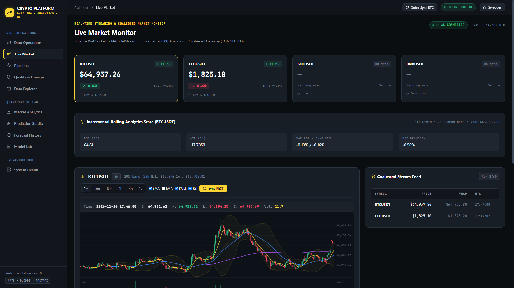
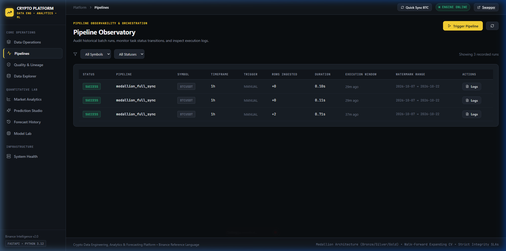
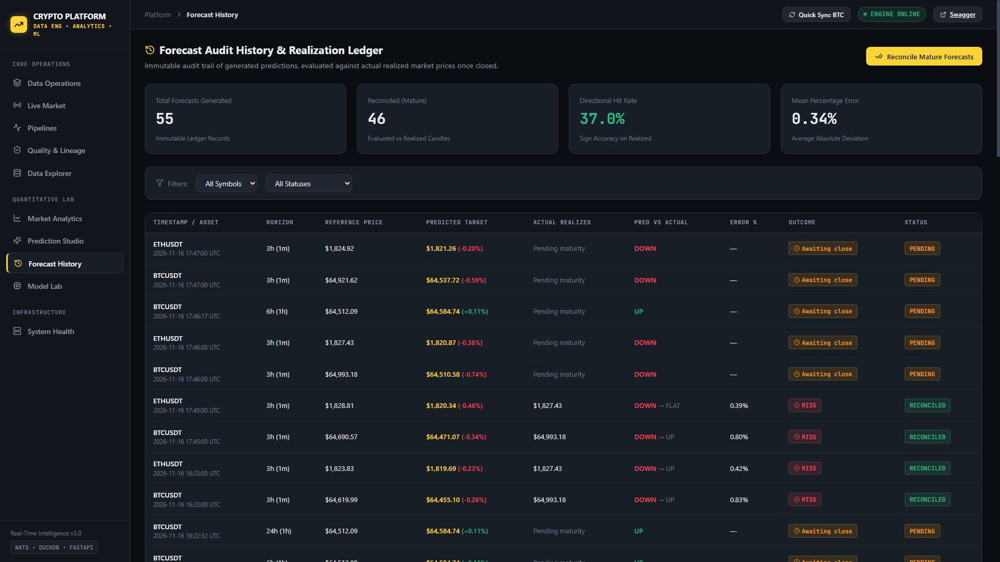
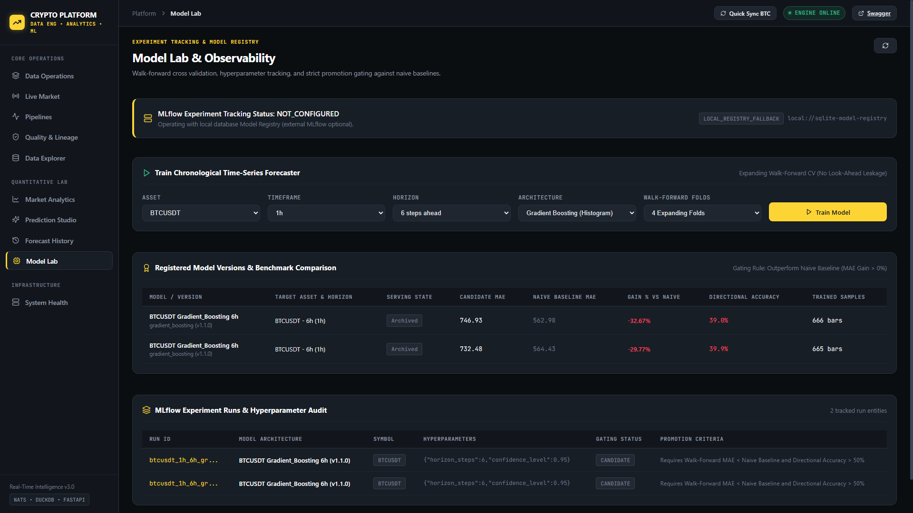
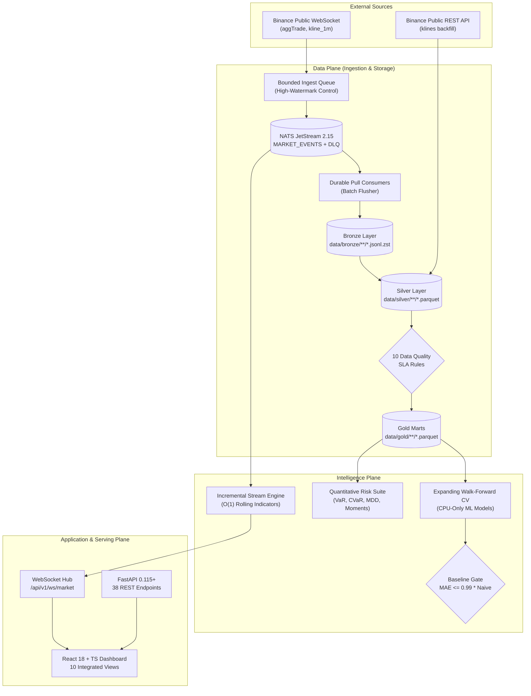

# Resource-Efficient Real-Time Financial Data Intelligence Platform (`v3.0.0`)

[](https://github.com/DungTran1201/CryptocurrencyPriceAnalysis_Forecasting/actions/workflows/ci.yml)
[](https://www.python.org/downloads/)
[](https://fastapi.tiangolo.com)
[](https://nats.io/)
[](https://duckdb.org/)
[](https://react.dev)
[](https://www.typescriptlang.org/)
[](https://opensource.org/licenses/MIT)

> **A single-node, resource-aware Real-Time Streaming Data Lakehouse, Quantitative Risk Analytics, and Experimental ML Forecasting Platform engineered for commodity workstations.**

[Quick Start](#quick-start-windows) • [Visual Showcase](#visual-showcase--platform-walkthrough) • [Architecture](#architecture-overview) • [Data Lifecycle](#end-to-end-data-lifecycle) • [API Reference](#api-documentation--route-specifications) • [Benchmarks](#verification-benchmarking--testing-suite) • [Documentation](#documentation-navigation-matrix)

---

## Executive Summary & Architectural Motivation

Most cryptocurrency analytics and machine-learning repositories are toy Jupyter notebooks. They download static CSV files from public URLs, engineer features with future-leakage train/test splits, claim artificial 90%+ directional accuracies, and require heavy distributed clusters (Apache Spark, Apache Flink, Kafka, GPU servers) that overwhelm personal computers.

This platform takes a **data-engineering-first approach**: a production-grade, single-node architecture designed to operate reliably on standard workstations (tested on 8 GB to 16 GB RAM). It manages the entire streaming and analytical data lifecycle—from raw WebSocket trade ingestion to columnar lakehouse storage, automated data quality scoring, incremental streaming analytics, and gated walk-forward machine learning.

```
┌─────────────────────────────────────────────────────────────────────────────────────────────┐
│                                 END-TO-END DATA LIFECYCLE                                    │
│                                                                                             │
│  Binance WS & REST ──► Bounded Queue ──► NATS JetStream ──► Bronze (zstd JSONL)             │
│                                                                  │                          │
│  WebSocket Gateway ◄── Incremental Analytics ◄── DuckDB Marts ◄──┴──► Silver (Parquet + DQ) │
│           │                                      │                                          │
│    10-View Dashboard ◄──────────────────── Walk-Forward ML ◄── Gold Feature Vectors         │
└─────────────────────────────────────────────────────────────────────────────────────────────┘
```

The system features an institutional Binance-inspired technical visual language (`#0B0E11` deep graphite surfaces, restrained `#FCD535` active accents, semantic `#2EBD85`/`#F6465D` market colors), persistent 10-view categorized sidebar navigation, zero lookahead leakage in CPU walk-forward validation, bounded backpressure-aware queues, and strict honest telemetry—**never showing fabricated zeroes or mock metrics**.

---

## Visual Showcase & Platform Walkthrough

The platform user interface is built with **React 18**, **TypeScript 5.6**, **Tailwind CSS**, and **HTML5 Canvas**. The following screenshots are captured directly from the live running application:

### 1. Data Operations Overview (`/overview`)
The primary operational cockpit displaying end-to-end pipeline health, Medallion stage watermarks, live SLA scorecard, candle freshness trackers, and immediate manual orchestration triggers.

*Displays: Real-time telemetry across the Medallion lifecycle (Source → Bronze 78k rows → Silver 76k rows → Gold Marts 1.4k rows → Features → Serving), SLA scorecards (38/41 rules, 92.7%), candle freshness ("Just now" / SYNCHRONIZED), and recent orchestrator runs with duration.*

---

### 2. Live Market Monitor & Real-Time Pipeline Flow (`/live`)
Dedicated real-time market operations monitor featuring a live candlestick chart, order book depth, rolling trade feed, and live WebSocket price ticks.

*Displays: Live WebSocket stream (WS CONNECTED) streaming real-time prices for BTCUSDT ($64,937.26, 1,242 ticks) and ETHUSDT ($1,825.10, 1,004 ticks), incremental $O(1)$ technical indicators (RSI 64.61, ATR 117.7850, VaR 95%), responsive candlestick chart with moving averages and volume, and the coalesced trade feed.*

---

### 3. Market Analytics & Quantitative Research (`/analytics`)
High-density quantitative research workbench for asset price dynamics, statistical return distributions, and risk profiling.

*Displays: Responsive HTML5 Canvas candlestick charting with locked height (no canvas stretching), Bollinger Bands, SMA/EMA overlays, volume histogram, and RSI (14) momentum oscillator across 150 historical 1-hour candles.*

---

### 4. Automated Data Quality & Medallion Lineage (`/quality`)
The platform data integrity center auditing market partitions against 10 automated rules and rendering interactive dataset lineage.

*Displays: 92.7% pass rate score across active asset suites, interactive Medallion Lineage DAG tracing Binance Public API → Bronze → Silver → Gold Marts → Features → Serving, and the lineage transformation edges ledger with record counts and UTC timestamps.*

---

### 5. Pipeline Observatory & Real-Time Processing Time (`/pipelines`)
Task-level execution audit tracking stage transitions, execution durations, records processed, and the **Real-Time Data Pipeline Telemetry Flowchart**.

*Displays: The 8-node Real-Time Data Flow Pipeline (`ws_ingest` → `normalize` → `bounded_queue` → `nats_broker` → `consumer_handle` → `incremental_analytics` → `ws_gateway` → `medallion_flush`), rolling p95 latency, inline processing sum (4.204 ms), background micro-batch flush time (170.55 ms), primary bottleneck analysis, and filterable historical pipeline runs.*

---

### 6. Multi-Horizon Prediction Studio (`/studio`)
Point-in-time experimental machine learning inference studio with frozen cutoff timestamps, calibrated probabilities, and empirical confidence intervals.

*Displays: Asset pair selection (BTC/USDT), interval selection (1 Hour), multi-horizon forecast targets (1 to 24 steps ahead), and synchronous prediction generation.*

---

### 7. Forecast History & Audit Ledger (`/history`)
Audited immutable prediction ledger tracking all historical predictions, status transitions (`PENDING` vs `RECONCILED`), and realized error metrics against closed candle outcomes.

*Displays: 55 total forecasts generated, 46 reconciled against closed market candles, 37.0% directional hit rate, 0.34% mean percentage error, full audit trail (reference price, target, realized price, outcome, and status), and on-demand reconciliation trigger.*

---

### 8. Model Lab & Registry (`/models`)
Walk-forward CV experiment leaderboard comparing model iterations (`Ridge`, `LogisticRegression`, `HistGradientBoosting`) against the naive persistence baseline, tracking hyperparameter sets and promotion gate compliance.

*Displays: Model Lab & Observability, local database Model Registry status, chronological expanding walk-forward forecaster training form, registered model benchmark comparison (Candidate MAE vs Naive Baseline MAE), and MLflow experiment runs audit.*

---

### 9. Data Explorer & Schema Catalog (`/explorer`)
Safe, read-only dataset exploration interface with schema contract dictionaries, partition watermarks, server-side pagination, and bounded CSV exports.

*Displays: Indexed records for Silver Validated Klines (722 records indexed), column types, timestamps, formatted prices ($64,927.21, $65,150.00), volume, trade counts, server-side page navigation (page 1 of 29), and CSV export snapshot controls.*

---

### 10. System Health & Resource Observatory (`/system`)
Real-time infrastructure diagnostic center monitoring process memory against configured budgets, CPU utilization, NATS JetStream lag, storage usage, and sync checkpoints.

*Displays: Operational state (`OPERATIONAL` under `LITE`), Process RSS memory (328.01 MB / 72.9% of 450 MB cap, CPU 8%), Host RAM free (878.7 MB), 19,158 stored candles, NATS JetStream broker messages (59,399), Medallion storage usage (Bronze 2.61MB, Silver 3.04MB, Gold 0.51MB, NATS 27.7MB, DB 6.98MB), and Checkpoints table.*

---

### 11. Responsive Mobile & Tablet Navigation
Collapsible navigation drawer and responsive layout verified on 768px tablet and mobile viewports.

*Displays: Compact collapsible drawer maintaining full navigation access, status indicators, and operational controls on constrained viewports.*

---

## Core Product Capabilities

| Domain | Implemented Capability | Technical Realization |
| :--- | :--- | :--- |
| **Data Engineering** | Public Binance WS & REST Ingestion | Real-time `aggTrade` & `kline_1m` streaming; REST backfill with exponential backoff & gap healing. |
| | Durable Message Broker | Single-binary NATS JetStream 2.15 (`MARKET_EVENTS` stream, `MARKET_DLQ`, pull consumers). |
| | Flow Control & Backpressure | Bounded queues with high-watermark flow control; zero silent event drops. |
| **Data Platform** | Hybrid Medallion Lakehouse | **Bronze**: `zstd` compressed raw JSONL; **Silver**: Partitioned Parquet + SQLite WAL; **Gold**: DuckDB Parquet marts. |
| | Automated Data Quality (DQ) | 10 programmatic rules auditing schema, OHLC geometry, monotonicity, freshness, and gaps. |
| | Lineage & Catalog Governance | Persistent `data_catalog_entries`, `data_lineage_edges`, stream checkpoints, and automated retention pruning. |
| **Financial Analytics** | Incremental Stream Processing | $O(1)$ rolling indicators (Returns, SMA, EMA, RSI, MACD, BB, VWAP, ATR14) updated per trade bar. |
| | Quantitative Risk Metrics | Vectorized Historical & Parametric VaR/CVaR (95%/99%), Maximum Drawdown (MDD), Pearson Correlation/Covariance. |
| **Machine Learning** | Leakage-Free Walk-Forward CV | Expanding-window cross-validation on chronological Gold feature sets; zero future data leakage. |
| | Baseline-Gated Model Registry | Mandatory $\ge 1\%$ naive MAE improvement promotion gate; automatic fallback to persistence model. |
| | Forecast Reconciliation | Automated background reconciliation of pending forecasts against closed candle actuals. |
| **Application & Serving** | Coalesced WebSocket Gateway | Bounded per-client push `/api/v1/ws/market` delivering price ticks, depth, and indicators. |
| | REST API & Open Standards | 38 HTTP REST routes, OpenAPI 3.1 Swagger UI (`/docs`), ReDoc (`/redoc`), and Prometheus `/metrics`. |
| | Resource-Aware Profiles | `lite` (450 MB RAM budget), `standard` (950 MB), and `extended` (1800 MB) adaptive runtimes. |

---

## Architecture Overview

The system is organized into three distinct operational planes designed to enforce single-node resource efficiency while maintaining strict separation of concerns:

```
┌─────────────────────────────────────────────────────────────────────────────────────────────┐
│                                APPLICATION PLANE (Presentation)                             │
│   • React 18 + TypeScript 5.6 SPA (10 Accessible Navigation Views)                           │
│   • HTML5 Canvas Financial Charting • Realtime Pipeline Flowchart • Responsive Drawer       │
│   • Coalesced WebSocket Client • Server-Side Paginated Tables • Bounded CSV Snapshot Export │
└──────────────────────────────────────────────┬──────────────────────────────────────────────┘
                                               │ HTTP REST (JSON) & Coalesced WS Frames
┌──────────────────────────────────────────────▼──────────────────────────────────────────────┐
│                                  SERVING & CONTROL PLANE                                    │
│   • FastAPI 0.115+ (38 REST Routes + /api/v1/ws/market WebSocket Gateway)                  │
│   • Prometheus /metrics Text Exposition • Security Headers (nosniff, DENY, strict-origin)   │
│   • Adaptive Resource Monitor (/api/v1/system/resources) • Profile Enforcement             │
└──────────────────────┬───────────────────────────────────────────────┬──────────────────────┘
                       │ Queries & Mutations                           │ Stream Subscriptions
┌──────────────────────▼────────────────────────┐ ┌────────────────────▼──────────────────────┐
│            DATA PLANE (Streaming & Storage)   │ │       INTELLIGENCE PLANE (Analytics & ML)  │
│ • Binance Ingestion (WS & REST Backfill)      │ │ • O(1) Incremental Streaming Engine       │
│ • Bounded Queue Flow Control (Watermarks)     │ │ • Vectorized Quantitative Risk Suite      │
│ • NATS JetStream 2.15 (Durable Streams & DLQ) │ │ • Expanding Walk-Forward Chronological CV │
│ • Bronze: zstd-compressed JSONL micro-batches │ │ • CPU Ridge, Logistic & HistGradientBoost │
│ • Silver: Partitioned Parquet + 10 DQ Rules   │ │ • Baseline Gating & Fallback Engine       │
│ • Gold: Analytical Marts & ML Feature Vectors │ │ • Matured Forecast Reconciler             │
└──────────────────────┬────────────────────────┘ └────────────────────┬──────────────────────┘
                       │                                               │
┌──────────────────────▼───────────────────────────────────────────────▼──────────────────────┐
│                            METADATA & STORAGE LAYER (Single Node)                           │
│   • SQLite WAL (Async SQLAlchemy 2.0 / aiosqlite): symbols, klines, checkpoints, catalogs   │
│   • DuckDB In-Memory Session: Fast zero-copy columnar analytical aggregations               │
│   • Local File System: Partitioned Bronze, Silver, Gold, and Artifact directories           │
└─────────────────────────────────────────────────────────────────────────────────────────────┘
```

### High-Level Component Flow



---

## End-to-End Data Lifecycle

1. **Ingestion & Normalization**: Connects to Binance public WebSockets (`aggTrade` and `kline_1m`) with automatic reconnection and exponential backoff. Incoming raw JSON payloads are normalized into canonical typed schemas (`CanonicalTradeEvent`, `CanonicalKlineEvent`).
2. **Bounded JetStream Buffering**: Enqueues normalized events through bounded memory buffers. If downstream processing stalls, high-watermark flow control applies backpressure—preventing memory exhaustion without silent message loss. Messages publish to NATS JetStream stream `MARKET_EVENTS` (malformed payloads route to `MARKET_DLQ`).
3. **Bronze Raw Storage**: A background micro-batch consumer pulls batches and writes raw immutable events to date-partitioned `data/bronze/{symbol}/{date}/events.jsonl.zst` using `zstandard` compression (~25x compression ratio).
4. **Silver Cleanse & 10 DQ Rules**: De-duplicates records by `(symbol, timeframe, open_time)`, enforces strict OHLC geometry ($Low \le Open, Close \le High$), validates timestamps, and writes columnar Parquet partitions alongside indexed SQLite `klines`. The 10-rule Data Quality engine evaluates every partition.
5. **Gold Marts & DuckDB Aggregations**: Materializes `data/gold/analytics_marts/` and `data/gold/feature_sets/` Parquet files. DuckDB queries these files via memory-bounded queries (`128MB` under `lite`) to compute historical rolling indicators and cross-asset correlations.
6. **Incremental Real-Time Analytics**: An in-memory state tracker (`IncrementalSymbolState`) calculates real-time technical indicators ($O(1)$ complexity) for every incoming tick and bar, perfectly matching batch Pandas reference implementations.
7. **Leakage-Free Machine Learning**: Trains CPU-efficient models (`Ridge`, `LogisticRegression`, `HistGradientBoosting`) using expanding walk-forward cross-validation. A candidate model is promoted **only** if its out-of-sample MAE improves upon the naive persistence baseline by at least 1.0%; otherwise, the platform safely falls back to the baseline.
8. **Serving & Reconciliation**: Broadcasts coalesced price ticks and pipeline latency metrics over `/api/v1/ws/market`. When future candles close, a background reconciler scores pending forecasts against realized market prices and records realized MAE/RMSE.

---

## Data Quality Rules & SLAs

Every market partition is scored against 10 automated programmatic rules. If critical rules fail, downstream pipeline promotion halts immediately:

| Rule ID | Rule Name | Category | Severity | Failure Condition |
| :--- | :--- | :--- | :--- | :--- |
| **DQ-SCH-01** | Schema & Type Adherence | SCHEMA | CRITICAL | Column types differ from float/int/datetime or required columns are missing. |
| **DQ-NUL-01** | Non-Null Completeness | COMPLETENESS | CRITICAL | Null or NaN values detected in OHLCV columns. |
| **DQ-UNI-01** | Primary Key Uniqueness | INTEGRITY | CRITICAL | Duplicate `(symbol, timeframe, open_time)` combinations found. |
| **DQ-ORD-01** | Monotonic Ordering | CONSISTENCY | ERROR | Out-of-order timestamp sequence detected ($t_i \le t_{i-1}$). |
| **DQ-GAP-01** | Interval Continuity | CONSISTENCY | WARNING | Timestamp delta between consecutive candles exceeds $1.5\times$ expected timeframe. |
| **DQ-REL-01** | OHLC Price Geometry | INTEGRITY | CRITICAL | $High < Low$, $High < Open$, $High < Close$, $Low > Open$, or $Low > Close$. |
| **DQ-VOL-01** | Non-Negative Volume | INTEGRITY | ERROR | Base or quote asset volume $< 0.0$. |
| **DQ-FUT-01** | Temporal Validity | CONSISTENCY | CRITICAL | Candle open timestamp exceeds current UTC wall-clock time. |
| **DQ-OUT-01** | Extreme Price Spike Flag | ANOMALY | WARNING | Single-candle price return $|r_t| > 35\%$ (flagged for review). |
| **DQ-FRE-01** | Freshness SLA | COMPLETENESS | WARNING | Latest closed candle timestamp exceeds allowable SLA delay window. |

---

## Technology Stack

| Layer | Technology | Version | Architectural Responsibility & Rationale |
| :--- | :--- | :--- | :--- |
| **Backend API** | [FastAPI](https://fastapi.tiangolo.com/) | `0.115.8` | High-performance async REST framework with auto-generated OpenAPI documentation. |
| **Data Validation** | [Pydantic v2](https://docs.pydantic.dev/) | `2.10.6` | Strict contract validation, input sanitization, and response serialization. |
| **Streaming Broker** | [NATS JetStream](https://nats.io/) | `2.15.3` | Single-binary durable message broker (~22 MB RSS idle) replacing heavy Kafka clusters. |
| **Lakehouse Storage** | [PyArrow](https://arrow.apache.org/docs/python/) & [DuckDB](https://duckdb.org/) | `19.0.0` / `1.2.0` | Columnar Silver/Gold Parquet storage and bounded in-process SQL analytical queries. |
| **Raw Compression** | [zstandard](https://github.com/indygreg/python-zstandard) | `0.23.0` | High-ratio zstd compression for raw Bronze JSONL micro-batch files. |
| **Operational DB** | [SQLAlchemy](https://www.sqlalchemy.org/) & [aiosqlite](https://github.com/omnilib/aiosqlite) | `2.0.38` / `0.21.0` | Async WAL SQLite metadata engine storing symbols, klines, catalog, and lineage. |
| **Database Migrations**| [Alembic](https://alembic.sqlalchemy.org/) | `1.14.1` | Version-controlled deterministic database schema migrations. |
| **Quantitative ML** | [NumPy](https://numpy.org/), [Pandas](https://pandas.pydata.org/), [scikit-learn](https://scikit-learn.org/) | `2.2.3` / `2.2.3` / `1.6.1` | Vectorized risk analytics, technical indicators, and CPU walk-forward regression. |
| **System Metrics** | [psutil](https://github.com/giampaolo/psutil) & [prometheus-client](https://github.com/prometheus/client_python) | `7.0.0` / `0.21.1` | Process RSS memory, CPU tracking, and standard Prometheus `/metrics` exposition. |
| **Frontend Framework**| [React 18](https://react.dev/) | `18.3.1` | Component-driven user interface with responsive rendering and lifecycle management. |
| **Language & Build** | [TypeScript](https://www.typescriptlang.org/) & [Vite](https://vitejs.dev/) | `5.6.3` / `6.2.0` | Strongly typed frontend compilation and sub-second production asset bundling. |
| **Icons & Design** | [Lucide React](https://lucide.dev/) & [Tailwind CSS](https://tailwindcss.com/) | `0.468.0` / `3.4.17` | Clean financial iconography and responsive Binance-inspired graphite theme. |

---

## Repository Structure

```
CryptocurrencyPriceAnalysis_Forecasting/
├── backend/                              # Core Python backend package
│   └── app/
│       ├── api/v1/                       # API v1 routes (38 REST endpoints + 1 WS hub)
│       │   ├── analytics.py              # Quantitative returns, volatility, drawdowns, correlations
│       │   ├── data_explorer.py          # Paginated dataset browser & CSV export
│       │   ├── data_quality.py           # DQ scorecards, rule evaluator, and lineage DAG
│       │   ├── forecast.py               # Point-in-time predictions and reconciliation
│       │   ├── governance.py             # Data catalog, checkpoints, and retention pruning
│       │   ├── market.py                 # Symbols, candlestick history, and REST sync
│       │   ├── models.py                 # Walk-forward CV training and model registry
│       │   ├── pipelines.py              # Medallion orchestrator and execution logs
│       │   ├── streaming.py              # Streaming status, DLQ, flush, and /ws/market
│       │   └── system.py                 # Health probes, sync state, and resource telemetry
│       ├── core/                         # Config, async database, logging, and metrics
│       ├── models/                       # SQLAlchemy models (symbols, klines, catalog, etc.)
│       ├── schemas/                      # Pydantic v2 schemas and event contracts
│       ├── services/                     # Business logic and domain service implementations
│       ├── storage/                      # Bronze zstd, Silver Parquet, and Gold DuckDB managers
│       └── streaming/                    # Binance WS, NATS broker, consumers, and telemetry
├── frontend/                             # React 18 + TypeScript + Vite frontend
│   ├── src/
│   │   ├── components/                   # CandlestickChart, RealtimePipelineFlow, StatusBadge
│   │   ├── services/                     # Typed Axios API client & WebSocket hooks
│   │   ├── types/                        # TypeScript interfaces matching backend schemas
│   │   └── views/                        # 10 accessible navigation views
│   └── dist/                             # Compiled production bundle served directly by FastAPI
├── ml/                                   # Financial analytics & machine learning engine
│   ├── analytics.py                      # Vectorized indicators, returns, and risk metrics
│   ├── incremental_analytics.py          # O(1) real-time streaming indicator state tracker
│   ├── walk_forward.py                   # Chronological expanding CV with baseline gating
│   └── registry.py                       # Local model registry with MLflow fallback
├── docs/                                 # Architectural documentation and audit reports
│   ├── 10-audit/                         # Hardware audit, resource budgets, performance reports
│   ├── 20-requirements/                  # SRS and traceability matrix
│   ├── 30-architecture/                  # Comprehensive architecture specifications
│   ├── 40-adr/                           # Architectural Decision Records (ADR-001 through 005)
│   ├── screenshots/                      # Verified UI screenshots
│   └── audit/                            # Codebase audit & README verification report
├── scripts/                              # Utility and launcher scripts
│   ├── install_nats.ps1                  # Downloads & extracts NATS server into .bin/
│   ├── start_nats.ps1                    # Starts local single-node NATS JetStream
│   ├── start_lite.ps1                    # One-click PowerShell platform launcher
│   └── benchmark_platform.py             # Resource and throughput benchmark runner
├── docker/                               # Containerized deployment definitions
│   ├── docker-compose.yml                # Multi-profile compose configuration
│   ├── Dockerfile.backend                # Multi-stage Python 3.12 container
│   └── Dockerfile.frontend               # Nginx frontend distribution container
├── tests/                                # Comprehensive automated test suite (77 Pytest tests)
├── setup.bat                             # One-click Windows setup script
├── run.bat                               # One-click Windows launch and control script
├── requirements.txt                      # Pinned Python backend dependencies
└── README.md                             # Project presentation and documentation
```

---

## Hardware & System Prerequisites

| Requirement | Minimum Specification | Tested & Verified Environment | Notes |
| :--- | :--- | :--- | :--- |
| **Operating System** | Windows 10/11 (64-bit), Ubuntu 22.04+, or macOS 13+ | **Windows 10 Pro (x64)** | Validated in native PowerShell and CMD. |
| **CPU Architecture** | 2 Physical Cores (x86_64 or ARM64) | **Intel Core i5-11400H (12 vCPUs)** | Single-node CPU training; no GPU required. |
| **System Memory** | 4 GB RAM available | **16 GB RAM (System Peak RSS < 350 MB)** | Adaptive profiles fit 450 MB (`lite`) to 1800 MB (`extended`). |
| **Free Disk Space** | 2 GB free storage | **50+ GB SSD (NVMe)** | Storage managed by automated retention pruning. |
| **Python** | Python `3.12.0`+ | **Python `3.12.9`** | Must be added to system PATH. |
| **Node.js & npm** | Node `18.0.0`+ / npm `9.0.0`+ | **Node `24.18.0` / npm `11.16.0`** | Required to build frontend assets. |
| **Message Broker** | NATS Server `2.10`+ | **NATS Server `2.15.3`** | Automatically installed into `.bin/` by setup script. |
| **Database** | SQLite `3.35`+ (built-in WAL mode) | **SQLite WAL (aiosqlite `0.21.0`)** | Default asynchronous local storage. |

---

## Quick Start (Windows)

The repository provides two automated batch scripts for Windows developers: [`setup.bat`](setup.bat) and [`run.bat`](run.bat).

### Step 1: Automated Installation (`setup.bat`)
Open Command Prompt or PowerShell in the repository root and run:
```cmd
setup.bat
```
`setup.bat` executes a 7-step preflight and configuration routine:
1. Detects Python 3.12+ and checks system requirements.
2. Creates `.venv` virtual environment.
3. Upgrades `pip` and installs pinned dependencies from `requirements.txt`.
4. Copies `.env.example` to `.env` (configured for profile `lite`).
5. Downloads and extracts the `nats-server.exe` binary into `.bin\`.
6. Executes Alembic database migrations (`alembic upgrade head`).
7. Installs frontend dependencies and compiles production assets into `frontend\dist`.

*(Flags: `setup.bat --extended` installs optional MinIO & Prometheus dependencies; `setup.bat --help` displays all flags.)*

---

### Step 2: One-Click Startup (`run.bat`)
To launch the entire platform:
```cmd
run.bat
```
`run.bat` automatically:
- Verifies virtual environment and configuration.
- Applies pending database migrations.
- Starts NATS JetStream in the background (PID tracked in `.nats.pid`).
- Launches FastAPI on **`http://127.0.0.1:8000/`** with the embedded streaming runtime and compiled dashboard.

**Useful Launcher Flags:**
```cmd
run.bat --open         :: Starts platform and automatically opens default browser
run.bat standard       :: Launches with the STANDARD profile (950 MB budget)
run.bat --port 8080    :: Starts backend on custom port 8080
run.bat --check        :: Validates environment, port 8000, and NATS without starting
run.bat --stop         :: Gracefully shuts down running NATS server and uvicorn processes
```

---

## Manual Step-by-Step Setup (PowerShell)

For Linux, macOS, or granular Windows developer control, execute the manual setup steps:

### 1. Clone & Enter Repository
```powershell
git clone https://github.com/DungTran1201/CryptocurrencyPriceAnalysis_Forecasting.git
cd CryptocurrencyPriceAnalysis_Forecasting
```

### 2. Configure Environment Variables
```powershell
Copy-Item .env.example .env
```
*(The default configuration sets `PLATFORM_PROFILE=lite`, `STREAM_ENABLED=true`, and connects to public Binance WebSocket feeds with zero API key requirements).*

### 3. Create Virtual Environment & Install Dependencies
```powershell
py -3.12 -m venv .venv
.\.venv\Scripts\python.exe -m pip install --upgrade pip
.\.venv\Scripts\python.exe -m pip install -r requirements.txt
```

### 4. Install Local Single-Binary NATS Broker
```powershell
.\scripts\install_nats.ps1
```
*(Extracts single-executable `nats-server.exe` into `.bin\`—no system-wide service installation needed).*

### 5. Apply Database Migrations
```powershell
$env:PYTHONPATH = "."
.\.venv\Scripts\alembic.exe upgrade head
```

### 6. Build Frontend Production Assets
```powershell
cd frontend
npm install
npm run build
cd ..
```
*Vite compiles the React application into `frontend/dist`, which FastAPI serves statically at `http://127.0.0.1:8000/`.*

### 7. Launch Platform
```powershell
# Option A: One-step launcher script
.\scripts\start_lite.ps1

# Option B: Manual uvicorn launch
.\scripts\start_nats.ps1
$env:PYTHONPATH = "."
$env:PLATFORM_PROFILE = "lite"
$env:STREAM_ENABLED = "true"
$env:STREAM_EMBEDDED_IN_API = "true"
.\.venv\Scripts\uvicorn.exe backend.app.main:app --host 127.0.0.1 --port 8000
```

Open **`http://127.0.0.1:8000/`** in your browser. Interactive Swagger API documentation is available at `http://127.0.0.1:8000/docs`.

---

## Configuration & Adaptive Profiles

The platform implements three resource profiles defined in [ADR-001](docs/40-adr/ADR-001-runtime-profiles-and-single-node-budget.md). Change the profile by setting `PLATFORM_PROFILE` in `.env`:

| Parameter | Profile A (`lite`) | Profile B (`standard`) | Profile C (`extended`) |
| :--- | :--- | :--- | :--- |
| **Target Workstation** | 4–8 GB RAM Laptop | 8–16 GB RAM PC (Default) | 16+ GB RAM Workstation |
| **Process Memory Budget** | **450 MB** | **950 MB** | **1800 MB** |
| **Monitored Symbols** | `BTCUSDT` (1–2 pairs) | `BTCUSDT`, `ETHUSDT`, `SOLUSDT`, `BNBUSDT` | Up to 10 trading pairs |
| **Ingest Buffer Watermark**| 2,000 events | 5,000 events | 20,000 events |
| **Max Candlestick History**| 500 bars | 2,000 bars | 10,000 bars |
| **DuckDB Memory Limit** | 128 MB | 256 MB | 512 MB |
| **Streaming Runtime** | Embedded in FastAPI process | Decoupled background worker | Decoupled background worker |
| **Object Storage** | Local File System | Local File System | Optional MinIO / S3 |
| **Monitoring** | Internal `/metrics` + JSON | Internal `/metrics` + JSON | Optional Prometheus + Grafana |

### Key Environment Variables (`.env`)

| Variable | Default (`lite`) | Description |
| :--- | :--- | :--- |
| `PLATFORM_PROFILE` | `lite` | Active resource profile (`lite`, `standard`, `extended`). |
| `DATABASE_URL` | `sqlite+aiosqlite:///./data/crypto_market.db` | Async SQLAlchemy database connection string (WAL enabled). |
| `DATA_ROOT_DIR` | `./data` | Directory root for Bronze, Silver, Gold, and model storage. |
| `NATS_URL` | `nats://127.0.0.1:4222` | NATS JetStream connection URI. |
| `STREAM_ENABLED` | `true` | Enables real-time streaming runtime. |
| `STREAM_EMBEDDED_IN_API` | `true` | Runs WebSocket ingestor and pull consumers inside FastAPI process. |
| `BINANCE_WS_URL` | `wss://stream.binance.com:9443/ws` | Public Binance streaming gateway (zero API key needed). |
| `CORS_ORIGINS` | `["http://localhost:5173", "http://127.0.0.1:8000"]` | Permitted browser origins. |

---

## Practical Usage & CLI Runbook

### 1. Synchronize Market Candles via REST
Sync the latest 300 1-hour candles from Binance public REST API:
```powershell
$body = @{ symbol = "BTCUSDT"; timeframe = "1h"; limit = 300 } | ConvertTo-Json
Invoke-RestMethod -Uri "http://127.0.0.1:8000/api/v1/market/sync" -Method POST -Body $body -ContentType "application/json"
```

### 2. Trigger Full Medallion Pipeline Execution
Execute the sequential data pipeline (`ingest_bronze` → `validate_silver` → `build_gold_marts` → `extract_features`):
```powershell
$pipe = @{ pipeline_name = "medallion_full_sync"; symbol = "BTCUSDT"; timeframe = "1h"; sync_mode = "sync" } | ConvertTo-Json
Invoke-RestMethod -Uri "http://127.0.0.1:8000/api/v1/pipelines/trigger" -Method POST -Body $pipe -ContentType "application/json"
```

### 3. Evaluate Data Quality SLAs On-Demand
Run all 10 automated data quality checks against the active dataset:
```powershell
$eval = @{ symbol = "BTCUSDT"; timeframe = "1h"; limit = 500 } | ConvertTo-Json
Invoke-RestMethod -Uri "http://127.0.0.1:8000/api/v1/data-quality/evaluate" -Method POST -Body $eval -ContentType "application/json"
```

### 4. Generate Multi-Horizon Machine Learning Forecast
Generate a point-in-time multi-step forecast (honors baseline gating):
```powershell
$pred = @{ symbol = "BTCUSDT"; timeframe = "1h"; horizon_steps = 6 } | ConvertTo-Json
Invoke-RestMethod -Uri "http://127.0.0.1:8000/api/v1/forecasts/generate" -Method POST -Body $pred -ContentType "application/json"
```

### 5. Reconcile Closed Predictions
Reconcile matured pending predictions against realized market prices:
```powershell
Invoke-RestMethod -Uri "http://127.0.0.1:8000/api/v1/forecasts/reconcile" -Method POST
```

### 6. Enforce Disk Retention Policies
Prune aged Bronze micro-batches and Silver partitions exceeding configured retention windows:
```powershell
Invoke-RestMethod -Uri "http://127.0.0.1:8000/api/v1/governance/retention/run" -Method POST
```

---

## API Documentation & Route Specifications

The backend exposes **38 HTTP REST routes**, **1 WebSocket streaming gateway**, and **1 Prometheus metrics endpoint**. Complete interactive schema documentation is generated automatically:
- **Swagger UI**: [`http://127.0.0.1:8000/docs`](http://127.0.0.1:8000/docs)
- **ReDoc**: [`http://127.0.0.1:8000/redoc`](http://127.0.0.1:8000/redoc)
- **OpenAPI Schema**: [`http://127.0.0.1:8000/openapi.json`](http://127.0.0.1:8000/openapi.json)

### Complete Route Reference Table

| Category | Method | Endpoint | Description |
| :--- | :--- | :--- | :--- |
| **System & Ops** | `GET` | `/api/v1/health` | Liveness and readiness health check probe. |
| | `GET` | `/api/v1/system/status` | Database connectivity, sync state, and checkpoint watermarks. |
| | `GET` | `/api/v1/system/resources` | Live process RSS memory, CPU %, host free RAM, and budget limits. |
| | `GET` | `/metrics` | Prometheus text exposition format metrics. |
| **Streaming & WS** | `GET` | `/api/v1/streaming/status` | NATS JetStream lag, queue depth, backpressure state, and node latencies. |
| | `GET` | `/api/v1/streaming/dlq` | Inspect quarantined Dead-Letter Queue events. |
| | `POST` | `/api/v1/streaming/flush` | Manually flush pending micro-batch buffers to Bronze/Silver storage. |
| | `POST` | `/api/v1/streaming/replay` | Replay historical events from NATS JetStream by sequence ID. |
| | `POST` | `/api/v1/streaming/simulate-disconnect` | Controlled WS disconnect to verify automatic reconnect & gap healing. |
| | `WS` | `/api/v1/ws/market` | Coalesced WebSocket stream for real-time prices, indicators & pipeline flow. |
| **Governance** | `GET` | `/api/v1/governance/catalog` | Persistent Medallion Data Catalog entries and dataset owners. |
| | `GET` | `/api/v1/governance/checkpoints` | Inspect durable stream consumer checkpoints (`stream_checkpoints`). |
| | `POST` | `/api/v1/governance/retention/run` | Execute Bronze/Silver/Gold retention pruning policy. |
| **Pipelines** | `GET` | `/api/v1/pipelines/overview` | Pipeline runs summary, success rate, and duration metrics. |
| | `GET` | `/api/v1/pipelines/runs` | Filterable list of historical pipeline executions. |
| | `GET` | `/api/v1/pipelines/runs/{run_id}` | Detailed task stage breakdown, record counts, and execution logs. |
| | `POST` | `/api/v1/pipelines/trigger` | Trigger synchronous or asynchronous Medallion pipeline run. |
| **Data Quality** | `GET` | `/api/v1/data-quality/overview` | Data quality scorecard, pass rates, and active rules overview. |
| | `GET` | `/api/v1/data-quality/lineage` | Medallion lineage DAG derived from `data_lineage_edges`. |
| | `GET` | `/api/v1/data-quality/runs` | Historical quality audit execution ledger. |
| | `GET` | `/api/v1/data-quality/runs/{run_id}` | Detailed rule evaluation results and violation samples. |
| | `POST` | `/api/v1/data-quality/evaluate` | Trigger on-demand quality evaluation on active symbol/timeframe. |
| **Data Explorer** | `GET` | `/api/v1/data-explorer/datasets` | Registered datasets and schema contract dictionaries. |
| | `GET` | `/api/v1/data-explorer/preview` | Paginated dataset inspection with profile statistics. |
| | `GET` | `/api/v1/data-explorer/export` | Download bounded dataset partitions as CSV extracts. |
| **Analytics** | `GET` | `/api/v1/analytics/returns` | Return distributions, moments ($\mu, \sigma, s, k$), VaR/CVaR, ATR14, VWAP, histogram. |
| | `GET` | `/api/v1/analytics/volatility` | Rolling annualized realized volatility (7, 14, and 30-period windows). |
| | `GET` | `/api/v1/analytics/drawdowns` | Cumulative peak series, drawdown percentages, and Maximum Drawdown (MDD). |
| | `GET` | `/api/v1/analytics/correlations` | Pairwise Pearson correlation and covariance matrices across assets. |
| | `GET` | `/api/v1/analytics/incremental` | Real-time $O(1)$ streaming per-symbol technical indicators and risk state. |
| **Market** | `GET` | `/api/v1/market/symbols` | Supported cryptocurrency trading pairs and sync status. |
| | `GET` | `/api/v1/market/klines` | Validated OHLCV candlestick bars and technical indicators. |
| | `POST` | `/api/v1/market/sync` | Incremental candle synchronization from Binance REST API. |
| **Forecasts** | `GET` | `/api/v1/forecasts` | Paginated immutable forecast history ledger. |
| | `POST` | `/api/v1/forecasts/generate` | Multi-horizon price & direction prediction (honors baseline gating). |
| | `POST` | `/api/v1/forecasts/reconcile` | Reconcile matured pending forecasts against closed candle outcomes. |
| **Models** | `GET` | `/api/v1/models` | Registered models and walk-forward CV metrics. |
| | `GET` | `/api/v1/models/experiments` | Experiment runs, hyperparameters, and evaluation metrics. |
| | `GET` | `/api/v1/models/tracking-status` | Probe remote MLflow server vs `LOCAL_REGISTRY_FALLBACK`. |
| | `POST` | `/api/v1/models/train` | Execute CPU walk-forward CV with naive baseline gating. |

---

## Verification, Benchmarking & Testing Suite

Every code modification is verified through automated backend tests, frontend type checks, and resource benchmarks:

### 1. Backend Pytest Suite (77 Tests Passed)
The backend test suite covers API response contracts, empty-candle schema edge cases, NATS JetStream integration, 10 DQ rules, incremental analytics parity, two-phase deduplication, DuckDB Star Schema warehouse, SQL durable workflows, decoupled serving bridge, and security headers:
```powershell
$env:PYTHONPATH = "."
$env:APP_ENV = "testing"
.\.venv\Scripts\python.exe -m pytest tests/ -v -m "not system and not performance and not live"
```
*Result: `77 passed, 1 deselected in 13.14s` (0 failed, 100% green).*

### 2. Frontend Unit Tests & Production Build
```powershell
cd frontend
npm test
npm run build
cd ..
```
*Result: `5 passed in 119ms`, `tsc && vite build` built in 2.27s.*

### 3. Resource & Throughput Benchmark
Measures actual throughput and memory consumption across `lite` and `standard` profiles:
```powershell
$env:PYTHONPATH = "."
.\.venv\Scripts\python.exe scripts\benchmark_platform.py
```

**Verified Benchmark Measurements:**
- **Streaming Throughput**: 15,112 to 17,402 events/sec processed through incremental analytics.
- **NATS JetStream Latency**: Average publish latency 0.23 ms to 0.24 ms; Memory KV put 0.19 ms to 0.20 ms.
- **Bronze Compression**: Raw JSONL compressed via `zstd` with a **22.5x to 25.8x ratio** (11 ms write latency).
- **Silver Columnar Parquet**: Parquet write time 9.0 ms to 19.2 ms.
- **DuckDB Analytical Query**: Columnar aggregation across candles completed in 48 ms to 66 ms.
- **System Memory Footprint**: Process RSS 225 MB idle, peaking at ~254 MB under load (well within 450 MB / 950 MB budgets).

---

## Troubleshooting Guide

| Issue / Symptom | Root Cause | Verified Solution |
| :--- | :--- | :--- |
| `ModuleNotFoundError: No module named 'backend'` | Python cannot locate package root | Set `$env:PYTHONPATH = "."` in PowerShell (or use `run.bat` which configures this automatically). |
| `Port 8000 already in use` | Another process is holding port 8000 | Terminate the process: `run.bat --stop` or run on an alternate port: `run.bat --port 8080`. |
| Missing or stale market candles | Fresh installation without synced data | Send a sync request via `POST /api/v1/market/sync` or click **Quick Sync BTC** in the dashboard header. |
| NATS JetStream connection error | `nats-server.exe` is not running | Run `.\scripts\install_nats.ps1` once, then launch NATS via `run.bat` or `.\scripts\start_nats.ps1`. |
| Binance HTTP 429 (Rate Limit) | Exceeded public request limits | The platform automatically applies exponential backoff up to 5 times. Wait 60 seconds for limits to reset. |
| Missing database table error | Migrations not applied | Run `$env:PYTHONPATH = "."; .\.venv\Scripts\alembic.exe upgrade head`. |
| Vite dev CORS blocked | Development port 5173 unlisted | Ensure `http://localhost:5173` is present in `CORS_ORIGINS` in `.env` (included by default). |

---

## Implementation Status & Gating Policy

| Capability | Status | Implementation Truth & Gating Rule |
| :--- | :--- | :--- |
| **Real-Time Streaming** | `Verified` | Binance WebSocket → Bounded Queue → NATS JetStream 2.15 → Incremental state. |
| **Medallion Architecture** | `Verified` | Bronze zstd JSONL, Silver Parquet + indexed SQLite klines, Gold DuckDB Parquet marts. |
| **Data Quality Engine** | `Verified` | 10 automated rules; evaluation scores partitions and stores results in `data_quality_runs`. |
| **Pipeline Observatory** | `Verified` | Orchestrator logs task transitions and durations in `pipeline_runs` and `pipeline_tasks`. |
| **Data Explorer & Export** | `Verified` | Paginated exploration of Silver/Gold/Bronze datasets with bounded CSV snapshot downloads. |
| **Financial Analytics** | `Verified` | Vectorized risk suite (VaR, CVaR, MDD) and $O(1)$ streaming indicator state matching batch parity. |
| **Walk-Forward ML** | `Experimental` | CPU-only `Ridge`, `LogisticRegression`, and `HistGradientBoosting`. **Promotion Gate**: Candidate model MUST achieve $\text{MAE} \le 0.99 \times \text{MAE}_{\text{naive}}$; otherwise system safely defaults to persistence baseline. |
| **Remote MLflow Tracking** | `Optional` | Connects to remote MLflow when `MLFLOW_TRACKING_URI` is provided; automatically uses local SQLite registry fallback when unconfigured. |
| **Distributed Orchestration** | `Excluded` | Apache Spark, Apache Flink, and Kubernetes are deliberately excluded to honor single-node workstation resource budgets. |

---

## Documentation Navigation Matrix

The repository includes detailed technical architecture and engineering reports:

| Document | Path | Scope & Subject Matter |
| :--- | :--- | :--- |
| **System Architecture** | [`docs/30-architecture/system-architecture.md`](docs/30-architecture/system-architecture.md) | Comprehensive 3-plane architecture specification and data contracts. |
| **Data Flow Specification** | [`docs/architecture/data-flow.md`](docs/architecture/data-flow.md) | In-depth stage-by-stage data transformation mechanics. |
| **Software Requirements (SRS)**| [`docs/20-requirements/srs.md`](docs/20-requirements/srs.md) | Functional and non-functional requirements and acceptance criteria. |
| **Hardware Capability Audit** | [`docs/10-audit/hardware-capability-report.md`](docs/10-audit/hardware-capability-report.md) | Machine inspection, CPU/RAM limits, and hardware-aware constraints. |
| **Resource Budget Spec** | [`docs/10-audit/resource-budget.md`](docs/10-audit/resource-budget.md) | Quantified memory and CPU budgets for `lite`, `standard`, and `extended`. |
| **Performance Benchmark** | [`docs/10-audit/final-performance-report.md`](docs/10-audit/final-performance-report.md) | Throughput, compression, and latency benchmark results. |
| **Known Limitations** | [`docs/10-audit/known-limitations.md`](docs/10-audit/known-limitations.md) | Transparent engineering audit of current platform boundaries. |
| **Architectural Decisions** | [`docs/40-adr/`](docs/40-adr/) | ADR-001 (Profiles), ADR-002 (NATS), ADR-003 (Storage), ADR-004 (Streaming), ADR-005 (ML). |
| **Design System Guide** | [`docs/design/design-system.md`](docs/design/design-system.md) | Color tokens, typography, component hierarchies, and dark mode rules. |
| **Codebase Audit** | [`docs/audit/codebase-audit.md`](docs/audit/codebase-audit.md) | Static analysis, security audit, and response contract compliance. |
| **README Verification Audit** | [`docs/audit/readme-audit.md`](docs/audit/readme-audit.md) | Verification matrix against acceptance criteria RD-01 through RD-18. |

---

## Future Development Roadmap

- [x] **v1.0.0**: Basic REST market data synchronization and historical candlestick charting.
- [x] **v2.0.0**: Institutional Binance design system, 10-view frontend dashboard, and responsive canvas charts.
- [x] **v3.0.0**: Real-Time Streaming Data Lakehouse:
  - Single-node NATS JetStream 2.15 durable broker integration.
  - Hybrid Medallion Architecture (Bronze zstd, Silver Parquet, Gold DuckDB marts).
  - 10 automated Data Quality SLA rules and dataset lineage graph.
  - $O(1)$ real-time streaming indicator calculation and WebSocket broadcasting.
  - Real-Time Data Pipeline Telemetry Flowchart with per-node latency monitoring.
  - Leakage-free expanding walk-forward cross-validation with baseline gating.
  - Automated Windows `setup.bat` and `run.bat` deployment scripts.
- [ ] **v3.1.0** *(Planned)*: Automated historical gap backfilling daemon using Binance monthly archive archives.
- [ ] **v3.2.0** *(Planned)*: Support for multi-exchange market feeds (Coinbase, OKX, Kraken) into canonical event schemas.
- [ ] **v3.3.0** *(Planned)*: Extended backtesting engine for quantitative volatility arbitrage strategies.

---

## References & Attribution

- **Public Market Data**: Provided via public REST and WebSocket endpoints by [Binance Vision](https://data-api.binance.vision).
- **Design Tokens**:
  - `Binance Official Visual Language`: Deep graphite background surfaces (`#0B0E11`, `#181A20`), restrained primary yellow action token (`#FCD535`), semantic market colors (`#2EBD85` Buy, `#F6465D` Sell).
  - `IBM Carbon Design System`: Enterprise data visualization hierarchy and quantitative dashboard block layouts.
  - `Ant Design & shadcn/ui`: High-density tables, status badge typography, and shimmer loading skeletons.

---

## License & Regulatory Disclaimer

This software is released under the **[MIT License](LICENSE)**.

```
Copyright (c) 2026 Dũng Trần
```

> [!IMPORTANT]
> **Strict Financial & Research Disclaimer**:
> This platform is engineered strictly for computational computer science, data engineering, and quantitative financial research purposes. Cryptocurrency markets are extraordinarily volatile, speculative, and susceptible to macroeconomic and systemic disruptions.
> 
> Nothing contained in this codebase, documentation, or user interface constitutes financial, investment, legal, tax, or trading advice. Model predictions and statistical indicators are experimental and carry zero guarantees of future accuracy or profitability. The author, contributors, and maintainers assume no liability for financial losses, capital impairment, or trading decisions made using this software.
