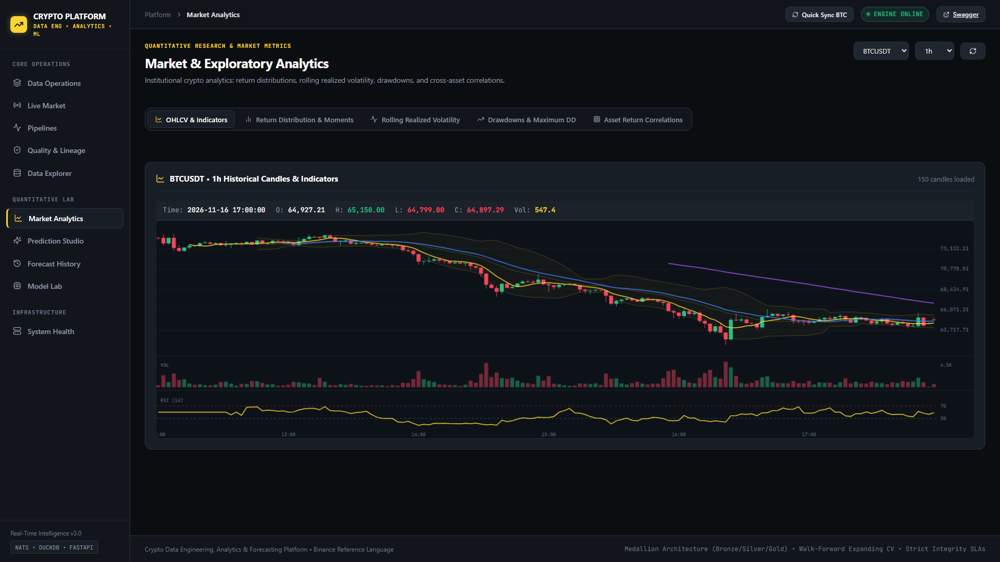
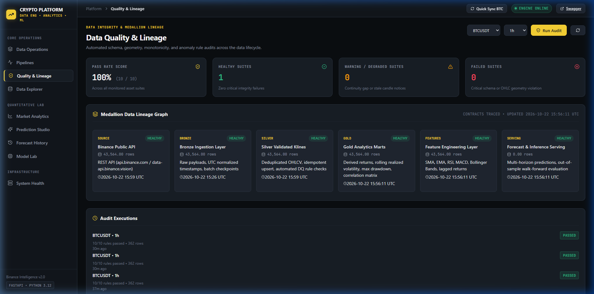
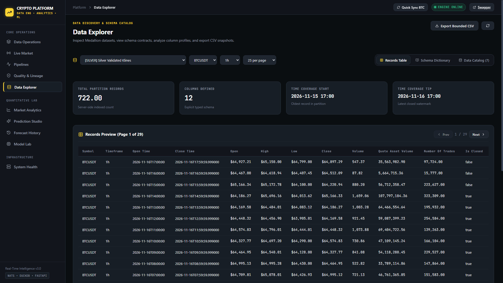
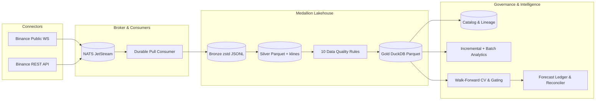

# Resource-Efficient Real-Time Financial Data Intelligence Platform (`v3.0.0`)

[](https://github.com/DungTran1201/CryptocurrencyPriceAnalysis_Forecasting/actions/workflows/ci.yml)
[](https://www.python.org/downloads/)
[](https://fastapi.tiangolo.com)
[](https://nats.io/)
[](https://duckdb.org/)
[](https://react.dev)
[](https://www.typescriptlang.org/)
[](https://opensource.org/licenses/MIT)

A single-node, resource-efficient **Real-Time Streaming Data Lakehouse, Financial Analytics, and Experimental ML Forecasting Platform** engineered to run comfortably on an 8 GB RAM workstation (`lite`, `standard`, and `extended` execution profiles).

The platform executes and monitors the end-to-end 3-plane streaming & batch data lifecycle:
$$\text{Binance WS \& REST} \longrightarrow \text{NATS JetStream} \longrightarrow \text{Bronze (zstd JSONL)} \longrightarrow \text{Silver (Parquet + DQ)} \longrightarrow \text{Gold (DuckDB + Marts)} \longrightarrow \text{Incremental \& Batch Risk Analytics} \longrightarrow \text{Walk-Forward ML \& WS UI}$$

Built with a Binance-inspired dark technical visual language (`#0B0E11` graphite surfaces with restrained `#FCD535` yellow active state), high information density, persistent categorized sidebar navigation across 10 interactive views, strict zero-leakage CPU ML validation, bounded backpressure-aware queues, and honest telemetry—never showing fake zeroes or fabricated production metrics.

---

## Visual Tour of the Platform (v2 Baseline UI + v3 Live Market & Governance Extensions)

The following screenshots are captured directly from the live running application:

### 1. Data Operations Overview (`/overview`)
*Control-plane overview displaying live pipeline telemetry, the 6-stage Medallion Data Lifecycle DAG, KPI SLA adherence, and recent orchestration runs.*


### 2. Market Analytics & Quantitative Research (`/analytics`)
*High-density technical analytics featuring responsive HTML5 Canvas candlestick charting, SMA overlays, return distributions with higher moments ($\mu$, $\sigma$, Skewness, Kurtosis), rolling volatility, and drawdowns.*


### 3. Automated Data Quality & Lineage DAG (`/quality`)
*Data quality engine scoring 10 automated schema, geometry, and continuity rules across Bronze, Silver, and Gold partitions, with interactive lineage DAG tracing upstream Binance sources to model serving.*


### 4. Pipeline Observatory & Task Breakdown (`/pipelines`)
*Task-level execution runner showing sequential execution stages (`ingest_bronze` → `validate_silver` → `build_gold_marts` → `extract_features`) with duration, record counts, and execution logs.*


### 5. Multi-Horizon Prediction Studio (`/studio`)
*Point-in-time multi-step forecast generation with frozen cutoff timestamps, calibrated directional probabilities, and empirical 95% confidence bands.*


### 6. Data Explorer & Catalog (`/explorer`)
*Safe, read-only dataset exploration with schema dictionaries, dataset profiling watermarks, server-side pagination, and bounded CSV data exports.*


### 7. System Health & Diagnostic Center (`/system`)
*Real-time diagnostics covering database connectivity, kline sync checkpoints, deterministic gap detection, and model serving status.*


### 8. Responsive Mobile & Tablet Drawer
*Compact collapsible navigation drawer verified on mobile and tablet viewports (768px).*


---

## Feature Summary & Implementation Status

| Capability / Module | Status | Description |
| :--- | :--- | :--- |
| **Binance WS + REST Ingestion** | `Implemented` | Public `aggTrade` & `kline_1m` streams + idempotent REST backfill with backoff & gap-heal hooks. |
| **NATS JetStream Broker** | `Implemented` | Durable single-node JetStream (`MARKET_EVENTS` + `MARKET_DLQ`), explicit ACK/NAK, replay & bounded backpressure. |
| **Hybrid Medallion Lakehouse** | `Implemented` | Bronze `zstd` JSONL, Silver partitioned Parquet + SQLite WAL metadata, Gold DuckDB/Parquet marts & feature sets. |
| **Catalog, Lineage & Retention** | `Implemented` | Persisted `data_catalog_entries`, `data_lineage_edges`, stream checkpoints, and automated disk retention pruning. |
| **10 Data Quality SLA Rules** | `Implemented` | Programmatic checks for schema, OHLC geometry, nulls, monotonicity, gaps, spikes, and freshness. |
| **Incremental & Batch Analytics** | `Implemented` | 15 metrics (Simple/Log Returns, SMA, EMA, RSI, MACD, BB, ATR14, VWAP, Vol 7/14/30, VaR/CVaR 95/99, MDD, Corr/Cov) with parity tests. |
| **Data Explorer & CSV Export** | `Implemented` | Paginated inspection across Silver, Bronze, Gold marts, features, DQ logs, and forecast records + Data Catalog tab. |
| **Experimental Walk-Forward ML** | `Implemented` | CPU-only `Ridge`, `LogisticRegression`, `HistGradientBoosting` + baselines with strict chronological CV gating ($\ge 1\%$ naive MAE improvement). |
| **Coalesced WebSocket Gateway** | `Implemented` | Bounded per-client coalesced `/api/v1/ws/market` streaming live prices, incremental indicators & broker telemetry. |
| **Observability & Profiles** | `Implemented` | Adaptive `lite`/`standard`/`extended` profiles, `/api/v1/system/resources` budget telemetry, and Prometheus `/metrics`. |
| **Remote MLflow & Docker Stack** | `Optional` | Local SQLite/file Model Registry fallback when MLflow is unconfigured; Compose profiles validated for Docker deployments. |

---

## Technology Stack & Architectural Roles

```
┌─────────────────────────────────────────────────────────────────────────────┐
│                   APPLICATION PLANE (FastAPI + WS + React/Vite)            │
│   • 10 Views incl. Live Market Monitor, Market Analytics, Observatory & Lab │
│   • 38 HTTP REST Routes + Coalesced WS Gateway (/ws/market) + /metrics      │
└──────────────────────────────────────┬──────────────────────────────────────┘
                                       │ REST (JSON) & Coalesced WS Frames
┌──────────────────────────────────────▼──────────────────────────────────────┐
│                       STREAMING & INTELLIGENCE PLANE                        │
│   • Binance WS (aggTrade, kline_1m) & REST -> Bounded Queue -> NATS JS      │
│   • Durable Pull Consumers -> Incremental Rolling Engine -> CPU Walk-Forward│
└──────────────┬───────────────────────┬───────────────────────┬──────────────┘
               │                       │                       │
┌──────────────▼──────────┐ ┌──────────▼──────────┐ ┌──────────▼──────────────┐
│   BRONZE (zstd JSONL)   │ │  SILVER (Parquet)   │ │  GOLD (DuckDB/Parquet)  │
│  • Immutable Raw Events │ │  • Validated OHLCV  │ │  • Financial/Risk Marts │
│  • Local FS / S3 Stub   │ │  • 10 DQ SLA Rules  │ │  • ML Feature Vectors   │
└──────────────┬──────────┘ └──────────┬──────────┘ └──────────┬──────────────┘
               │                       │                       │
┌──────────────▼───────────────────────▼───────────────────────▼──────────────┐
│                 OPERATIONAL METADATA (SQLite WAL / PostgreSQL)              │
│   • Alembic Migrations • symbols, klines, stream_checkpoints, catalog       │
│   • pipeline_runs, data_quality_*, data_lineage_edges, forecasts, models    │
└─────────────────────────────────────────────────────────────────────────────┘
```

- **Streaming & Data Plane**:
  - `Python 3.12.9`: Modern asynchronous runtime (`asyncio`, `websockets`, `httpx`).
  - `NATS JetStream 2.15.3` (`nats-py`): Lightweight single-binary durable message broker (~22.6 MB RSS idle) with pull consumers and DLQ.
  - `PyArrow`, `DuckDB`, `zstandard`, `orjson`: Columnar Silver/Gold Parquet storage, bounded analytical queries, and `zstd` compressed Bronze JSONL.
  - `SQLAlchemy 2.0 (Async) + Alembic`: Metadata catalog, lineage, checkpoints, DQ logs, and forecasts (`aiosqlite` WAL / `asyncpg`).
- **Analytics, ML & Serving**:
  - `NumPy`, `Pandas`, `SciPy`, `scikit-learn`: Vectorized + O(1) incremental indicators, VaR/CVaR/MDD, and CPU walk-forward CV models.
  - `FastAPI 0.115+`, `Pydantic v2`, `prometheus-client`: Typed API contracts, security headers, health probes, and `/metrics`.
- **Frontend**:
  - `React 18`, `TypeScript 5.6`, `Vite 6`, HTML5 Canvas API, `Lucide React`, and dedicated WebSocket hook (`useMarketStream.ts`).

---

## End-to-End Data Lifecycle



1. **Real-Time & Batch Ingestion**: Consumes `aggTrade` + `kline_1m` over WebSocket and historical OHLCV batches over public Binance REST with automatic reconnect and gap recovery.
2. **Bounded JetStream Buffering**: Enqueues normalized schema-versioned events via bounded queues (`high_watermark` flow control, zero silent drops) to NATS JetStream `MARKET_EVENTS` (and `MARKET_DLQ` for malformed/failing payloads).
3. **Bronze Storage**: Micro-batches raw immutable event payloads to date-partitioned `data/bronze/**/*.jsonl.zst`.
4. **Silver Validation & DQ**: Deduplicates and validates OHLC geometry into partitioned Parquet (`data/silver/...`) plus indexed SQLite WAL / PostgreSQL `klines` and runs the 10-rule Data Quality engine.
5. **Gold DuckDB/Parquet Marts**: Materializes `gold_analytics_marts` and `gold_feature_sets` Parquet files queried lazily through memory-capped DuckDB sessions (`128MB` under `lite`).
6. **Governance**: Persists dataset metadata in `data_catalog_entries`, transformation edges in `data_lineage_edges`, durable consumer offsets in `stream_checkpoints`, and enforces retention pruning.
7. **Analytics & Gated ML**: Maintains real-time incremental indicator snapshots alongside batch analytics parity, and enforces $\ge 1\%$ naive MAE improvement before model promotion.
8. **Serving & Reconciliation**: Broadcasts coalesced frames on `/api/v1/ws/market` and reconciles matured forecasts against closed market candles.

---

## Data Quality Rules & SLAs

Every market partition is continuously audited against 10 rigorous programmatic rules:

| Rule ID | Rule Name | Category | Severity | Failure Condition |
| :--- | :--- | :--- | :--- | :--- |
| **DQ-SCH-01** | Schema & Type Adherence | SCHEMA | CRITICAL | Column types differ from float/int/datetime |
| **DQ-NUL-01** | Non-Null Prices & Timestamps | COMPLETENESS | CRITICAL | Null or NaN values detected in OHLCV columns |
| **DQ-UNI-01** | Primary Key Uniqueness | INTEGRITY | CRITICAL | Duplicate `(symbol, timeframe, open_time)` |
| **DQ-ORD-01** | Monotonic Ordering | CONSISTENCY | ERROR | Out-of-order timestamp sequence ($t_i \le t_{i-1}$) |
| **DQ-GAP-01** | Interval Continuity | CONSISTENCY | WARNING | Gap exceeding $1.5\times$ expected timeframe delta |
| **DQ-REL-01** | OHLC Price Geometry | INTEGRITY | CRITICAL | $High < Low$ or extremes fail to bound $Open / Close$ |
| **DQ-VOL-01** | Non-Negative Volume | INTEGRITY | ERROR | Base or quote asset volume $< 0$ |
| **DQ-FUT-01** | Timestamp Temporal Validity | CONSISTENCY | CRITICAL | Candle open timestamp exceeds current UTC time |
| **DQ-OUT-01** | Extreme Price Spike Flag | ANOMALY | WARNING | Single-bar price change $> 35\%$ (flagged for review) |
| **DQ-FRE-01** | Freshness SLA Adherence | COMPLETENESS | WARNING | Latest closed candle exceeds allowable delay window |

---

## Prerequisites

| Tool / Runtime | Minimum Version | Tested Version | Purpose |
| :--- | :--- | :--- | :--- |
| **Python** | `3.12.0` | `3.12.9` | Backend API, streaming consumers, DuckDB analytics, and ML engine |
| **NATS Server** | `2.10.0+` | `2.15.3` | Single-node JetStream message broker (installed via `scripts/install_nats.ps1`) |
| **Node.js** | `18.0.0` | `24.18.0` | Frontend TypeScript development and building |
| **npm** | `9.0.0` | `11.16.0` | Frontend package manager |
| **SQLite** | `3.35.0+` | Built-in | Default asynchronous WAL operational metadata database |
| **PowerShell** | `5.1` / `7+` | `5.1` (Win10/11) | Primary validated development shell |

---

## Windows Setup & Run Guide

### Quick Start (Batch Scripts: `setup.bat` & `run.bat`)
Run once to create `.venv` (Python 3.12+), install Python & frontend dependencies, install `.bin\nats-server.exe`, run Alembic migrations, and build `frontend\dist`:
```cmd
setup.bat
```
Then launch NATS JetStream + FastAPI + Live Streaming + Dashboard (defaults to `lite` profile on `http://127.0.0.1:8000/`):
```cmd
run.bat
```
*(Useful flags: `setup.bat --extended`, `run.bat --open`, `run.bat standard`, `run.bat --port 8080`, `run.bat --check`, `run.bat --stop`.)*

---

### Manual Step-by-Step PowerShell Setup & Run

#### 1. Clone & Enter Repository
```powershell
git clone https://github.com/DungTran1201/CryptocurrencyPriceAnalysis_Forecasting.git
cd CryptocurrencyPriceAnalysis_Forecasting
```

### 2. Configure Environment & Profile
Copy `.env.example` to `.env` (defaults use `PLATFORM_PROFILE=lite`, SQLite WAL, and public Binance feeds):
```powershell
Copy-Item .env.example .env
```

### 3. Setup Python Environment & Local NATS Binary
```powershell
py -3.12 -m venv .venv
.\.venv\Scripts\python.exe -m pip install --upgrade pip
.\.venv\Scripts\python.exe -m pip install -r requirements.txt

# Install local single-binary NATS Server into .bin\nats-server.exe
.\scripts\install_nats.ps1
```

### 4. Apply Alembic Database Migrations
```powershell
$env:PYTHONPATH = "."
.\.venv\Scripts\alembic.exe upgrade head
```

### 5. Install Frontend Dependencies & Compile Bundle
```powershell
cd frontend
npm install
npm run build
cd ..
```
*`npm run build` outputs compiled assets into `frontend/dist`, served directly by FastAPI at `http://127.0.0.1:8000/`.*

### 6. Start the Platform (`LITE` Profile)

#### Option A: One-Step Helper (`NATS` + `FastAPI` + Streaming Runtime + Static UI)
```powershell
.\scripts\start_lite.ps1
```

#### Option B: Manual Two-Terminal Startup (or Separate Worker Process)
```powershell
# Terminal 1: Start NATS JetStream
.\scripts\start_nats.ps1

# Terminal 2: Start FastAPI + embedded streaming runtime & UI
$env:PYTHONPATH = "."
$env:PLATFORM_PROFILE = "lite"
$env:STREAM_ENABLED = "true"
$env:STREAM_EMBEDDED_IN_API = "true"
.\.venv\Scripts\uvicorn.exe backend.app.main:app --host 127.0.0.1 --port 8000
```
*Optional decoupled worker mode: set `$env:STREAM_EMBEDDED_IN_API = "false"` and run `.\.venv\Scripts\python.exe -m backend.app.workers.stream_worker` in a separate terminal.*

Open your browser to **`http://127.0.0.1:8000/`** (live Swagger UI at `http://127.0.0.1:8000/docs`, Prometheus metrics at `http://127.0.0.1:8000/metrics`).

*(For Docker Compose profiles `lite` / `standard` / `extended`, see `README_INSTALL.md` and `docker/docker-compose.yml`.)*

---

## Running Data Synchronization & Pipelines

Synchronize historical klines or trigger full Bronze -> Silver -> Gold pipelines using JSON payloads:

```powershell
# Synchronize BTCUSDT 1h candles from Binance public REST API
$syncBody = @{ symbol = "BTCUSDT"; timeframe = "1h"; limit = 500 } | ConvertTo-Json
Invoke-RestMethod -Uri "http://127.0.0.1:8000/api/v1/market/sync" -Method POST -Body $syncBody -ContentType "application/json"

# Trigger synchronous full Medallion pipeline (Bronze + Silver + DQ + Gold Marts & Features)
$pipeBody = @{ pipeline_name = "medallion_full_sync"; symbol = "BTCUSDT"; timeframe = "1h"; sync_mode = "sync" } | ConvertTo-Json
Invoke-RestMethod -Uri "http://127.0.0.1:8000/api/v1/pipelines/trigger" -Method POST -Body $pipeBody -ContentType "application/json"
```

---

## API Documentation & Route Specifications

The backend exposes **38 HTTP REST routes**, **1 WebSocket gateway** (`/api/v1/ws/market`), plus root **Prometheus `/metrics`** and static SPA hosting. Interactive API documentation is available at:
- **Swagger UI**: `http://127.0.0.1:8000/docs`
- **ReDoc**: `http://127.0.0.1:8000/redoc`

### Complete Endpoint Reference

| Category | Method | Endpoint | Description |
| :--- | :--- | :--- | :--- |
| **System & Ops** | `GET` | `/api/v1/health` | Service liveness, version, and health probe |
| | `GET` | `/api/v1/system/status` | Database connectivity, checkpoints, active profile, and sync state |
| | `GET` | `/api/v1/system/resources` | Live process RSS MB, CPU %, host free RAM, per-layer disk MB, and budget limits |
| | `GET` | `/metrics` | Prometheus text exposition format metrics |
| **Streaming & WS** | `GET` | `/api/v1/streaming/status` | NATS JetStream lag, queue depth, backpressure state, and incremental symbol snapshots |
| | `GET` | `/api/v1/streaming/dlq` | Inspect quarantined Dead-Letter Queue messages |
| | `POST` | `/api/v1/streaming/flush` | Flush pending micro-batch buffers to Bronze/Silver storage |
| | `POST` | `/api/v1/streaming/replay` | Replay messages from NATS JetStream by sequence/stream |
| | `POST` | `/api/v1/streaming/simulate-disconnect` | Controlled WS disconnect probe to verify reconnect & gap-heal recovery |
| | `WS` | `/api/v1/ws/market` | Coalesced real-time price, incremental indicator & pipeline health WebSocket feed |
| **Governance** | `GET` | `/api/v1/governance/catalog` | Persistent Medallion Data Catalog entries and owners |
| | `GET` | `/api/v1/governance/checkpoints` | Durable stream consumer checkpoints (`stream_checkpoints`) |
| | `POST` | `/api/v1/governance/retention/run` | Execute Bronze/Silver/Gold retention pruning policy |
| **Pipelines** | `GET` | `/api/v1/pipelines/overview` | Pipeline runs summary, success rate, duration |
| | `GET` | `/api/v1/pipelines/runs` | Filterable list of historical pipeline runs |
| | `GET` | `/api/v1/pipelines/runs/{run_id}` | Task stage breakdown, ingested rows, and execution logs |
| | `POST` | `/api/v1/pipelines/trigger` | Trigger synchronous or asynchronous Medallion pipeline run |
| **Data Quality** | `GET` | `/api/v1/data-quality/overview` | Overall quality pass rates and active rules summary |
| | `GET` | `/api/v1/data-quality/lineage` | Persisted Medallion lineage DAG from `data_lineage_edges` |
| | `GET` | `/api/v1/data-quality/runs` | Historical quality audit runs ledger |
| | `GET` | `/api/v1/data-quality/runs/{run_id}` | Detailed rule results and violation samples |
| | `POST` | `/api/v1/data-quality/evaluate` | Trigger on-demand quality evaluation on active symbol/timeframe |
| **Data Explorer** | `GET` | `/api/v1/data-explorer/datasets` | Registered dataset catalog (`silver_klines`, `bronze_market_events`, Gold marts, etc.) |
| | `GET` | `/api/v1/data-explorer/preview` | Paginated partition inspection with profile statistics |
| | `GET` | `/api/v1/data-explorer/export` | Download bounded dataset partitions as CSV |
| **Analytics** | `GET` | `/api/v1/analytics/returns` | Return distributions, moments, VaR/CVaR (95%/99%), ATR14, VWAP, and histogram |
| | `GET` | `/api/v1/analytics/volatility` | Rolling annualized realized volatility (`7, 14, 30` periods) |
| | `GET` | `/api/v1/analytics/drawdowns` | Cumulative peak series, drawdown %, and Maximum Drawdown |
| | `GET` | `/api/v1/analytics/correlations` | Pairwise Pearson correlation & covariance matrices across assets |
| | `GET` | `/api/v1/analytics/incremental` | Real-time O(1) incremental per-symbol indicator & risk state |
| **Market** | `GET` | `/api/v1/market/symbols` | Supported cryptocurrency trading pairs and sync status |
| | `GET` | `/api/v1/market/klines` | Validated OHLCV candlestick bars and technical indicators |
| | `POST` | `/api/v1/market/sync` | Incremental candle synchronization from Binance REST API |
| **Forecasts** | `GET` | `/api/v1/forecasts` | Paginated immutable forecast history ledger |
| | `POST` | `/api/v1/forecasts/generate` | Generate multi-horizon price & direction prediction (honors baseline fallback) |
| | `POST` | `/api/v1/forecasts/reconcile` | Reconcile matured pending forecasts against closed candle outcomes |
| **Models** | `GET` | `/api/v1/models` | Registered models and walk-forward CV metrics |
| | `GET` | `/api/v1/models/experiments` | Experiment runs, hyperparameters, and evaluation metrics |
| | `GET` | `/api/v1/models/tracking-status` | Probe remote MLflow server vs `LOCAL_REGISTRY_FALLBACK` |
| | `POST` | `/api/v1/models/train` | Execute CPU walk-forward CV with naive baseline gating |

---

## Verification, Benchmarking & Testing Suite

All unit/integration tests run locally without external network calls (`InMemoryBroker` + isolated async SQLite fixtures), plus live NATS/Binance acceptance checks when connected:

```powershell
# 1. Backend Pytest Suite (contracts, DQ, Medallion, streaming, financial parity, security)
$env:PYTHONPATH = "."
$env:APP_ENV = "testing"
.\.venv\Scripts\python.exe -m pytest tests/ -v

# 2. Resource & Latency Benchmark (LITE or STANDARD profile)
.\.venv\Scripts\python.exe scripts\benchmark_platform.py --profile lite

# 3. Frontend Unit Tests & Production Build
cd frontend
npm test
npm run build
cd ..
```

---

## Troubleshooting Guide

| Issue / Symptom | Root Cause | Solution |
| :--- | :--- | :--- |
| `ModuleNotFoundError: No module named 'backend'` | Python cannot locate package root | Set `$env:PYTHONPATH = "."` in PowerShell before running `uvicorn` or `pytest`. |
| `Port 8000 already in use` | Another process is holding port 8000 | Find and terminate: `Get-Process -Id (Get-NetTCPConnection -LocalPort 8000).OwningProcess \| Stop-Process` or use `--port 8080`. |
| Missing or stale market data | Fresh installation without synced candles | Send JSON `{"symbol": "BTCUSDT", "timeframe": "1h", "limit": 500}` to `POST /api/v1/market/sync` or trigger a pipeline from the UI. UI displays unavailable state rather than fake zeroes. |
| NATS JetStream unavailable | Local `nats-server.exe` not running | Run `.\scripts\install_nats.ps1` once, then start with `.\scripts\start_nats.ps1` (or launch everything with `.\scripts\start_lite.ps1`). |
| Binance rate limit error (HTTP 429) | Exceeded public request limits | Backoff is automatic. The application retries with exponential backoff up to 5 times. Alternatively, wait 60 seconds. |
| Database table missing error | Migrations not applied | Run `$env:PYTHONPATH = "."; .\.venv\Scripts\alembic.exe upgrade head`. |
| CORS origin blocked in frontend dev | Port 5173 not permitted | Ensure `http://localhost:5173` is present in `CORS_ORIGINS` in `.env` (it is enabled by default). |

---

## Limitations & Disclaimer

> [!IMPORTANT]
> **Experimental Research Platform**: The predictive models and forecasting outputs provided by this software are for computational and exploratory research purposes only. Cryptocurrency markets are highly volatile and influenced by macroeconomic, regulatory, and systemic factors.
> 
> **No Financial Advice**: Nothing in this repository constitutes financial, investment, or trading advice. Past performance or backtested walk-forward metrics do not guarantee future returns. The authors and maintainers assume no liability for financial losses incurred through the use of this software.

---

## Reference & Attribution

- **Binance Public Market Data**: Provided via public REST API endpoints (`data-api.binance.vision`).
- **Design References**:
  - `DungTran1201/AgentHarnessBuilderTools`: Persistent category sidebar layout, telemetry topbar, and status badges.
  - `Binance Official Visual Language`: Deep graphite surfaces (`#0B0E11`, `#181A20`), restrained yellow primary action token (`#FCD535`), semantic market colors (`#2EBD85` Buy, `#F6465D` Sell).
  - `IBM Carbon Design System`: Enterprise data visualization hierarchy and quantitative dashboard blocks.
  - `Ant Design & shadcn/ui`: High-density tables, status badge typography, and shimmer loading skeletons.

---

## License

This project is licensed under the **MIT License**. See the [LICENSE](LICENSE) file for complete details.