# Resource-Efficient Single-Node Financial Data Intelligence Architecture

**Version:** 3.0.0 (Target Architecture Specification)  
**Target Environment:** Single-node workstation (Intel i5-12400F, 8 GB RAM, constrained C: disk)

---

## 0. Target vs. Currently Implemented Status (Phase 14 Verification)

> [!NOTE]
> The single-node 3-plane real-time platform (`v3.0.0`) is **implemented** on host native Windows (`LITE` / `STANDARD` code paths), including:
> - **Implemented & Verified**: Binance public WebSocket (`aggTrade`, `kline_1m`) + REST backfill -> canonical event normalizer -> bounded producer queue with backpressure -> NATS JetStream (`2.15.3`, durable pull consumer, explicit ACK/NAK/DLQ/replay) -> micro-batch Bronze (`zstd` JSONL) -> Silver (partitioned Parquet + SQLite WAL metadata) -> Gold (DuckDB + Parquet marts & ML feature sets), 10-rule Data Quality SLA, persisted Data Catalog (7 datasets) & Lineage DAG, retention policy enforcement, 15 incremental + batch financial/risk analytics, CPU scikit-learn walk-forward CV with naive baseline gating, forecast ledger & post-close reconciler, coalesced WS gateway (`/api/v1/ws/market`), Prometheus `/metrics`, and the 10-view React/TypeScript/Vite frontend.
> - **Validated Config Only / Not Runtime-Executed**: Docker Compose profiles (`lite`, `standard`, `extended` validated with `docker compose config --quiet`), optional EXTENDED containers (MinIO, Prometheus, Grafana), external PostgreSQL server runtime (migrations & SQLite WAL executed; live Postgres server not started due to stopped Docker Desktop and ~1.4-1.5 GB free RAM constraint on the 8 GB host), and remote MLflow server (`NOT_CONFIGURED` -> local SQLite/file fallback active).

---

## 1. Three-Plane Logical Architecture

1. **DATA PLANE:** External connectors (Binance WS + REST) -> Canonical Event Normalizer -> Bounded Queue -> NATS JetStream Broker -> Durable Pull Consumers -> Micro-Batch Bronze (`zstd` JSONL) -> Validated Silver (Partitioned Parquet + SQLite/Postgres metadata) -> Materialized Gold (DuckDB + Parquet Marts) -> Data Quality, Data Catalog, Data Lineage, Checkpoints, Replay, Retention.
2. **INTELLIGENCE PLANE:** Incremental Per-Symbol Analytics & Feature State (SMA, EMA, RSI, MACD, BB, ATR, VWAP, Returns, Log Returns, Volatility, VaR, CVaR, MDD, Correlation, Covariance) + Independent Batch Reference Analytics -> Offline Feature Generator -> CPU-Friendly ML Training (`Ridge`, `LogisticRegression`, `HistGradientBoosting`, Baselines) -> Walk-Forward CV & Gating -> Model Registry -> Triggered Realtime Inference -> Forecast Ledger & Reconciliation.
3. **APPLICATION PLANE:** FastAPI REST API + Coalesced WebSocket Gateway (`/api/v1/ws/market`) + Prometheus `/metrics` + Static React/Vite UI (Data Operations Overview, Live Market Monitor, Data Explorer & Catalog, Data Quality & Lineage, Pipeline Observatory, Financial & Risk Analytics, Prediction Studio, Forecast History, Model Lab, System Health).

---

## 2. Architecture Diagrams

### 2.1 System Context
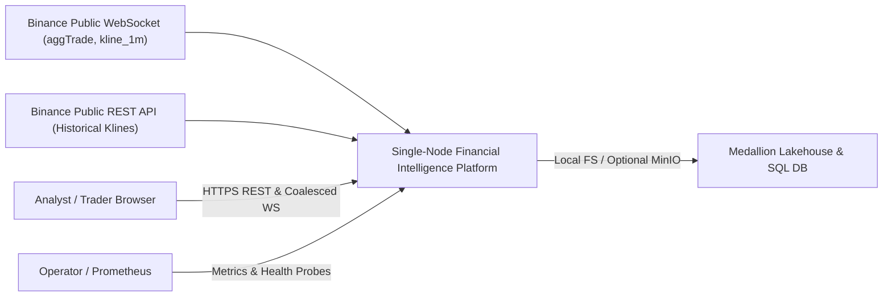

### 2.2 Three-Plane Architecture
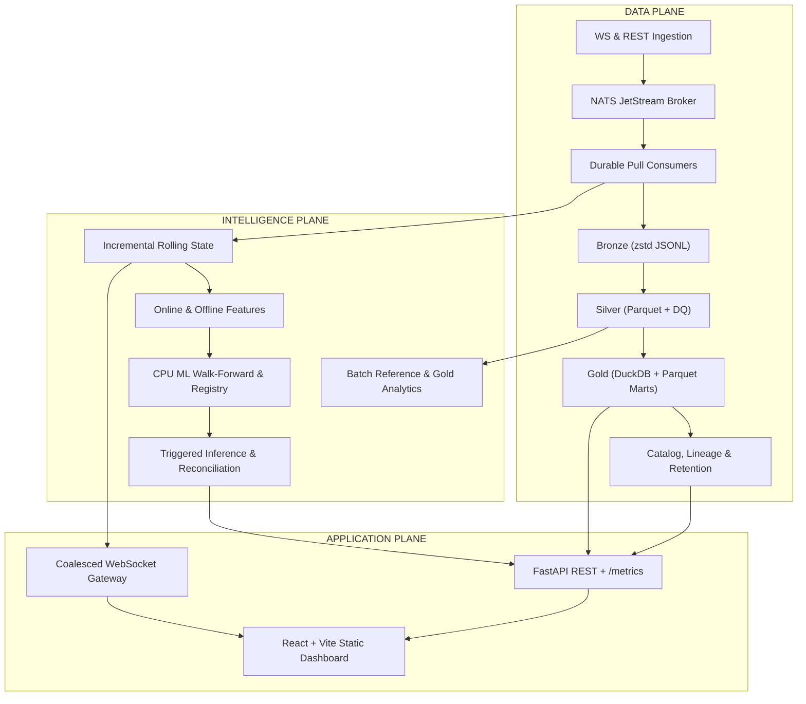

### 2.3 Component Relationships
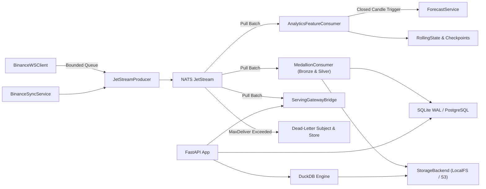

### 2.4 Ingestion Flow & Event Semantics
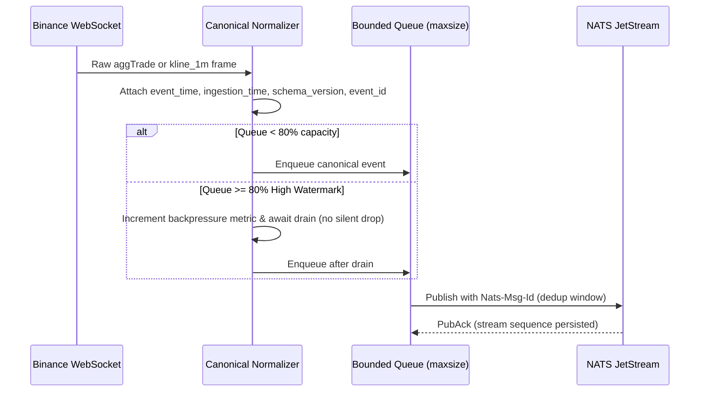

### 2.5 Broker and Consumer Flow
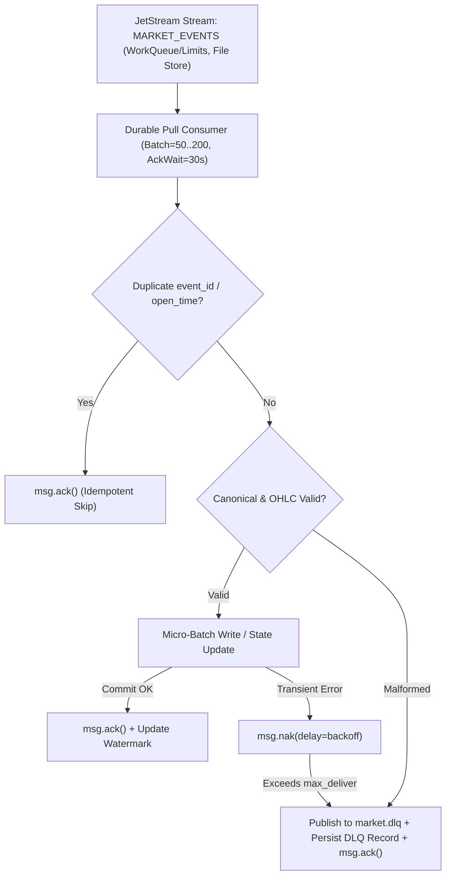

### 2.6 Medallion Flow
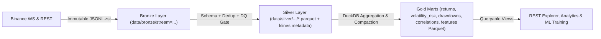

### 2.7 Database ERD (Operational Metadata)
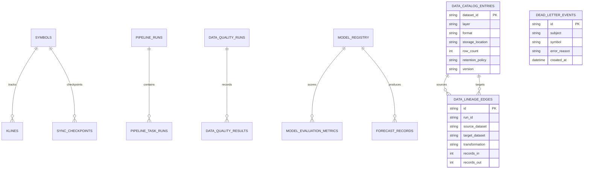

### 2.8 Data Catalog and Lineage
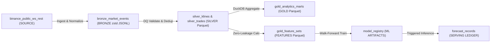

### 2.9 Financial Analytics (Incremental + Batch Reference)
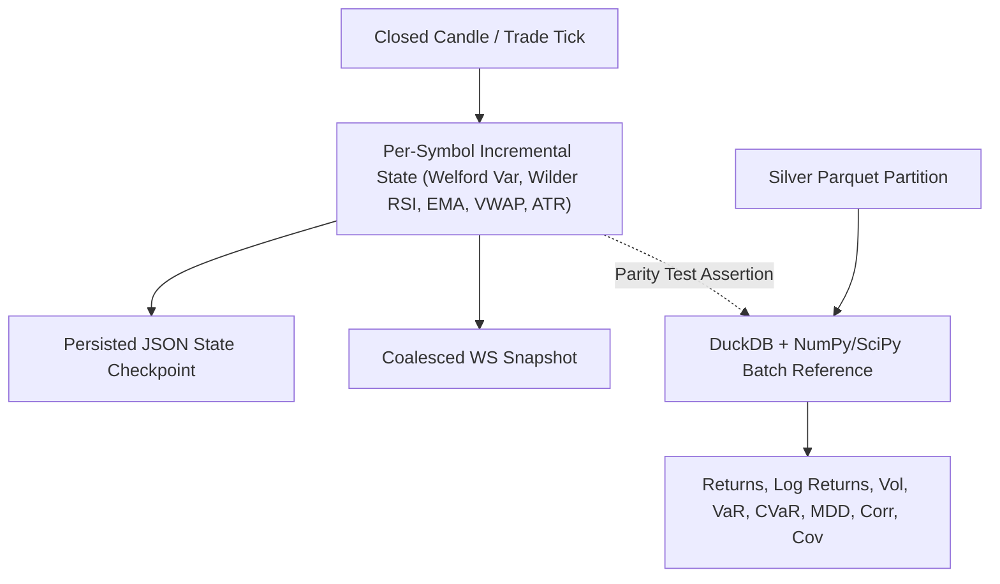

### 2.10 ML Pipeline
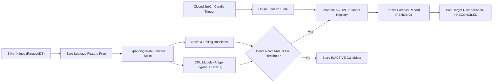

### 2.11 Deployment Architecture (Adaptive Profiles)
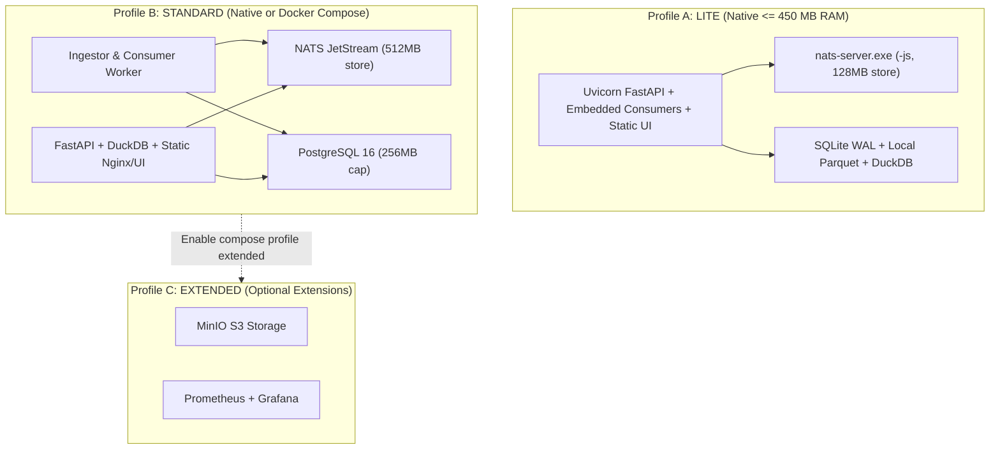

### 2.12 Failure Recovery
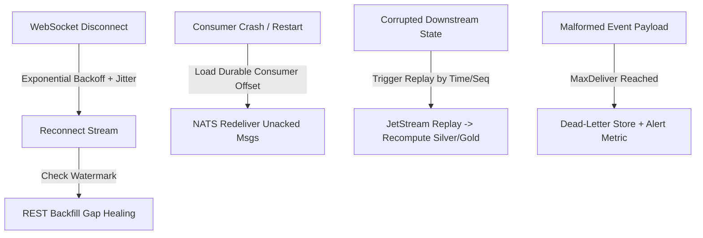

---

## 3. Streaming, Storage, Resource & Security Policies

### Streaming Semantics
- **Event Time (`event_time`)**: Exchange candle open/close or trade timestamp (`T` / `E` from Binance), stored in UTC.
- **Ingestion Time (`ingestion_time`)**: UTC timestamp recorded when the WS/REST connector receives the frame.
- **Processing Time (`processing_time`)**: UTC timestamp recorded when a consumer processes/persists the record.
- **Partition Key**: `symbol` (for NATS subject sharding `market.<stream>.<symbol>`) and `(source, event_type, dt, symbol)` for Parquet paths.
- **Watermark & Late Events**: Per-symbol high-watermark tracks latest closed `open_time`. If a late/corrected closed candle arrives (`open_time <= watermark`), consumers upsert idempotently (`(symbol, timeframe, open_time)`), rewrite the affected daily Silver partition, mark Gold mart stale for recomputation, and log a late-event metric.

### Security Architecture
- No Binance API keys required (public market data only).
- Strict input validation on symbols (`^[A-Z0-9]{3,20}$`), timeframes, dataset identifiers, and pagination bounds.
- CORS restricted to configured origins; security response headers (`X-Content-Type-Options`, `X-Frame-Options`, `Referrer-Policy`) enforced.
- Sanitized HTTP/WS errors (no tracebacks, SQL, env vars, or filesystem paths exposed publicly).
- Optional API admin token (`ADMIN_API_TOKEN`) support for privileged mutation endpoints when deployed beyond localhost.

