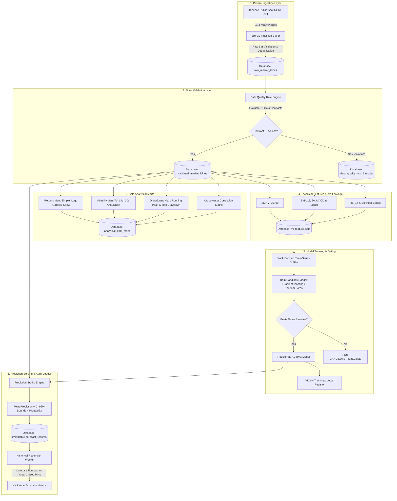
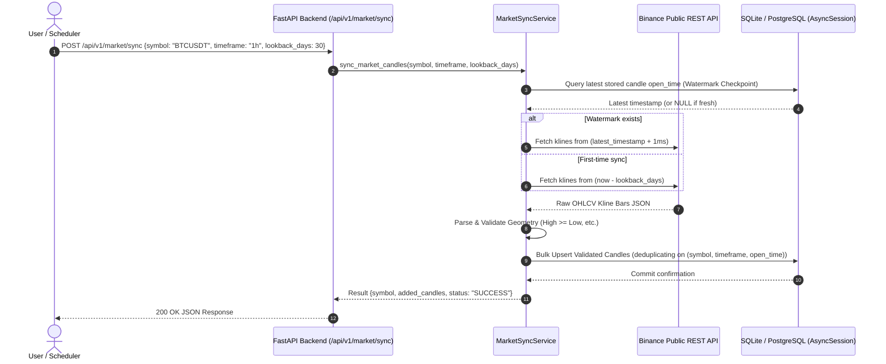
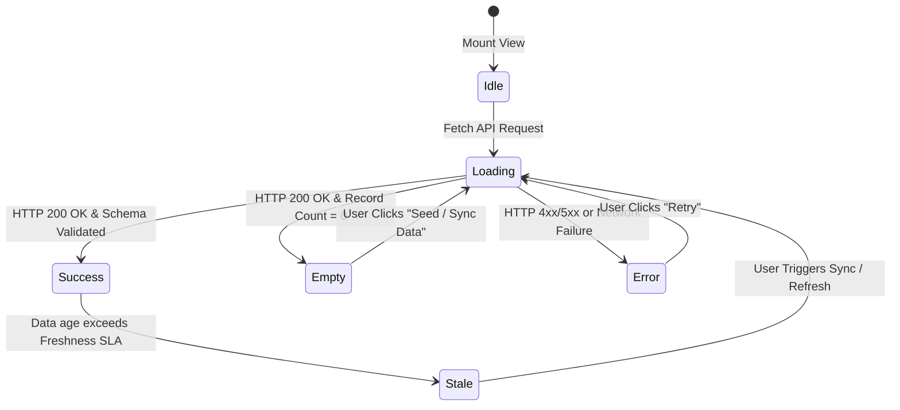

# Enterprise Data Flow & Lifecycle Architecture

**Document Version**: 2.0.0  
**Application**: Binance Predict Value & Trend  
**Layered Architecture**: Medallion Pipeline (Bronze $\rightarrow$ Silver $\rightarrow$ Gold $\rightarrow$ Features $\rightarrow$ Serving)

---

## 1. End-to-End Medallion Data Lifecycle

---

## 2. Market-Data Ingestion & Incremental Synchronization

---

## 3. Synchronous vs Asynchronous Task Execution

| Workflow Stage | Execution Mode | Database Session Owner | Error Handling & Observability |
| :--- | :--- | :--- | :--- |
| **Incremental Sync** (`/market/sync`) | Synchronous (bounded to 1000 candles per batch) | Route handler `AsyncSession` | Returns HTTP 400/502 with error details; rolls back transaction on error. |
| **Full Pipeline Trigger** (`/pipelines/trigger?sync_mode=false`) | Asynchronous Background Task (`FastAPI.BackgroundTasks`) | Worker-dedicated `AsyncSession` context manager | Writes execution state (`RUNNING` $\rightarrow$ `SUCCESS` / `FAILED`) to `pipeline_runs` table with detailed stage logs. |
| **Data Quality Audit** (`/data-quality/evaluate`) | Synchronous or Background | Isolated session per audit run | Records per-rule pass/fail count, severity, and violation payload samples. |
| **Walk-Forward Model Training** (`/models/train`) | Synchronous compute (bounded sample size) | Dedicated session | Enforces baseline promotion gatekeeper; logs MAE, RMSE, and MAPE metrics. |
| **Forecast Reconciliation** (`/forecasts/reconcile`) | Synchronous batch reconcile | Dedicated session | Reconciles open forecasts against closed bars and marks them `RECONCILED`. |

---

## 4. Frontend State Machine & Error Handling

