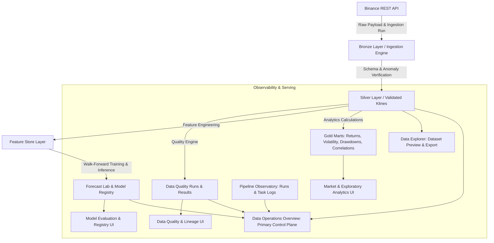

# Comprehensive Current-State Audit: Binance Predict Value & Trend

**Date**: 2026-10-22  
**Auditor**: Senior Data & Platform Engineering Agent  
**Repository**: [Binance-Predict-Value-And-Trend](https://github.com/DungTran1201/Binance-Predict-Value-And-Trend)  
**Git Branch**: `main` @ commit `843c107` (Clean working tree)  

---

## 1. Executive Summary & Context Verification

A thorough inspection of the workspace was conducted across backend models, services, routers, tests, data layers, and the React frontend. 

The application recently received critical stability and contract fixes:
- The `ResponseValidationError` on empty klines was resolved with explicit contract fulfillment (`count: 0`, `candles: []`, `indicators: {}`).
- False-zero price rendering was eliminated through nullable types and explicit market sync status flags (`SYNCHRONIZED`, `PARTIAL`, `UNAVAILABLE`, `STALE`).
- Backend test suite passes (20/20 tests green in ~3.0s).
- Frontend TypeScript type checking and production build compile cleanly (`tsc && vite build`).

However, from a **Data Engineering, Analytics Engineering, and ML Observability** perspective, the platform currently functions primarily as an operational candlestick dashboard with point-in-time forecasting. It lacks an end-to-end data platform lifecycle: structured Medallion data stages, persisted pipeline orchestration, automated data quality rule scoring, exploratory analytics (return distributions, rolling volatility, cross-asset correlations, drawdowns), dataset profiling, and experiment tracking observability.

---

## 2. Findings Matrix

| Finding ID | Domain | Description | File Path Evidence | Severity | Verification Status |
| :--- | :--- | :--- | :--- | :--- | :--- |
| **AUD-01** | **Orchestration** | **Absence of Persisted Pipeline Runs & Lineage State**: Ingestion runs via ephemeral background tasks (`sync_service.py:sync_incremental`). There are no database tables tracking pipeline runs, task stages, dependencies, row throughput, watermarks, duration, or retry state. Status cannot be audited post-execution. | `backend/app/services/sync_service.py#L271-L338`, `backend/app/api/v1/market.py#L90-L105` | **HIGH** | **CONFIRMED** |
| **AUD-02** | **Data Quality** | **No Formal Data Quality Engine or Rule Persistence**: Basic validation occurs during parsing (`parse_kline_payload`), but there is no rule evaluation framework (schema, null checks, duplicate keys, monotonic timestamps, OHLC integrity, volume $\ge 0$, statistical outlier jumps). Validation runs and rule results are not persisted or observable. | `backend/app/services/sync_service.py#L132-L178` | **HIGH** | **CONFIRMED** |
| **AUD-03** | **Data Architecture** | **Incomplete Medallion Architecture**: Data goes straight into `klines` without separating Bronze (raw source payload metadata, batch timestamps), Silver (validated, deduplicated, gap-checked bars), Gold (analytical marts: returns, volatility, drawdowns), and Features (versioned training/inference feature sets). | `backend/app/models/market.py#L30-L62` | **MEDIUM** | **CONFIRMED** |
| **AUD-04** | **Analytics** | **Limited Exploratory Analytics**: The market service computes standard technical indicators (SMA, EMA, RSI, MACD, Bollinger Bands) on the fly, but lacks institutional analytics: log/simple return distributions (skewness, kurtosis), rolling realized volatility, max drawdowns, and pairwise cross-asset correlation matrices. | `backend/app/services/market_service.py#L120-L245` | **MEDIUM** | **CONFIRMED** |
| **AUD-05** | **Data Access** | **No Data Explorer or Dataset Profiling**: There is no safe, read-only UI or API endpoint for users/analysts to inspect datasets, view column data dictionaries, analyze missingness/distribution statistics, or download bounded CSV extracts. | `backend/app/api/v1/` (absent) | **MEDIUM** | **CONFIRMED** |
| **AUD-06** | **ML Observability** | **External MLflow / Experiment Tracking Unconnected**: The system maintains an internal `model_registry` table, but lacks an adapter to inspect external MLflow experiments or display honest unavailable/fallback status when an external tracking server is not configured. | `backend/app/services/model_service.py#L25-L60` | **LOW** | **CONFIRMED** |
| **AUD-07** | **Product & UX** | **Dashboard Defaults to Retail Chart Instead of Data Platform Control Plane**: The primary landing tab (`MarketOverview.tsx`) is a candlestick chart. The system lacks a primary Data Operations Overview control plane featuring pipeline KPI cards, data freshness watermarks, data quality pass/fail scorecards, and run volume trends. | `frontend/src/App.tsx#L20-L80`, `frontend/src/views/MarketOverview.tsx` | **MEDIUM** | **CONFIRMED** |
| **AUD-08** | **Environment** | **Heavy Distributed Frameworks (Prefect, MLflow, Evidently) Not Pre-installed**: Inspection of `.venv` confirms `scipy`, `pandas`, `sklearn`, `sqlalchemy`, and `fastapi` are present, but `prefect`, `mlflow`, `pandera`, and `evidently` are absent. A modular Python orchestration and quality engine with clean adapter interfaces is required to prevent breaking local execution. | Python environment verification script | **INFORMATIONAL** | **CONFIRMED** |

---

## 3. Detailed Technical Analysis

### 3.1 Data Pipeline & Orchestration (`AUD-01`)
- **Current State**: `BinanceSyncService.sync_incremental` pulls klines from Binance REST API in 1000-candle batches and stores them into the `klines` table. `SyncCheckpoint` only records `last_close_time`, `total_candles`, and `last_sync_status`.
- **Defect/Gap**: No audit trail of historical runs exists. If a sync fails midway, there is no run ID, task failure log, retry counter, or duration record.
- **Remediation**: Create `PipelineRun` and `PipelineTaskRun` models in `backend/app/models/pipeline.py`. Implement `PipelineOrchestrationService` that runs tasks (Ingest Bronze → Validate Silver → Build Gold Marts → Extract Features) with real status transitions (`RUNNING`, `SUCCESS`, `FAILED`), execution watermarks, row counts, and logs.

### 3.2 Data Quality & Lineage (`AUD-02`)
- **Current State**: `parse_kline_payload` casts fields to float/int and checks if `close_time <= now_utc`.
- **Defect/Gap**: No programmatic validation suite exists to verify:
  1. Schema compliance & types
  2. Null or NaN values in mandatory fields
  3. Key uniqueness (`symbol`, `timeframe`, `open_time`)
  4. Monotonic timestamp progression
  5. OHLC logical relationships (`high >= low`, `high >= open`, `high >= close`, `low <= open`, `low <= close`)
  6. Non-negative volume
  7. Statistical price jumps / outlier anomalies
  8. Missing interval gap detection
- **Remediation**: Implement `backend/app/services/data_quality_service.py` with structured rule checks, persisting each validation execution into `data_quality_runs` and `data_quality_results`. Expose a lineage map tracing Binance API → Bronze → Silver → Gold → Features → Models.

### 3.3 Analytics & Data Exploration (`AUD-04`, `AUD-05`)
- **Current State**: Only klines with standard technical indicators are returned.
- **Defect/Gap**: Analytics engineers and quantitative researchers need return distributions (mean, median, standard deviation, skewness, kurtosis), rolling realized volatility across multiple windows, price drawdowns, and pairwise cross-asset correlation matrices.
- **Remediation**: Create `backend/app/services/analytics_service.py` to calculate exact mathematical formulations for returns, volatility, drawdowns, and asset correlations. Create `backend/app/api/v1/analytics.py` and `backend/app/api/v1/data_explorer.py` with server-side pagination, summary profiles, and bounded CSV exports.

---

## 4. Architecture Plan & Target State

---

## 5. Non-Negotiable Commitments
1. **Zero Fabricated Metrics**: All pipeline runs, data quality pass/fail rates, rows processed, and analytical metrics will be sourced directly from the SQLite/PostgreSQL database and live computation.
2. **Backward Compatibility**: Existing routes (`/api/v1/market/*`, `/api/v1/forecast/*`, `/api/v1/models/*`, `/api/v1/system/*`) and their test suites will remain 100% operational.
3. **Graceful Degraded States**: External integrations (such as remote MLflow servers or Prefect servers) will report honest statuses (`DISCONNECTED` or `FALLBACK_LOCAL_ADAPTER`) without crashing the application.
