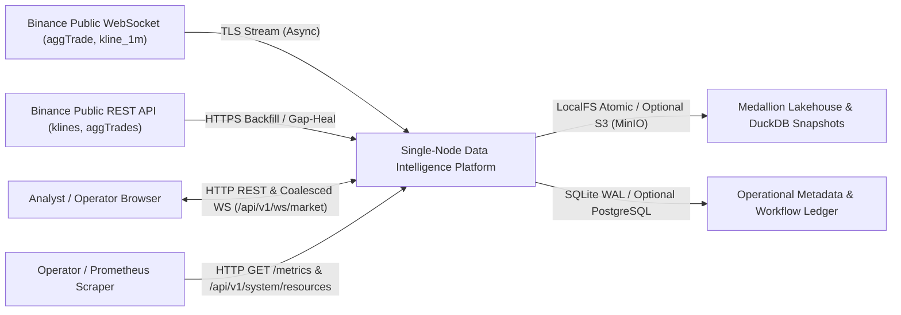
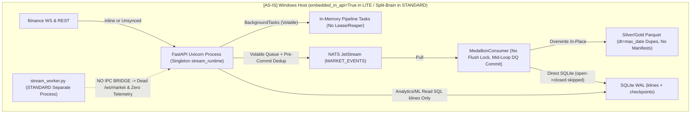
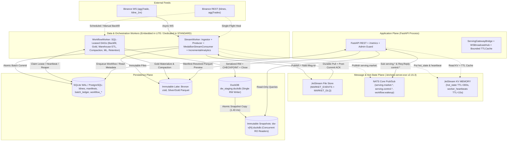
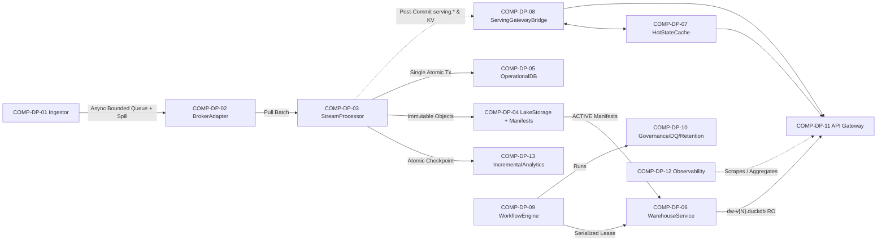
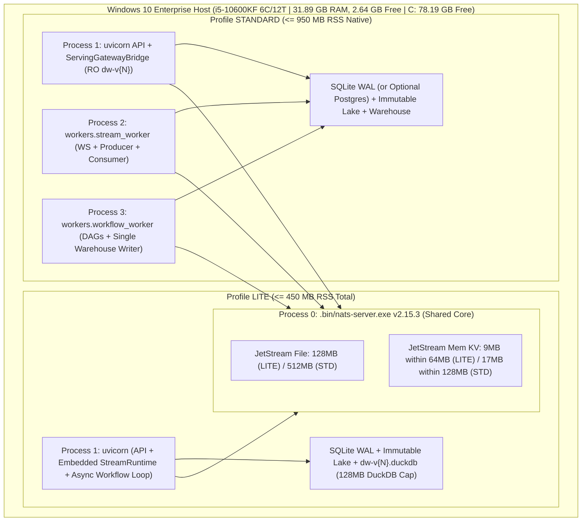
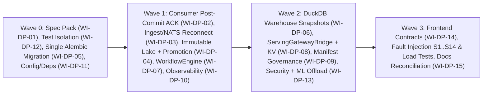

# Data Plane Architecture Diagrams

**Document ID:** `DOC-DP-20-DIAGRAMS`  
**Version:** `1.0.0`  
**Status:** `APPROVED_PHASE_1_BASELINE`  
**Legend:** Every diagram is explicitly tagged `[AS-IS]`, `[TO-BE]`, or `[TRANSITION]`. Solid arrows denote synchronous or primary data flows; dashed arrows (`-.->`) denote asynchronous control, wakeups, metadata, or read paths.

---

## 1. `[TO-BE]` System Context Diagram

---

## 2. `[AS-IS]` C4 Container & Coupling Diagnosis (Observed Defects `#7`, `#8`, `#9`)

---

## 3. `[TO-BE]` C4 Container Diagram (Decoupled Processes, Unified Contracts)

---

## 4. `[TO-BE]` Component Architecture (`COMP-DP-01..13`)

---

## 5. `[TO-BE]` Deployment & Single-Node Resource Allocation Diagram

---

## 6. `[TRANSITION]` Phased Upgrade Roadmap (`Wave 0` -> `Wave 3`)

