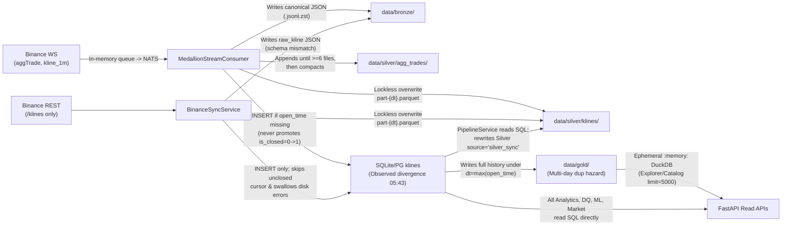
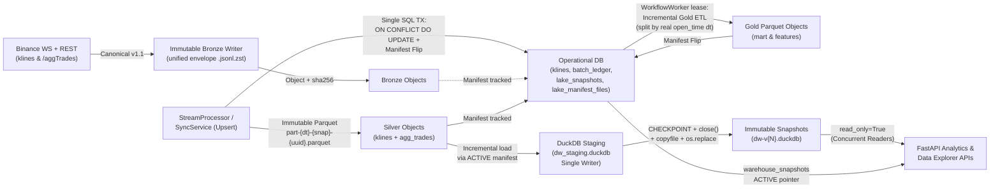
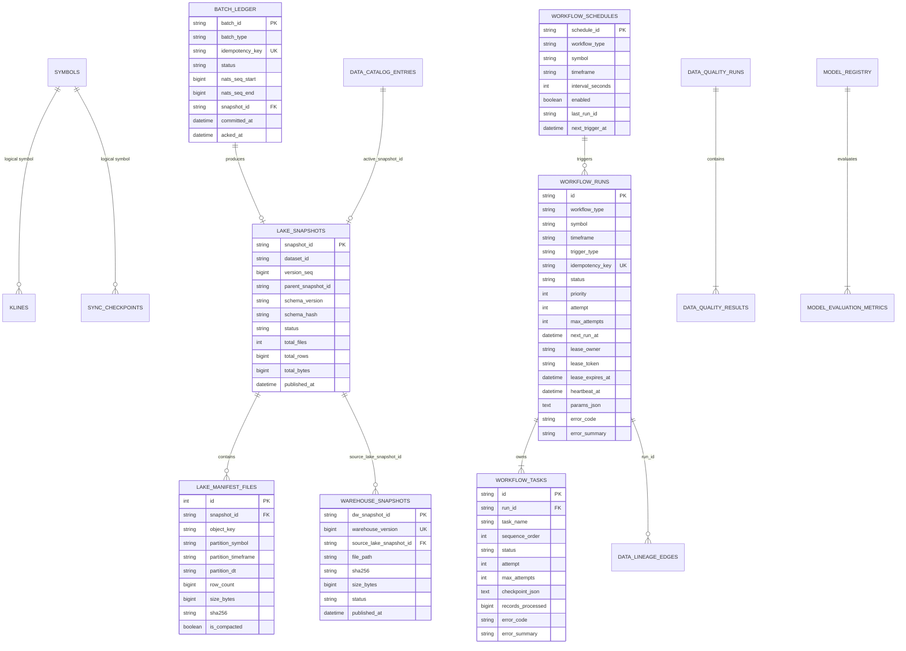
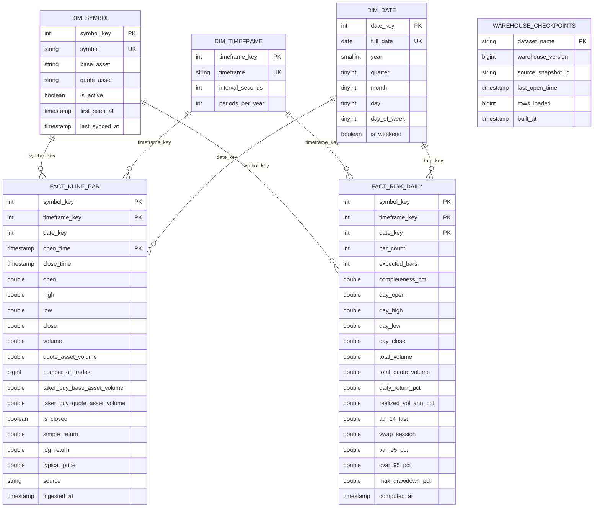
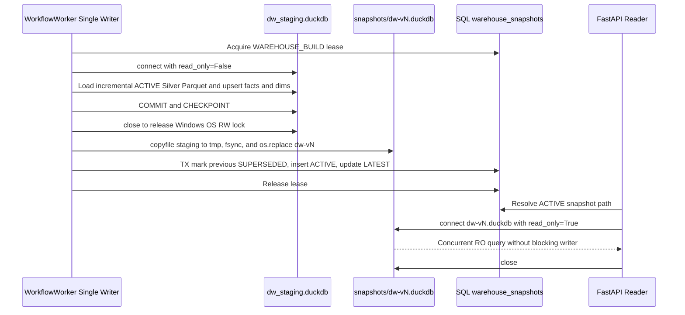
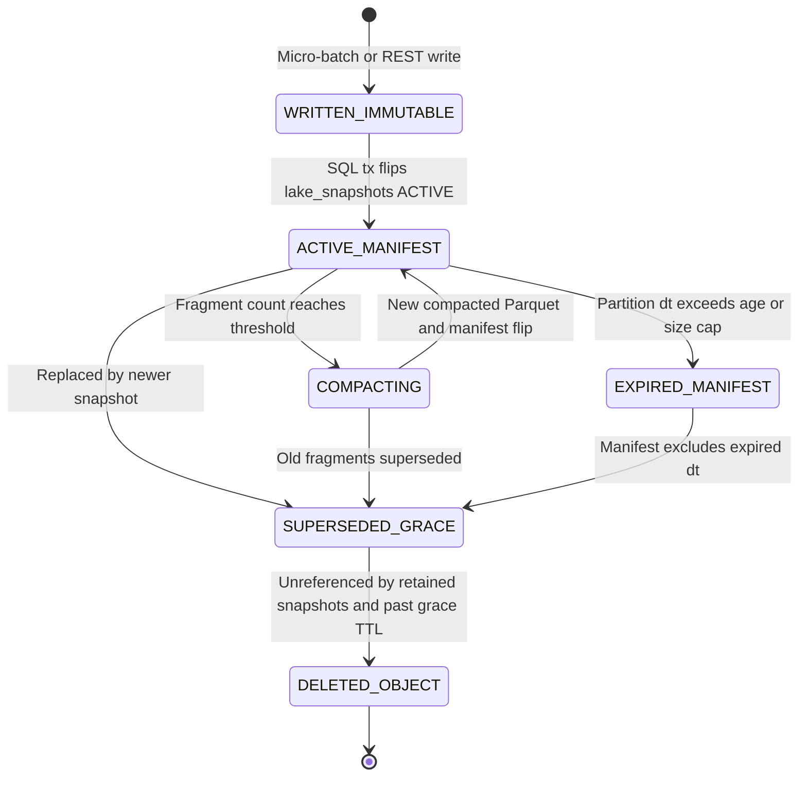

# Storage & Data Warehouse Diagrams

All diagrams strictly denote `[AS-IS]` (observed current state), `[TO-BE]` (target architecture), or `[TRANSITION]`.

---

## 1. `[AS-IS]` Medallion Flow & Observed Divergence Hazards

---

## 2. `[TO-BE]` Immutable Lake, SQL Manifests & DuckDB Warehouse Flow

---

## 3. `[TO-BE]` Operational Metadata & Manifest ERD

---

## 4. `[TO-BE]` Persistent DuckDB Warehouse Star Schema

---

## 5. `[TO-BE]` Warehouse Snapshot Publish & Concurrent Reader Sequence

---

## 6. `[TO-BE]` Snapshot-Aware Data Lifecycle, Compaction & Retention

