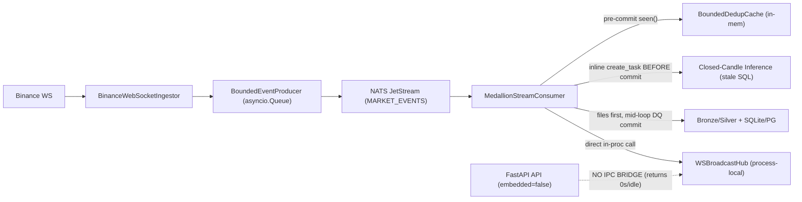
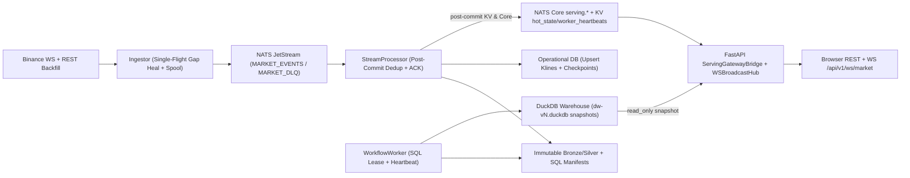
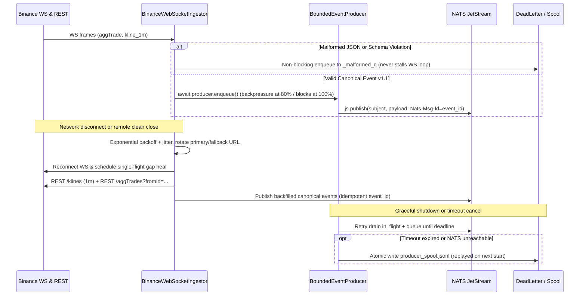
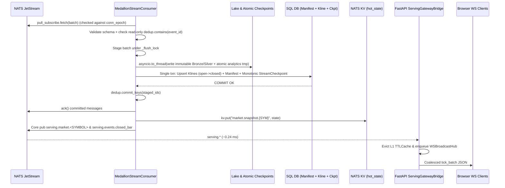
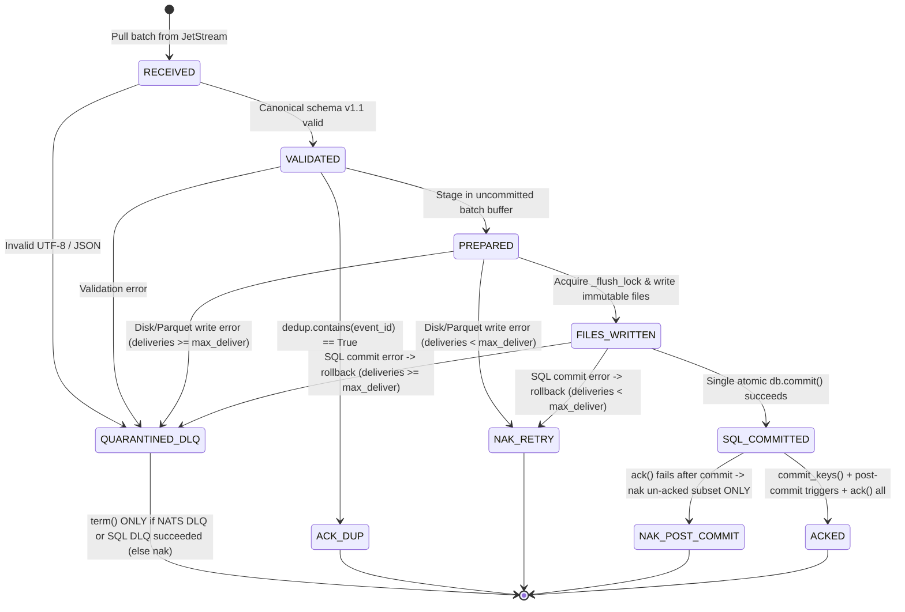
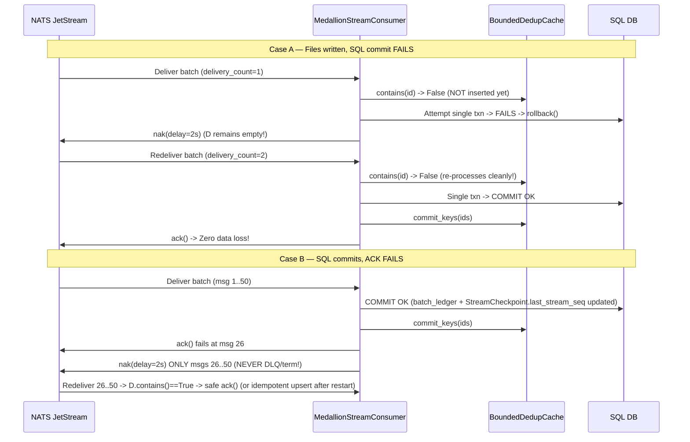
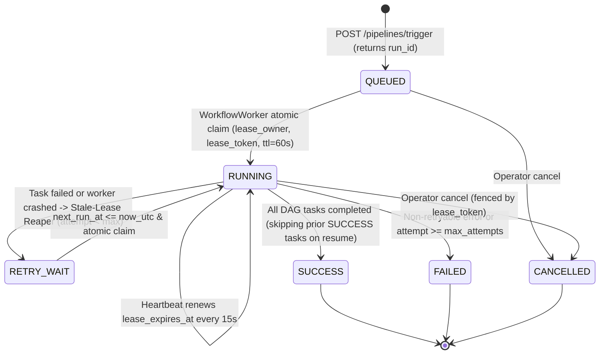

# Streaming and Orchestration Diagrams

- **Document ID:** `DD-DP-DIAG-001`
- **Status:** `PROPOSED` (Specification Baseline v1.0)
- **Owner:** `@stream-orch` (Phase 1 Step 2)
- **Traceability:** `ADR-DP-001`, `ADR-DP-002`, `ADR-DP-005`, `ADR-DP-006`, `ADR-DP-007`, `WI-DP-02`, `WI-DP-03`, `WI-DP-07`, `WI-DP-08`

---

## 1. End-to-End Streaming & Control Data Flow (`[AS-IS]` vs `[TO-BE]`)

### 1.1 [AS-IS] Coupling & Split-Brain Flow (`[OBSERVED]`)

### 1.2 [TO-BE] Decoupled Streaming, Lake/Warehouse & Serving Bridge (`[PROPOSED]`)

---

## 2. [TO-BE] Ingestion, Disconnect Gap-Heal, and Shutdown Sequence

---

## 3. [TO-BE] Event Processing & `ServingGatewayBridge` Sequence

---

## 4. [TO-BE] Micro-Batch Durability State Machine

---

## 5. [TO-BE] Failure & Recovery Sequence (Pre-Commit vs Post-Commit Failure)

---

## 6. [TO-BE] Durable Workflow DAG & Task Lease State Machine

